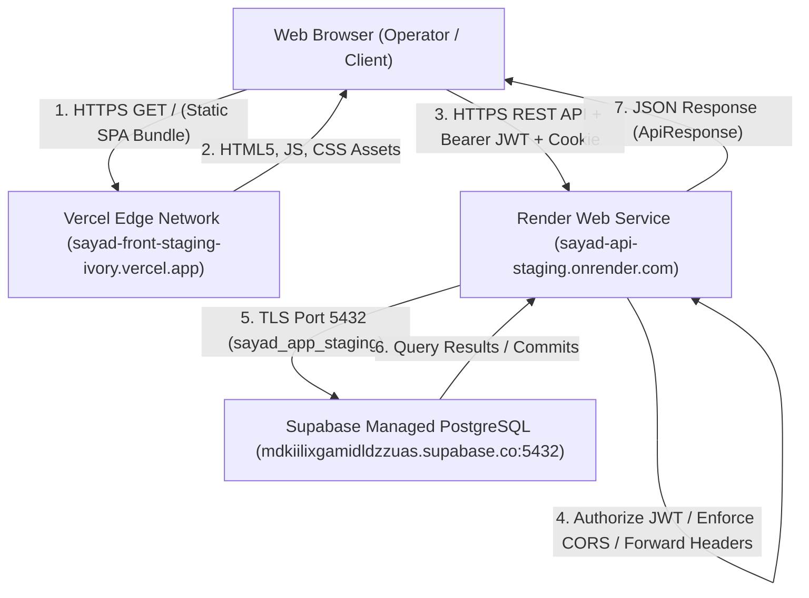

# SAYAD Technical Operations Guide

> **Target Audience**: Maintainers, DevOps Engineers, System Administrators, Technical Support Specialists, and Release Managers.
> **Operational Invariants**:
> 1. **Zero Secret Exposure**: Passwords, tokens, private keys, and connection strings must remain exclusively inside secure platform secret vaults. Never expose secret values.
> 2. **Immutable Accounting & Non-Destructive Operations**: Production data integrity takes precedence over convenience. Never perform raw destructive SQL mutations.
> 3. **Authoritative Evidence-Based Classification**: Technical assertions are strictly classified by proof source: `VERIFIED FROM SOURCE`, `VERIFIED BY CURRENT COMMAND`, `HISTORICALLY VERIFIED`, `LIVE VERIFICATION REQUIRED`, or `NOT VERIFIED`.

## 1. Technical Document Index

| Section Number | Title | Target Audience | Target Environment | Operational Risk Level | Evidence Classification |
|:---:|---|---|---|:---:|:---:|
| 1 | Technical Document Index | All Technical Staff | All Environments | Informational | VERIFIED FROM SOURCE |
| 2 | Authoritative Current Environments & Classification | DevOps / Admins | Local, Staging, Production | Low | HISTORICALLY VERIFIED / VERIFIED FROM SOURCE |
| 3 | Repository Structure & Source Code Organization | Maintainers / Developers | Local Development | Low | VERIFIED FROM SOURCE |
| 4 | Complete Technology Stack Specification | All Technical Staff | All Environments | Low | VERIFIED FROM SOURCE / HISTORICALLY VERIFIED |
| 5 | Local Frontend Development Environment Setup | Frontend Engineers | Local Development | Low | VERIFIED FROM SOURCE |
| 6 | Local Backend Development Environment Setup | Backend Engineers | Local Development | Low | VERIFIED FROM SOURCE |
| 7 | Comprehensive Environment Variable Catalog | DevOps / SysAdmins | All Environments | High | VERIFIED FROM SOURCE |
| 8 | Database Architecture & PostgreSQL Configuration | Database Administrators | Staging, Production | High | VERIFIED FROM SOURCE / HISTORICALLY VERIFIED |
| 9 | Database Migration Architecture & EF Core Workflow | Backend / DevOps | All Environments | High | VERIFIED FROM SOURCE |
| 10 | Database Migration Safety Checklist | Release Managers | Staging, Production | High | VERIFIED FROM SOURCE |
| 11 | Database Seeding & Initialization Architecture | Backend Engineers | Development, Staging | Medium | VERIFIED FROM SOURCE |
| 12 | Frontend Build & Deployment Architecture (Vercel) | DevOps / Frontend | Staging, Production | Medium | VERIFIED FROM SOURCE / LIVE VERIFICATION REQUIRED |
| 13 | Backend Build & Deployment Architecture (Render) | DevOps / Backend | Staging, Production | High | VERIFIED FROM SOURCE |
| 14 | System Deployment & Network Topology Architecture | DevOps / Enterprise Arch | Staging, Production | Medium | VERIFIED FROM SOURCE |
| 15 | API Health Check & Observability Endpoints | Technical Support / DevOps | All Environments | Low | VERIFIED FROM SOURCE |
| 16 | Post-Deployment Technical Smoke Test Suite | QA / Release Managers | Staging, Production | Medium | VERIFIED FROM SOURCE |
| 17 | Critical Business Transaction Staging Smoke Tests | Lead QA Engineers | Staging Only | High | VERIFIED FROM SOURCE |
| 18 | Logging Framework & Diagnostics Configuration | DevOps / Support | All Environments | Medium | VERIFIED FROM SOURCE / LIVE VERIFICATION REQUIRED |
| 19 | Frontend & Backend Error Observability Architecture | Support / Frontend | All Environments | Low | VERIFIED FROM SOURCE |
| 20 | Database Observability & Diagnostic Queries | Database Administrators | Staging, Production | Medium | VERIFIED FROM SOURCE |
| 21 | Backup, Disaster Recovery & Restore Safety | DevOps / SysAdmins | Production, Staging | Critical | LIVE VERIFICATION REQUIRED |
| 22 | Release Management & Git Operational Safety | Maintainers / Engineers | All Environments | High | VERIFIED FROM SOURCE |
| 23 | Build Verification & Test Suite Execution | QA / Maintainers | Local, CI | Low | VERIFIED FROM SOURCE / TESTS ENUMERATED |
| 24 | CI/CD Pipeline & Deployment Automation | DevOps Engineers | Staging, Production | Medium | VERIFIED FROM SOURCE / LIVE VERIFICATION REQUIRED |
| 25 | Application & Database Rollback Runbooks | Release Managers | Staging, Production | Critical | LIVE VERIFICATION REQUIRED |
| 26 | Configuration & Secret Management Runbook | Security / DevOps | Staging, Production | High | VERIFIED FROM SOURCE |
| 27 | Security Architecture & Access Control Operations | Security Engineers | All Environments | High | VERIFIED FROM SOURCE |
| 28 | Staging Permission Catalog Synchronization Runbook | Database / Backend | Staging, Production | High | VERIFIED FROM SOURCE |
| 29 | Data Integrity & Financial Parity Reconciliation | Finance SysAdmins | All Environments | Medium | VERIFIED FROM SOURCE |
| 30 | Performance Monitoring & Capacity Management | DevOps / SRE | Production, Staging | Low | LIVE VERIFICATION REQUIRED |
| 31 | Common Technical Incident Runbooks (10 Runbooks) | On-Call Engineers | All Environments | High | VERIFIED FROM SOURCE |
| 32 | Staging Release Checklist (Copy-Ready) | Release Engineers | Staging | Medium | VERIFIED FROM SOURCE |
| 33 | Production Release Checklist (Conservative) | Enterprise Leadership | Production | Critical | VERIFY BEFORE USE |
| 34 | High-Impact Technical Incident Protocol | Executive Technical Lead | All Environments | Critical | VERIFIED FROM SOURCE |

---

## 2. Authoritative Current Environments & Classification

### Operational Classification Matrix

| Environment | Frontend Hosting | Backend Hosting | Database Hosting | Configuration Source | Deployment Branch | Deployment Method | Evidence Classification |
|---|---|---|---|---|---|---|:---:|
| **Local Development** | Local Vite Dev Server (`localhost:3000`) | Local Kestrel Server (`127.0.0.1:5000`) | Local PostgreSQL / SQLite / Remote Staging | `.env.development`, `appsettings.Development.json` | `migration/postgresql-supabase` | Manual CLI (`yarn start`, `dotnet run`) | **VERIFIED FROM SOURCE** |
| **Staging** | Vercel (`sayad-front-staging-ivory.vercel.app`) | Render (`sayad-api-staging.onrender.com`) | Supabase (`mdkiilixgamidldzzuas.supabase.co`) | Vercel Environment Store, Render Environment Store | `migration/postgresql-supabase` | Platform-Native Git Auto-Deploy | **HISTORICALLY VERIFIED & SOURCE CONFIG** |
| **Production** | *Not Configured in Active Source* | *Not Configured in Active Source* | *Not Configured in Active Source* | *Not Provisioned* | *Not Designated* | *Not Provisioned* | **NOT VERIFIED** |

### Detailed Verified Staging Topology
* **Frontend Hosting Platform**: Vercel (HISTORICALLY VERIFIED)
  * **Staging URL**: `https://sayad-front-staging-ivory.vercel.app`
  * **Build Framework**: Vite (Single Page Application)
  * **Routing Mode**: HTML5 Client-Side History Mode with root fallback rewrite (`vercel.json`)
  * **Branch Mapping**: `migration/postgresql-supabase` (HISTORICALLY VERIFIED / LIVE VERIFICATION REQUIRED on Vercel Dashboard)
* **Backend Hosting Platform**: Render (VERIFIED FROM SOURCE CONFIG)
  * **Service Identifier**: `sayad-api-staging` (`render.yaml`)
  * **Staging URL**: `https://sayad-api-staging.onrender.com`
  * **Hosting Region**: Frankfurt, Germany (`region: frankfurt` in `render.yaml`)
  * **Runtime Engine**: Docker container based on `mcr.microsoft.com/dotnet/aspnet:8.0`
  * **Health Check Path**: `/health` (`render.yaml`)
  * **Auto-Deploy Trigger**: Enabled on Git push to branch `migration/postgresql-supabase` (`render.yaml`)
* **Database Platform**: Supabase Managed PostgreSQL (HISTORICALLY VERIFIED)
  * **Project Name**: `sayad-staging`
  * **Project Reference**: `mdkiilixgamidldzzuas`
  * **PostgreSQL Engine Version**: 17.6 (`17.6.1.147`) (HISTORICALLY VERIFIED from active staging; codebase targets PostgreSQL generically via Npgsql 8.0.11)
  * **Runtime Application Role**: `sayad_app_staging` (Restricted DML application role)
  * **Connection Protocol**: Direct TCP connection over TLS port 5432 or Transaction Pooler over port 6543

> [!WARNING]
> **Production Environment Status: NOT VERIFIED**:
> No production infrastructure, domains, connection strings, or automated production deployment pipelines exist in the repository source code. Any production deployment must undergo formal architecture review and manual provisioning before live use.

---

## 3. Repository Structure & Source Code Organization

### 1. Frontend Repository: `sayad-front` (VERIFIED FROM SOURCE)
* **Active Working Branch**: `migration/postgresql-supabase`
* **Directory Organization**:
  * `src/`: Main React application source code.
    * `src/api/`: Axios HTTP client instances, request/response interceptors, and typed service calls.
    * `src/assets/`: Static image assets, SVG icons, and typography.
    * `src/components/`: Reusable UI components (data grids, modals, form controls, guards).
    * `src/contexts/`: React context providers (JWT Authentication context, Theme context, RTL context).
    * `src/layout/`: Application layout shell, navigation sidebar, header toolbar, and breadcrumb layout.
    * `src/modules/` or `src/views/`: Functional domain screens (Administration, Parties, Inventory, Treasury, Expenses, Purchases, Sales, Accounting, Labor, Payroll, Manufacturing).
    * `src/routes/`: React Router DOM v6 route definitions and permission route guards (`PermissionGuard`, `GuestGuard`, `AuthGuard`).
    * `src/store/`: Redux Toolkit store, root reducer, and domain slice definitions.
  * `docs/`: System documentation (User Manuals 01-11, System Catalog, Reports Guide, Permissions Reference, SOP Manual, Troubleshooting Guide, Technical Operations Guide).
  * `vercel.json`: Vercel platform build and SPA routing configuration.
  * `vite.config.mts`: Vite build tool configuration, dev proxy, and bundle optimizations.
  * `package.json` & `yarn.lock`: Package dependency definitions and locked resolution tree.

### 2. Backend Repository: `sayad-back` (VERIFIED FROM SOURCE)
* **Active Working Branch**: `migration/postgresql-supabase`
* **Architectural Pattern**: **Clean Architecture** (Domain-Driven Design with CQRS patterns):
  * `src/Sayad.Domain/`: Enterprise domain models, entities, value objects, domain events, and core business exceptions. Zero external framework dependencies.
  * `src/Sayad.Application/`: Application business logic, CQRS commands and queries, validation pipelines (FluentValidation), and interfaces (`IAppDbContext`, `ICurrentUserService`).
  * `src/Sayad.Infrastructure/`: External service implementations, persistence configurations (EF Core mappings), JWT token generator, password hashing (BCrypt), and seeding logic.
  * `src/Sayad.Migrations.PostgreSql/`: Dedicated EF Core migration project housing PostgreSQL-specific migrations, historical migration snapshots, and SQL seed migrations.
  * `src/Sayad.Api/`: ASP.NET Core Web API presentation layer, REST controllers, custom middlewares (`ExceptionHandlingMiddleware`), authorization handlers, Serilog configuration, and `Program.cs`.
  * `tests/`: Automated test suite containing `Sayad.UnitTests` and `Sayad.IntegrationTests`.
  * `Dockerfile`: Multi-stage container build definition for staging and containerized execution.
  * `render.yaml`: Infrastructure-as-Code specification for Render deployment.
  * `Sayad.sln`: Visual Studio solution grouping all backend projects.

---

## 4. Complete Technology Stack Specification

### Frontend Stack (`sayad-front`) (VERIFIED FROM SOURCE)
* **Core Runtime**: JavaScript / HTML5 / CSS3
* **Language**: TypeScript 5.6.3 (`package.json`, `tsconfig.json`)
* **UI Framework**: React 18.3.1 (`react`, `react-dom` in `package.json`)
* **Package Manager**: **Yarn 4.10.3** (Modern Yarn via Corepack; lockfile: `yarn.lock`)
* **Build Tool**: **Vite 5.4.8** (`vite.config.mts`, `package.json`)
* **Component System**: Material UI 5.16.7 (`@mui/material`, `@mui/icons-material`, `@mui/x-data-grid`, `@mui/x-date-pickers`)
* **Styling Engine**: Emotion (`@emotion/react`, `@emotion/styled`) + Stylis RTL plugin (`stylis-plugin-rtl`)
* **State Management**: Redux Toolkit 2.2.7 (`@reduxjs/toolkit`, `react-redux`, `redux-persist`)
* **Client-Side Routing**: React Router DOM 6.26.1 (`react-router-dom`)
* **HTTP Client**: Axios 1.7.5 (`axios`) with custom bearer token and error handling interceptors
* **Data Fetching / Caching**: SWR 2.2.5 (`swr`)
* **Form Management & Validation**: Formik 2.4.6 / React Hook Form 7.53.0 with Yup 1.4.0 schemas
* **Typography & Fonts**: `@fontsource/cairo` (Arabic UI), `@fontsource/roboto` (English UI)
* **Localization**: `react-intl` supporting Arabic (`ar`) and English (`en`) with RTL/LTR layout flipping

### Backend Stack (`sayad-back`) (VERIFIED FROM SOURCE)
* **Runtime Platform**: .NET 8.0 (SDK Version `8.0.424` verified via command, ASP.NET Core Runtime `8.0.11`)
* **Language**: C# 12.0
* **Web Framework**: ASP.NET Core 8.0 Web API
* **Object-Relational Mapper**: Entity Framework Core 8.0.11 (`Microsoft.EntityFrameworkCore` in csproj)
* **Database Provider**: Npgsql Entity Framework Core PostgreSQL Provider 8.0.11 (`Npgsql.EntityFrameworkCore.PostgreSQL`)
* **Authentication & Security**: ASP.NET Core JWT Bearer Authentication 8.0.11 (`Microsoft.AspNetCore.Authentication.JwtBearer`), BCrypt password hashing (`BCrypt.Net-Next`)
* **Authorization System**: Dynamic Permission-based authorization via custom policy provider (`PermissionAuthorizationPolicyProvider`, `PermissionAuthorizationHandler`) and `SystemOwnerAuthorizationHandler`
* **Logging Framework**: Serilog (`Serilog.AspNetCore`, `Serilog.Sinks.Console`)
* **API Documentation**: Swagger / OpenAPI (`Swashbuckle.AspNetCore` 6.5.0) in Development mode
* **Automated Testing**: xUnit 2.9.2, `Microsoft.AspNetCore.Mvc.Testing` 8.0.11, `Microsoft.EntityFrameworkCore.Sqlite` 8.0.11

---

## 5. Local Frontend Development Environment Setup

### Prerequisites (VERIFIED FROM SOURCE)
1. **Node.js**: LTS version >= `20.18.0` (Verified compatible with Node.js `v24.19.0`).
2. **Corepack**: Must be enabled to activate the pinned Yarn Modern version:
   ```bash
   corepack enable
   ```
3. **Git**: Installed and configured.

### Step-by-Step Clean Setup
1. **Clone Repository and Switch Branch**:
   ```bash
   git clone <REPO_URL> sayad-front
   cd sayad-front
   git checkout migration/postgresql-supabase
   ```
2. **Install Pinned Dependencies**:
   ```bash
   corepack yarn install --immutable
   ```
3. **Configure Local Environment Variables**:
   Copy `.env.example` to create `.env.local`:
   ```bash
   cp .env.example .env.local
   ```
   Ensure `VITE_APP_API_URL` is set to `/` (which utilizes the built-in Vite development proxy routing to `http://127.0.0.1:5000`).
4. **Start the Local Development Server**:
   ```bash
   corepack yarn start
   ```
   * The server launches on `http://localhost:3000`.
   * Automatically proxies API calls matching `/api/*` to the local backend at `http://127.0.0.1:5000`.
5. **Build Verification Procedure (BUILD PROCEDURE VERIFIED FROM SOURCE)**:
   ```bash
   corepack yarn build
   ```
   * Runs `tsc` followed by `vite build`. Output directory: `dist/`.
   * *Audit Note*: Build procedure is verified from `package.json`, but `corepack yarn build` was **NOT EXECUTED IN PHASE 17**.
6. **Code Quality Verification (Linting)**:
   ```bash
   corepack yarn lint
   ```

---

## 6. Local Backend Development Environment Setup

### Prerequisites (VERIFIED FROM SOURCE)
1. **.NET 8.0 SDK**: Version `8.0.4xx` or later (Verified installed: `8.0.424`).
2. **PostgreSQL Server**: Local PostgreSQL instance or active network connection to Supabase Staging.

### Step-by-Step Clean Setup
1. **Clone Repository and Switch Branch**:
   ```bash
   git clone <REPO_URL> sayad-back
   cd sayad-back
   git checkout migration/postgresql-supabase
   ```
2. **Restore NuGet Dependencies**:
   ```bash
   dotnet restore Sayad.sln
   ```
3. **Build Solution (BUILD PROCEDURE VERIFIED FROM SOURCE)**:
   ```bash
   dotnet build Sayad.sln -c Release
   ```
   * *Audit Note*: Solution build procedure is verified from `Sayad.sln`, but full Release build was **NOT EXECUTED IN PHASE 17**.
4. **Configure Local Environment Overrides**:
   Create `src/Sayad.Api/appsettings.Development.json` (do NOT commit credentials):
   ```json
   {
     "ConnectionStrings": {
       "DefaultConnection": "Host=127.0.0.1;Port=5432;Database=sayad_dev;Username=postgres;Password=<LOCAL_PASSWORD>;"
     },
     "Database": {
       "Provider": "PostgreSql",
       "ApplyMigrationsOnStartup": true
     },
     "Auth": {
       "Jwt": {
         "SigningKey": "<DEVELOPMENT_SECRET_MIN_32_CHARS>"
       },
       "DevelopmentAdmin": {
         "Email": "admin@sayad.local",
         "DisplayName": "System Administrator",
         "Password": "<LOCAL_DEV_PASSWORD>"
       }
     }
   }
   ```
5. **Run Backend API Server**:
   ```bash
   dotnet run --project src/Sayad.Api/Sayad.Api.csproj
   ```
   * Listens on `http://127.0.0.1:5000`.
   * In Development mode, Swagger UI is accessible at `http://127.0.0.1:5000/swagger`.
   * Health check endpoint is accessible at `http://127.0.0.1:5000/health`.

---

## 7. Comprehensive Environment Variable Catalog

### Frontend Variables (`sayad-front`) (VERIFIED FROM SOURCE)

| Variable Name | Component | Required? | Secret? | Purpose / Description | Safe Example Value | Target Environment |
|---|---|:---:|:---:|---|---|---|
| `VITE_APP_VERSION` | Frontend | YES | NO | Semantic version string displayed in application footer. | `1.0.0` | All |
| `VITE_APP_API_URL` | Frontend | YES | NO | Base URL for backend REST API calls. Must end with trailing slash. | `/` (Local) / `https://sayad-api-staging.onrender.com/` (Staging) | Local, Staging |
| `VITE_APP_BASE_NAME` | Frontend | NO | NO | Base URL path routing prefix for React Router DOM. | `/` | All |
| `GENERATE_SOURCEMAP` | Frontend | NO | NO | Flag controlling generation of production JavaScript sourcemaps. | `false` | Staging, Production |
| `VITE_APP_MAPBOX_ACCESS_TOKEN` | Frontend | NO | NO | Optional access token for interactive geolocation maps. | `<PUBLIC_TOKEN>` | Optional |
| `VITE_APP_PUBLIC_CLARITY_ID` | Frontend | NO | NO | Microsoft Clarity session tracking identifier. | `<CLARITY_ID>` | Staging, Production |
| `VITE_APP_PUBLIC_NOTIFY_ID` | Frontend | NO | NO | Notification service identifier token. | `<NOTIFY_ID>` | Optional |
| `VITE_APP_PUBLIC_ANALYTICS_ID` | Frontend | NO | NO | Application analytics telemetry tracking ID. | `<ANALYTICS_ID>` | Optional |

### Backend Variables (`sayad-back`) (VERIFIED FROM SOURCE)

| Variable Name | Component | Required? | Secret? | Purpose / Description | Safe Example Value | Target Environment |
|---|---|:---:|:---:|---|---|---|
| `ASPNETCORE_ENVIRONMENT` | Backend | YES | NO | Dictates runtime mode, Swagger exposure, and seeder behavior. | `Development` / `Staging` / `Production` | All |
| `ConnectionStrings__DefaultConnection` | Backend | YES | **YES** | Master PostgreSQL database connection string. Contains credentials. | `Host=<HOST>;Port=5432;Database=<DB>;Username=<USER>;Password=<PASSWORD>;` | All |
| `Database__Provider` | Backend | YES | NO | Underlying EF Core database provider name. | `PostgreSql` | All |
| `Database__ConnectionStringName` | Backend | YES | NO | Key name inside `ConnectionStrings` section to resolve. | `DefaultConnection` | All |
| `Database__ApplyMigrationsOnStartup` | Backend | YES | NO | Controls whether `db.Database.MigrateAsync()` runs on container start. | `true` (Staging) / `false` (Production) | Staging, Production |
| `Auth__Jwt__Issuer` | Backend | YES | NO | Issuer claim encoded in JWT access tokens. | `Sayad` | All |
| `Auth__Jwt__Audience` | Backend | YES | NO | Audience claim validated by API security middleware. | `Sayad.Web` | All |
| `Auth__Jwt__SigningKey` | Backend | YES | **YES** | HMAC-SHA256 secret key for signing JWT tokens. Min 32 characters. | `<REDACTED_SECURE_HMAC_KEY>` | All |
| `Auth__Jwt__AccessTokenMinutes` | Backend | YES | NO | Expiration lifetime of access token in minutes. | `15` | All |
| `Auth__RefreshTokens__CookieName` | Backend | YES | NO | HTTP-only secure cookie key name storing refresh token. | `sayad_refresh_token` | All |
| `Auth__RefreshTokens__LifetimeDays` | Backend | YES | NO | Lifetime of refresh tokens before mandatory re-login. | `7` | All |
| `Auth__RefreshTokens__CookiePath` | Backend | YES | NO | Restricted HTTP cookie path scope. | `/api/auth` | All |
| `Auth__DevelopmentAdmin__Email` | Backend | NO | NO | Seeded admin email (runs ONLY in Development mode). | `admin@sayad.local` | Development Only |
| `Auth__DevelopmentAdmin__DisplayName` | Backend | NO | NO | Seeded admin display name. | `System Administrator` | Development Only |
| `Auth__DevelopmentAdmin__Password` | Backend | NO | **YES** | Seeded admin initial password. | `<REDACTED>` | Development Only |
| `Cors__AllowedOrigins__*` | Backend | YES | NO | Array of permitted CORS origins allowed to access the API. | `https://sayad-front-staging-ivory.vercel.app` | All |
| `Serilog__MinimumLevel__Default` | Backend | NO | NO | Default logging verbosity threshold. | `Information` | All |
| `Serilog__MinimumLevel__Override__Microsoft` | Backend | NO | NO | Framework-level noise suppression threshold. | `Warning` | All |

---

## 8. Database Architecture & PostgreSQL Configuration

### Database Engine & Platform
* **Engine**: PostgreSQL (Targeted generically in codebase via `Npgsql.EntityFrameworkCore.PostgreSQL` 8.0.11; specific engine version `17.6.1.147` is **HISTORICALLY VERIFIED** from live staging Supabase).
* **Staging Database Target**: `mdkiilixgamidldzzuas.supabase.co` (HISTORICALLY VERIFIED)
* **Runtime Application User**: `sayad_app_staging` (HISTORICALLY VERIFIED: Restricted DML role)

### Relational Schema Topology (12 Logical Schemas) (VERIFIED FROM SOURCE)
SAYAD enforces domain segregation across 12 logical PostgreSQL schemas:
1. `foundation`: Global operational sequences, numbering rules, and lookup enumerations.
2. `identity`: User accounts, security stamps, password hashes, refresh tokens, role definitions, and master permission catalog (`identity."Permissions"`).
3. `audit`: Immutable temporal audit trail logs and document lifecycle modification snapshots.
4. `parties`: Customer and supplier master registries, contact information, sub-ledger statements, and settlements.
5. `inventory`: Warehouse catalog, stock balance tables, unit conversions, customer material intakes, and physical movements.
6. `purchases`: Supplier invoices, invoice line items, purchase return vouchers, and purchase payment linkages.
7. `sales`: Customer credit invoices, cash sales, line item cost snapshots, sales returns, and collection records.
8. `treasury`: Liquid accounts (cash boxes, bank accounts), inbound receipts, outbound payments, and internal transfers.
9. `expenses`: Operational expense vouchers, expense category definitions, and beneficiary records.
10. `accounting`: General Ledger accounts (Chart of Accounts), journal entries, journal lines, fiscal years, accounting periods, and financial statement structures.
11. `labor`: Worker profiles, wage rates, operational jobs, piecework task logs, and monthly movement records.
12. `manufacturing`: Bill of Materials (BOM), production orders, material issues, finished goods receipts, and work center definitions.

### Staging Permission Drift Census (HISTORICALLY & SOURCE VERIFIED)
* **Codebase Source-Defined Permissions**: Exactly **182 permissions** (`Permissions.cs`, `PurchasePermissions.cs`, `SalesPermissions.cs`, `AccountingPermissions.cs`).
* **Supabase Staging Database Persisted Permissions**: Exactly **178 permissions**.
* **Missing Permissions on Staging (4 Permissions)**:
  1. `accounting.view` (Domain: Accounting)
  2. `labor.operations.edit` (Domain: Labor)
  3. `labor.operations.delete` (Domain: Labor)
  4. `payroll.periods.reopen` (Domain: Payroll)

---

## 9. Database Migration Architecture & EF Core Workflow

### Migration Architecture Overview (VERIFIED FROM SOURCE)
* **Migration Project**: `src/Sayad.Migrations.PostgreSql` (`Sayad.Migrations.PostgreSql.csproj`).
* **Startup Project**: `src/Sayad.Api` (`Sayad.Api.csproj`).
* **Target DbContext**: `Sayad.Infrastructure.Persistence.AppDbContext`.
* **History Table**: Standard EF Core table `__EFMigrationsHistory` in the `public` schema.

### Authoritative EF Core CLI Commands
Execute from backend repository root (`sayad-back`):

#### 1. List Applied and Pending Migrations
```bash
dotnet ef migrations list \
  --project src/Sayad.Migrations.PostgreSql \
  --startup-project src/Sayad.Api
```

#### 2. Create a New Code-First Migration
```bash
dotnet ef migrations add <DescriptiveMigrationName> \
  --project src/Sayad.Migrations.PostgreSql \
  --startup-project src/Sayad.Api \
  --output-dir Migrations
```

#### 3. Generate Idempotent SQL Migration Script (Mandatory for Review)
```bash
dotnet ef migrations script \
  --project src/Sayad.Migrations.PostgreSql \
  --startup-project src/Sayad.Api \
  --idempotent \
  --output artifacts/migration.sql
```

#### 4. Apply Migrations Directly (Development / Staging Only)
```bash
dotnet ef database update \
  --project src/Sayad.Migrations.PostgreSql \
  --startup-project src/Sayad.Api
```

### Migration Auto-Run Analysis
* **Migration Auto-Run Capability**: **VERIFIED FROM SOURCE CONFIG** (Configured in `Program.cs` via `db.Database.MigrateAsync()` bound to `DatabaseOptions.ApplyMigrationsOnStartup`).
* **Staging Activation**: **VERIFIED FROM SOURCE CONFIG** (Explicitly set to `true` in `render.yaml`: `key: Database__ApplyMigrationsOnStartup, value: true`).
* **Production Strategy**: Must set `Database__ApplyMigrationsOnStartup=false` in production. Always generate and review an idempotent SQL script before applying schema updates.

---

## 10. Database Migration Safety Checklist

### Pre-Migration Phase
- [ ] **Branch Verification**: Confirm you are on `migration/postgresql-supabase`.
- [ ] **Clean Working Tree**: Ensure `git status` is clean with zero uncommitted modifications.
- [ ] **Target Database Confirmation**: Explicitly verify connection string hostname.
- [ ] **Point-in-Time Snapshot / Backup**: [LIVE VERIFICATION REQUIRED] Confirm a verified Supabase database backup exists prior to schema modification.
- [ ] **Idempotent SQL Review**: Inspect SQL script generated via `dotnet ef migrations script --idempotent`.
- [ ] **Destructive Operation Scan**: Confirm script contains NO destructive `DROP` statements.
- [ ] **Runtime Role Grant Check**: Verify newly created tables grant DML to `sayad_app_staging`.

### Post-Migration Phase
- [ ] **Migration History Audit**: Verify `__EFMigrationsHistory` contains the new migration record.
- [ ] **API Health Verification**: Query `GET /health` to confirm backend boots and database responds.
- [ ] **Schema Conformance**: Verify new columns/tables exist with correct nullability and defaults.
- [ ] **Application Smoke Test**: Execute non-destructive smoke tests in affected modules.
- [ ] **Container Log Review**: Inspect Render application logs for clean startup.

---

## 11. Database Seeding & Initialization Architecture

### Architectural Analysis of Seeding Logic (VERIFIED FROM SOURCE)
Startup code in `src/Sayad.Api/Program.cs` enforces strict environment gating:
```csharp
if (app.Environment.IsDevelopment())
{
    var seeder = scope.ServiceProvider.GetRequiredService<DevelopmentAdminSeeder>();
    await seeder.EnsureSeededAsync();
}

var inventorySeeder = scope.ServiceProvider.GetRequiredService<InventorySeeder>();
await inventorySeeder.EnsureSeededAsync();
```

### Non-Development Automatic Permission Catalog Sync Audit
* **Non-Development Automatic Permission Sync**: **NO** (VERIFIED FROM SOURCE).
* **Root Cause Confirmation**: `EnsurePermissionCatalogAsync()` resides exclusively inside `DevelopmentAdminSeeder.cs`. Because `ASPNETCORE_ENVIRONMENT` is set to `Staging` on Render, `DevelopmentAdminSeeder` is completely bypassed. Therefore, any permissions added to C# catalog classes that lack a dedicated EF Core SQL migration script are never inserted into the staging database.

---

## 12. Frontend Build & Deployment Architecture (Vercel)

### Platform & Build Configuration (VERIFIED FROM SOURCE)
* **Platform**: Vercel
* **Build Command**: `corepack yarn exec vite build` (`vercel.json`)
* **Install Command**: `corepack yarn install --immutable` (`vercel.json`)
* **Output Directory**: `dist`
* **SPA Routing Rewrites**: `{"source": "/(.*)", "destination": "/index.html"}` (`vercel.json`)
* **Branch Mapping**: `migration/postgresql-supabase` (HISTORICALLY VERIFIED / LIVE VERIFICATION REQUIRED on Vercel platform dashboard)

---

## 13. Backend Build & Deployment Architecture (Render)

### Platform & Service Configuration (VERIFIED FROM SOURCE)
* **Platform**: Render (`render.yaml`)
* **Service Name**: `sayad-api-staging`
* **Runtime Engine**: Docker container built from `./Dockerfile`
* **Hosting Region**: Frankfurt, Germany (`region: frankfurt`)
* **Auto-Deploy Trigger**: Enabled on Git push to branch `migration/postgresql-supabase` (`autoDeploy: true`)
* **Health Check Path**: `/health`
* **Startup Migration**: Executes `await db.Database.MigrateAsync()` on container boot when `Database__ApplyMigrationsOnStartup=true`.

---

## 14. System Deployment & Network Topology Architecture



---

## 15. API Health Check & Observability Endpoints

### Health Check Specification (VERIFIED FROM SOURCE)
* **Endpoint**: `GET /health`
* **Source Implementation**:
  * Registered via `app.MapHealthChecks("/health")` in `src/Sayad.Api/Program.cs` (line 131).
  * Service configured via `services.AddHealthChecks().AddDbContextCheck<AppDbContext>()` in `src/Sayad.Infrastructure/DependencyInjection.cs` (line 50).
* **Health Check Scope**: **DATABASE INCLUDED** (Tests both host application liveness and database connectivity via EF Core `AppDbContext` probe).
* **Expected Success Status**: `HTTP 200 OK` (Body: `Healthy`).
* **Failure Status**: `HTTP 503 Service Unavailable` (Body: `Unhealthy`) if database connectivity fails.

---

## 16. Post-Deployment Technical Smoke Test Suite

### Non-Destructive Smoke Test Verification Checklist
1. **Platform Availability & Health**:
   - [ ] Query `GET https://sayad-api-staging.onrender.com/health` -> Returns `200 OK` (`Healthy`).
   - [ ] Load `https://sayad-front-staging-ivory.vercel.app` -> Returns application login screen.
2. **Authentication & Session Lifecycle**:
   - [ ] Log in with staging credentials -> JWT access token returned and decoded.
   - [ ] Verify `sayad_refresh_token` HTTP-only cookie set on domain path `/api/auth`.
   - [ ] Verify navigation sidebar renders permitted functional modules.
3. **Administration Module**: Navigate to `/administration/users` and `/administration/roles` -> Lists load.
4. **Parties Module**: Navigate to `/parties` -> Customer/Supplier records render with balances.
5. **Inventory Module**: Navigate to `/inventory/items` and `/inventory/stock-balance` -> Catalogs render.
6. **Treasury Module**: Navigate to `/treasury/accounts` -> Cash/Bank cards render operational balances.
7. **Expenses Module**: Navigate to `/expenses/categories` -> Expense categories load.
8. **Purchases Module**: Navigate to `/purchases/invoices` -> Invoices table renders.
9. **Sales Module**: Navigate to `/sales/invoices` and `/sales/reports/invoices` -> Invoices and analytical reports load.
10. **Accounting Module**: Navigate to `/accounting/accounts` and `/accounting/journal-entries` -> Chart of Accounts and Journals render.
11. **Labor Module**: Navigate to `/labor/workers` -> Worker roster renders.
12. **Payroll Module**: Navigate to `/payroll/periods` -> Payroll periods list renders.
13. **Manufacturing Module**: Navigate to `/manufacturing/orders` -> Orders load; navigate to `/manufacturing/dashboard` -> Displays placeholder "Coming Soon".
14. **Reporting Module**: Generate General Ledger query (`/reports/general-ledger`) for active period.

---

## 17. Critical Business Transaction Staging Smoke Tests

> [!CAUTION]
> **STAGING ENVIRONMENT ONLY**:
> Never execute transactional tests in Production. In Staging, all test transactions must be reversed upon completion.

### Test 1: Purchase Invoice Lifecycle
* **Action**: Post a Draft Purchase Invoice for 1 unit at 100.00 EGP.
* **Expected Side Effects**: Inventory increments by 1, MAC recalculates, supplier credited 100.00, GL journal posted (Dr Inventory, Cr AP).
* **Reversal / Cleanup**: Click "Cancel Invoice" -> Reverses inventory, creates reversing GL journal, restores supplier balance.

### Test 2: Sales Invoice Lifecycle
* **Action**: Post a Credit Sales Invoice for 1 unit at 150.00 EGP.
* **Expected Side Effects**: Warehouse stock decrements, customer debited 150.00, GL journal posted (Dr AR, Cr Revenue, Dr COGS, Cr Inventory).
* **Reversal / Cleanup**: Click "Cancel Invoice" -> Restores warehouse stock, creates reversing GL journal, clears customer balance.

### Test 3: Treasury Internal Transfer
* **Action**: Transfer 50.00 EGP between two Treasury accounts in identical currency.
* **Expected Side Effects**: Source balance decrements, destination balance increments, GL journal posted.
* **Reversal / Cleanup**: Click "Cancel Transfer" -> Reverses movements atomically.

---

## 18. Logging Framework & Diagnostics Configuration

### Logging Architecture (VERIFIED FROM SOURCE)
* **Framework**: Serilog (`Serilog.AspNetCore`) writing structured events to `stdout`.
* **Log Level Configuration** (`appsettings.json`): `Default: Information`, `Microsoft: Warning`.
* **Cloud Ingestion (LIVE VERIFICATION REQUIRED)**: Render captures container stdout logs. Log retention, search indexing, and export capabilities depend on active Render account plan.
* **Log Redaction**: Passwords, JWT keys, tokens, and EF Core parameter data (`EnableSensitiveDataLogging`) are strictly excluded from output.

---

## 19. Frontend & Backend Error Observability Architecture

### Frontend Error Observability (VERIFIED FROM SOURCE)
* **React Error Boundaries**: Top-level and route boundaries intercept rendering exceptions.
* **Axios Interceptor**: Intercepts 401 Unauthorized, 403 Forbidden, and 500 Server Errors, displaying localized notifications via `notistack`.
* **Centralized APM**: **NOT IMPLEMENTED** (No external monitoring agent like Sentry or Datadog is currently bundled).
* **Clarity Session Replay**: Hooked via `VITE_APP_PUBLIC_CLARITY_ID` in `.env.example`; runtime activation is **LIVE VERIFICATION REQUIRED**.

### Backend Error Observability (VERIFIED FROM SOURCE)
* **Global Exception Middleware**: `ExceptionHandlingMiddleware` intercepts unhandled exceptions, writes structured error logs to Serilog, and returns sanitized `ApiResponse<T>` with HTTP 500.
* **Validation Errors**: FluentValidation pipeline returns structured HTTP 400 Bad Request responses with detailed property-level error arrays.

---

## 20. Database Observability & Diagnostic Queries

> [!IMPORTANT]
> **READ-ONLY DIAGNOSTIC QUERIES**:
> Never execute manual `UPDATE`, `DELETE`, or `DROP` statements on staging or production databases.

### 1. Connection & Engine Diagnostic
```sql
SELECT version(), current_user, current_database(), pg_is_in_recovery();
```

### 2. Applied EF Core Migration Audit
```sql
SELECT "MigrationId", "ProductVersion"
FROM public."__EFMigrationsHistory"
ORDER BY "MigrationId" DESC
LIMIT 10;
```

### 3. Active Permission Count Diagnostic
```sql
SELECT count(*) AS active_permissions
FROM identity."Permissions"
WHERE "IsDeleted" = FALSE AND "IsActive" = TRUE;
```
*(Expected Staging Count: 178 | Expected Source Count: 182)*

### 4. Active Connections by Application User
```sql
SELECT usename, client_addr, state, count(*)
FROM pg_stat_activity
WHERE datname = current_database()
GROUP BY usename, client_addr, state;
```

---

## 21. Backup, Disaster Recovery & Restore Safety

### Backup Capabilities & Verification Status
* **Platform Backup Capability**: **DOCUMENTED** (Supabase platform supports automated physical and logical backups).
* **Current Project Backup Configuration**: **LIVE VERIFICATION REQUIRED** (Requires direct confirmation in Supabase dashboard for project `mdkiilixgamidldzzuas`).
* **Point-in-Time Recovery (PITR) Status**: **LIVE VERIFICATION REQUIRED**.
* **Retention Period**: **LIVE VERIFICATION REQUIRED** (Varies by Supabase plan tier).

### High-Level Restore Runbook
* **Recovery Procedure**: **DOCUMENTED**
* **Recovery Point Availability**: **LIVE VERIFICATION REQUIRED**
1. **Incident Declaration & Write Halt**: Scale Render backend instances to 0 or revoke runtime credentials.
2. **Identify Proven Recovery Point**: Audit temporal logs in `audit` schema to determine safe timestamp.
3. **Isolated Sandbox Restore**: Restore snapshot to an isolated staging/sandbox instance; never restore in-place over production without verification.
4. **Schema & Count Validation**: Verify table counts, GL balances, and migration history.
5. **Controlled Service Cutover**: Update `ConnectionStrings__DefaultConnection` on Render and boot single container.

---

## 22. Release Management & Git Operational Safety

### Active Working Branch (VERIFIED FROM SOURCE)
* **Authoritative Active Branch**: **`migration/postgresql-supabase`**

### Operator Git Safety Rules
1. **Strictly Prohibit Force Pushes**: `git push --force` is permanently prohibited on `migration/postgresql-supabase`.
2. **Strictly Prohibit Hard Resets on Shared Trees**: Never execute `git reset --hard` against remote branches.
3. **Inspect Working Tree Before Every Action**: Always execute `git status --short`, `git diff --check`, and `git diff --stat` prior to staging.
4. **Micro-Commit Philosophy**: Commit small, logical units of work with descriptive conventional commit prefixes.
5. **Remote Synchronization Check**: Confirm `origin/migration/postgresql-supabase` is up to date.

### SSH Connectivity Workaround
In restricted Windows environments experiencing IPv6 DNS lookup delays, execute push with explicit IPv4:
```bash
git -c core.sshCommand="ssh -4" push origin migration/postgresql-supabase
```
*(Documented strictly as a connectivity workaround; not an architectural dependency).*

---

## 23. Build Verification & Test Suite Execution

### Build Verification Status
* **Frontend Build Procedure**: `BUILD PROCEDURE VERIFIED FROM SOURCE` (`corepack yarn build`), `CURRENT BUILD NOT EXECUTED IN PHASE 17`.
* **Backend Build Procedure**: `BUILD PROCEDURE VERIFIED FROM SOURCE` (`dotnet build Sayad.sln -c Release`), `CURRENT BUILD NOT EXECUTED IN PHASE 17`.

### Automated Test Suite Inventory
* **Frontend Tests**: **NOT PRESENT** (No test runners installed in `package.json`).
* **Backend Unit Tests** (`tests/Sayad.UnitTests/Sayad.UnitTests.csproj`):
  * **Status**: **TEST PROJECT EXISTS**, **TESTS ENUMERATED** (84 unit tests enumerated via `dotnet test --list-tests`), **TESTS NOT EXECUTED IN PHASE 17**.
  * Framework: xUnit 2.9.2.
  * Coverage: Domain entities, moving average cost, payroll calculations, validators.
  * Execution Command:
    ```bash
    dotnet test tests/Sayad.UnitTests/Sayad.UnitTests.csproj -c Release
    ```
* **Backend Integration Tests** (`tests/Sayad.IntegrationTests/Sayad.IntegrationTests.csproj`):
  * **Status**: **TEST PROJECT EXISTS** (41 source files), **TESTS NOT EXECUTED IN PHASE 17**.
  * Framework: xUnit with `Microsoft.AspNetCore.Mvc.Testing` and in-memory SQLite / PostgreSQL.
  * Execution Command:
    ```bash
    dotnet test tests/Sayad.IntegrationTests/Sayad.IntegrationTests.csproj -c Release
    ```
* **End-to-End Tests**: **NOT PRESENT**.

---

## 24. CI/CD Pipeline & Deployment Automation

* **GitHub Actions Workflows**: **NOT PRESENT** (Neither repository contains `.github/workflows`).
* **Platform-Native Git Webhooks**:
  * **Frontend (Vercel)**: Git integration triggers automated builds on push (`HISTORICALLY VERIFIED / LIVE VERIFICATION REQUIRED` on Vercel dashboard).
  * **Backend (Render)**: `render.yaml` declares `autoDeploy: true` on branch `migration/postgresql-supabase` (`VERIFIED FROM SOURCE CONFIG`).

---

## 25. Application & Database Rollback Runbooks

### 1. Frontend Application Rollback
* **Rollback Procedure**: **DOCUMENTED**
* **Current Previous Deployment Availability**: **LIVE VERIFICATION REQUIRED** (Depends on Vercel deployment history).
* **Procedure**: Navigate to Vercel Project Dashboard -> Deployments -> Select previous verified deployment -> Promote to production.

### 2. Backend Application Rollback
* **Rollback Procedure**: **DOCUMENTED**
* **Current Previous Deployment Availability**: **LIVE VERIFICATION REQUIRED** (Depends on Render deployment history).
* **Procedure**: Navigate to Render Dashboard -> Service `sayad-api-staging` -> Deploys -> Select previous successful commit deployment -> Rollback.

### 3. Database Layer Rollback Safety
> [!CAUTION]
> **DATABASE SCHEMA ROLLBACK WARNING**:
> Application rollback DOES NOT automatically revert database migrations. Reverting application code while leaving newer schema migrations in place may cause catastrophic EF Core mapping failures.
* **Forward-Fix Preference**: Always prefer forward-fixing schema discrepancies via corrective migrations rather than executing down-migrations.

---

## 26. Configuration & Secret Management Runbook

1. **Record Planned Change**: Document variable key and purpose in change ticket.
2. **Update Platform Store**: Update in Vercel Project Settings or Render Dashboard Environment.
3. **Trigger Redeploy**: Redeploy service to inject updated variables into container environment.
4. **Verify Health**: Query `GET /health` and monitor container logs.
5. **Smoke Test**: Execute Post-Deployment Smoke Test suite.
6. **Contingency Rollback**: If boot fails, revert variable in platform store and redeploy.

---

## 27. Security Architecture & Access Control Operations

* **Least Privilege Principle**: Backend connects using restricted role `sayad_app_staging`.
* **Zero Plaintext Secrets**: Passwords hashed via BCrypt (`BCrypt.Net-Next`).
* **JWT Token Security**: Access tokens expire in 15 minutes; refresh tokens expire in 7 days via HTTP-only secure cookies.
* **System Owner Protection**: Immutable authorization handlers protect System Owner and System Administrator accounts.

---

## 28. Staging Permission Catalog Synchronization Runbook

### Background & Missing Permissions
Staging currently holds 178 permissions because `DevelopmentAdminSeeder` only executes in Development mode. The 4 missing permissions are:
1. `accounting.view`
2. `labor.operations.edit`
3. `labor.operations.delete`
4. `payroll.periods.reopen`

### Recommended Engineering Remediation
Patterned after `20260914073000_SeedManufacturingPermissions.cs`, create a formal EF Core migration in `src/Sayad.Migrations.PostgreSql`:
```sql
INSERT INTO identity."Permissions" ("Id", "Code", "NameArabic", "NameEnglish", "Module", "DescriptionArabic", "DescriptionEnglish", "CreatedAtUtc", "IsActive", "IsDeleted")
VALUES (gen_random_uuid(), 'accounting.view', 'عرض المحاسبة', 'View Accounting', 'Accounting', 'عرض المحاسبة العامة', 'View General Accounting', NOW(), TRUE, FALSE)
ON CONFLICT ("Code") DO NOTHING;
```
Cross-join into `identity."RolePermissions"` for role `SYSTEM ADMINISTRATOR`, commit, and deploy.

---

## 29. Data Integrity & Financial Parity Reconciliation

Technical staff should verify system parity using built-in analytical reconciliation reports:
* **Treasury vs. GL**: Run `Reports > Treasury Reconciliation` (`SOP-RPT-006`). Variance must evaluate to `0.00`.
* **Inventory vs. GL**: Run `Reports > Inventory Reconciliation` (`SOP-RPT-007`). Customer-owned stock must evaluate to zero valuation.
* **AR / AP Aging**: Run `Reports > AR Aging` and `Reports > AP Aging` (`SOP-RPT-004`).
* **Trial Balance**: Run `Reports > Trial Balance` (`SOP-RPT-003`). Total Debits must equal Total Credits across all periods.

---

## 30. Performance Monitoring & Capacity Management

* **Render Dashboard Metrics**: Monitor CPU, RAM (512MB limit on free plan), and response latency graphs (LIVE VERIFICATION REQUIRED).
* **Supabase Metrics**: Monitor client connections and transaction pooler utilization (LIVE VERIFICATION REQUIRED).
* **Vercel Web Analytics**: Monitor Core Web Vitals (LIVE VERIFICATION REQUIRED).

---

## 31. Common Technical Incident Runbooks

### Runbook 1: Frontend Deployment Succeeded but Backend API Unreachable
* **Symptom**: Frontend displays network error / CORS failure banners; browser network console shows `ERR_CONNECTION_REFUSED` or `502 Bad Gateway`.
* **Safe Checks**: Check Render dashboard for `sayad-api-staging` service status; verify `GET https://sayad-api-staging.onrender.com/health`.
* **Likely Causes**: Render service spun down due to inactivity (free tier cold start) or container crashed during boot.
* **Resolution Path**: Send GET request to `/health` to trigger warm-up; check Render logs for startup crash stack traces.

### Runbook 2: Backend Deployment Fails on Render
* **Symptom**: Render deployment status displays `Deploy failed`.
* **Safe Checks**: Review Render build logs.
* **Likely Causes**: C# compilation error, missing project reference in `Sayad.sln`, or NuGet package restore timeout.
* **Resolution Path**: Test build locally with `dotnet build Sayad.sln -c Release`; fix compilation error, commit, and push.

### Runbook 3: Backend Service Starts but Database Connection Fails
* **Symptom**: Container crashes shortly after starting; logs display `Npgsql.NpgsqlException: Connection refused` or `Password authentication failed`.
* **Safe Checks**: Verify Supabase project status in dashboard; verify connection string environment variable in Render.
* **Likely Causes**: Supabase project paused due to inactivity, rotated database password, or network firewall block.
* **Resolution Path**: Resume project in Supabase Studio; verify credentials in Render dashboard under `ConnectionStrings__DefaultConnection`.

### Runbook 4: Database Schema / Migration Pending or Version Mismatch
* **Symptom**: API returns HTTP 500 on specific endpoints with error `relation does not exist` or `column does not exist`.
* **Safe Checks**: Execute `SELECT "MigrationId" FROM public."__EFMigrationsHistory" ORDER BY "MigrationId" DESC LIMIT 5;`.
* **Likely Causes**: A migration was merged into source but failed to apply during container startup.
* **Resolution Path**: Verify `Database__ApplyMigrationsOnStartup = true` on Render; inspect container startup logs for migration exceptions.

### Runbook 5: User Authorization Fails Suddenly Across Multiple Modules
* **Symptom**: Authenticated users receive HTTP 403 Forbidden across previously accessible screens.
* **Safe Checks**: Decode JWT token claims using client-side debugger; inspect user roles in `Administration > Users`.
* **Likely Causes**: User assigned role had permissions revoked, or user session holds stale JWT claims.
* **Resolution Path**: User must log out and log back in to refresh JWT claims; Administrator verifies role permissions in `Administration > Roles`.

### Runbook 6: Staging-Specific Permission Mismatch / Drift
* **Symptom**: User holding supervisor role cannot view Accounting dashboard or reopen Payroll periods on Staging.
* **Safe Checks**: Verify if the action requires one of the 4 known drifted permissions (`accounting.view`, `payroll.periods.reopen`, `labor.operations.edit`, `labor.operations.delete`).
* **Likely Causes**: Staging database lacks the 4 permissions as documented in Section 11.
* **Resolution Path**: Assign granular child permissions (`accounting.accounts.view`, `accounting.journal-entries.view`) or wait for formal migration script.

### Runbook 7: Cross-Origin Resource Sharing (CORS) Rejection
* **Symptom**: Browser console displays `Access to XMLHttpRequest blocked by CORS policy: No 'Access-Control-Allow-Origin' header is present`.
* **Safe Checks**: Inspect `Cors:AllowedOrigins` in Render environment variables.
* **Likely Causes**: Frontend preview domain or new URL is missing from `Cors:AllowedOrigins` array in backend config.
* **Resolution Path**: Add the exact frontend origin URL (e.g. `https://sayad-front-staging-ivory.vercel.app`) to Render `Cors__AllowedOrigins__*` settings and restart service.

### Runbook 8: Frontend Points to Erroneous or Stale Backend API URL
* **Symptom**: Frontend makes API requests to `http://localhost:5000` or `https://api.example.com` in staging.
* **Safe Checks**: Inspect network tab request URLs; check `VITE_APP_API_URL` in Vercel environment settings.
* **Likely Causes**: Missing or incorrect `VITE_APP_API_URL` in Vercel production/preview environment variables.
* **Resolution Path**: Set `VITE_APP_API_URL=https://sayad-api-staging.onrender.com/` in Vercel project settings and trigger a clean redeployment.

### Runbook 9: HTTP 500 Internal Server Errors Following Deployment
* **Symptom**: API consistently responds with HTTP 500 across multiple mutation endpoints.
* **Safe Checks**: Open Render dashboard logs and search for `ExceptionHandlingMiddleware` log entries.
* **Likely Causes**: Unmapped database schema change, missing environment variable (e.g. JWT Signing Key), or null reference exception.
* **Resolution Path**: Identify failing service from stack trace; if critical, trigger application rollback to previous deployment.

### Runbook 10: Entity Framework Core Concurrency Conflict or Schema Drift
* **Symptom**: Updates fail with `DbUpdateConcurrencyException`.
* **Safe Checks**: Verify entity concurrency token / RowVersion configuration.
* **Likely Causes**: Two operators attempted simultaneous conflicting modifications on the same document.
* **Resolution Path**: Operator must refresh screen to pull current version before resubmitting edit.

---

## 32. Staging Release Checklist (Copy-Ready)

```markdown
### SAYAD Staging Release Ticket
* **Date**: YYYY-MM-DD
* **Release Branch**: migration/postgresql-supabase
* **Release Manager**: [Name]

#### 1. Pre-Release Verification
- [ ] Git working tree clean across frontend and backend repos.
- [ ] Local build verified: `corepack yarn build` (Frontend) passed.
- [ ] Local build verified: `dotnet build Sayad.sln -c Release` (Backend) passed.
- [ ] Unit test suite passed: `dotnet test tests/Sayad.UnitTests/Sayad.UnitTests.csproj`.
- [ ] Idempotent database migrations reviewed if new migrations are introduced.

#### 2. Deployment Execution
- [ ] Push backend commit to `origin/migration/postgresql-supabase`.
- [ ] Verify Render build completes cleanly (Service: `sayad-api-staging`).
- [ ] Verify Render health check returns HTTP 200 at `/health`.
- [ ] Push frontend commit to `origin/migration/postgresql-supabase`.
- [ ] Verify Vercel build completes cleanly (`sayad-front-staging-ivory.vercel.app`).

#### 3. Post-Deployment Smoke Test
- [ ] Successful login with staging credentials.
- [ ] Verify Navigation Sidebar renders all 11 core modules.
- [ ] Check Administration (Users & Roles lists load).
- [ ] Check Inventory Stock Balance loads.
- [ ] Check Accounting Chart of Accounts renders.
- [ ] Check Treasury Account Balances display.

#### 4. Sign-Off
- [ ] Release approved for Staging QA evaluation.
```

---

## 33. Production Release Checklist (Conservative Template)

> [!WARNING]
> **VERIFY BEFORE USE**:
> Production hosting environments, domains, and automated release gates are not yet provisioned. The following conservative checklist must be adapted to verified production architecture prior to initial commercial launch.

```markdown
### Production Deployment Checklist (Draft / Unverified Template)
- [ ] [VERIFY BEFORE USE] Formal Change Advisory Board (CAB) approval secured.
- [ ] [VERIFY BEFORE USE] Verified full database backup executed and recovery checkpoint confirmed.
- [ ] [VERIFY BEFORE USE] Maintenance window banner active / client writes stopped.
- [ ] [VERIFY BEFORE USE] Production migration script executed and audited by DBA.
- [ ] [VERIFY BEFORE USE] Production container image published and verified.
- [ ] [VERIFY BEFORE USE] Production environment variables verified.
- [ ] [VERIFY BEFORE USE] SSL/TLS certificates active and valid.
- [ ] [VERIFY BEFORE USE] Post-deployment non-destructive smoke tests executed.
- [ ] [VERIFY BEFORE USE] Maintenance banner removed and commercial traffic enabled.
```

---

## 34. High-Impact Technical Incident Protocol

1. **Triage & Halt Writes**: If financial or inventory corruption is active, immediately scale backend service to zero.
2. **Preserve Evidence**: Immediately capture container logs, database transaction logs, and error snapshots before rebooting.
3. **Prohibit Direct SQL Mutation**: Under NO circumstances should support staff execute ad-hoc manual SQL `DELETE` or `UPDATE` statements to "fix" balances.
4. **Escalate to Level 4 Engineering**: Engage core engineering leadership with captured log evidence.
5. **Execute Controlled Point-in-Time Recovery**: If data corruption occurred, restore from the last verified clean checkpoint following Section 21.
