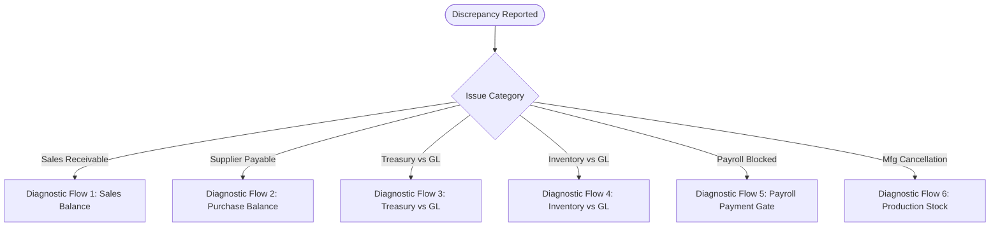
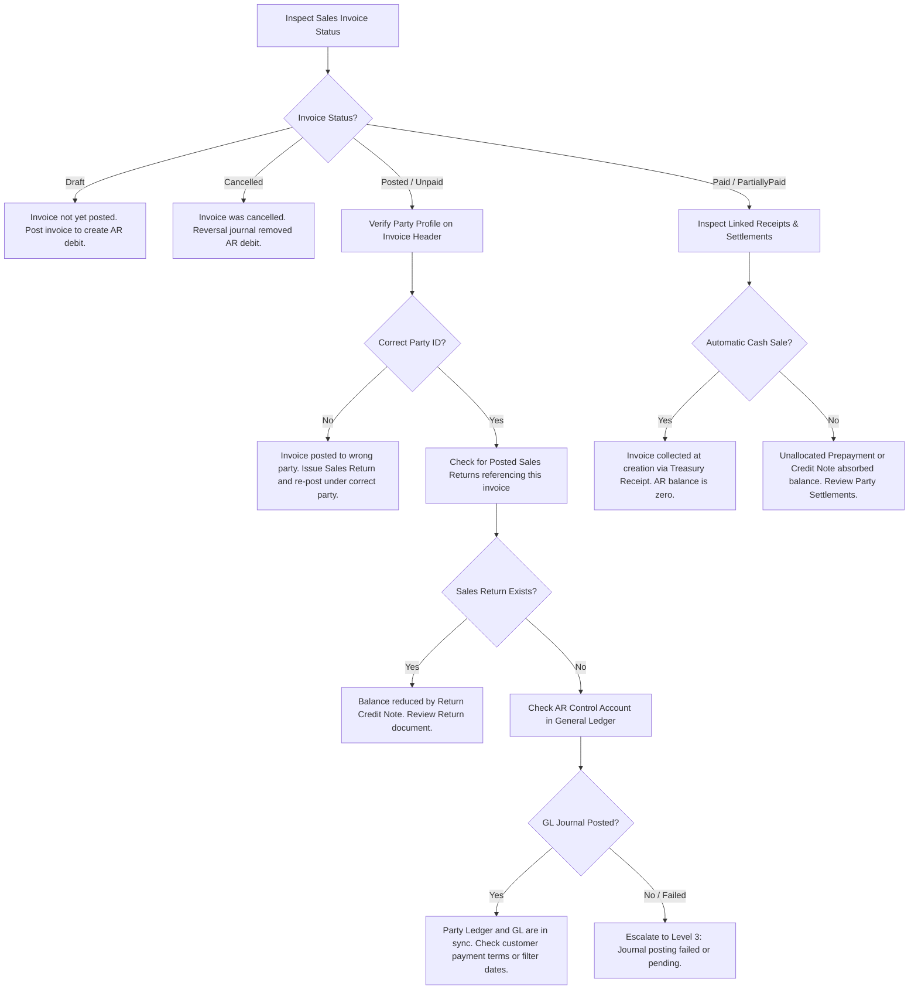
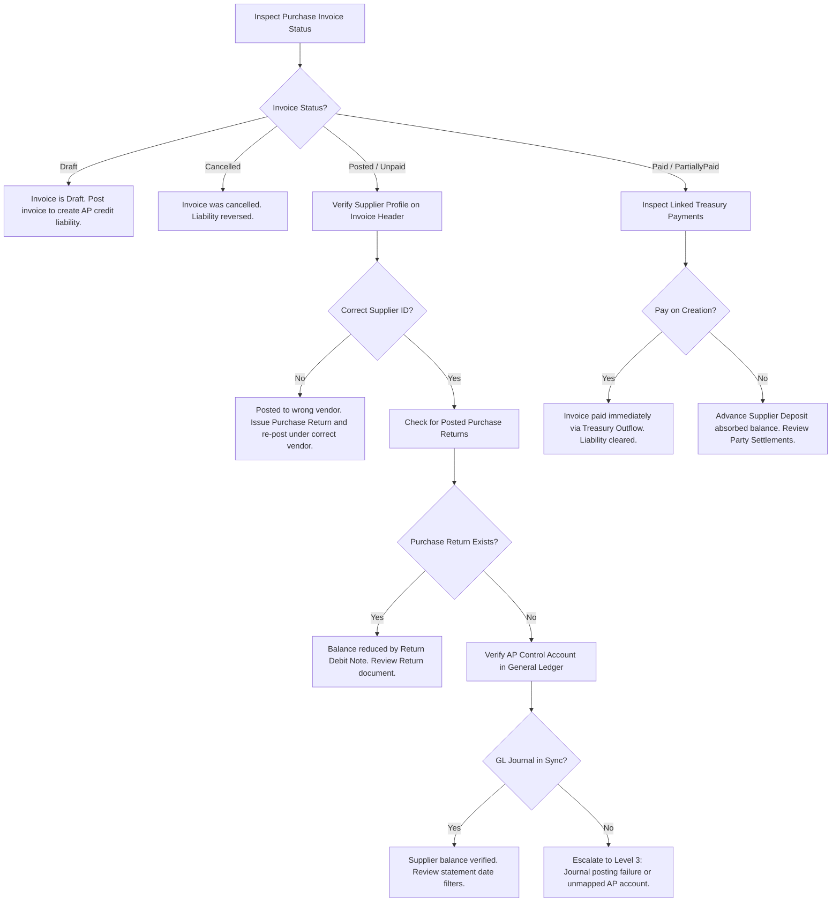
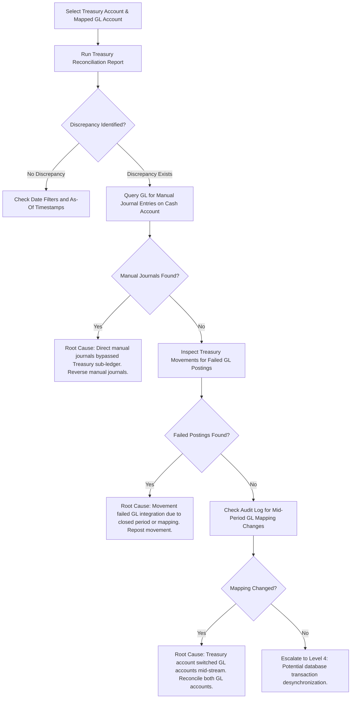
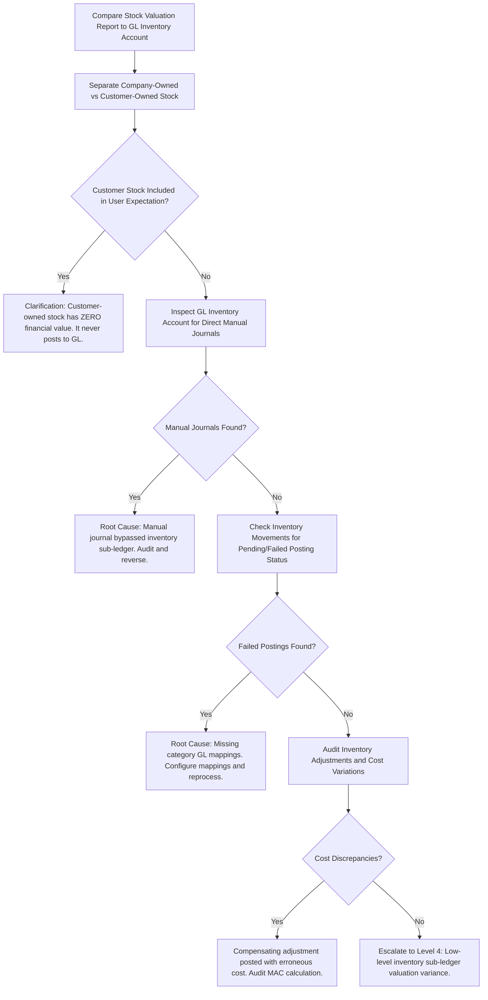
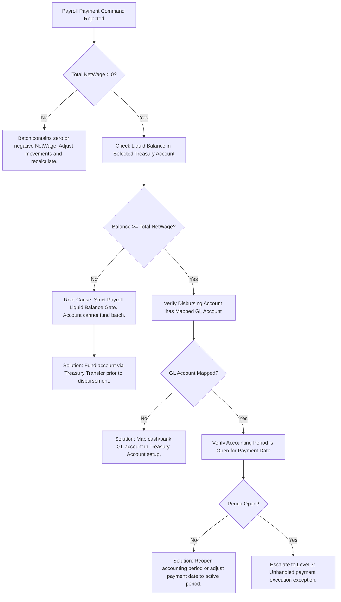
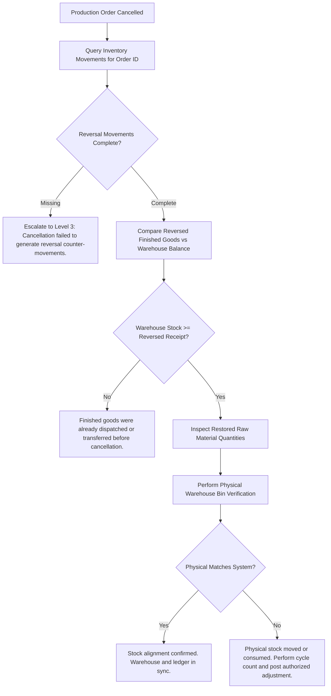

# SAYAD System Operational Troubleshooting Guide

> **Audience**: System Operators, Department Supervisors, Support Personnel, and System Administrators.
> **Purpose**: Authoritative diagnostic workflows for operational blocking conditions, lifecycle locks, validation rejections, and cross-module reconciliation issues.
> **Core Invariant**: **Strictly Immutable Accounting & Non-Destructive Corrections**. Never bypass business logic or attempt direct database mutations.

## 1. Master Troubleshooting Index

| ID | Problem / Symptom Summary | Module | Severity | Likely Cause Category | User Can Resolve? | Escalation Level |
|----|---------------------------|--------|----------|-----------------------|-------------------|------------------|
| TS-ADM-001 | User Can Log In but Cannot See Required Module | Administration | LOW | Permissions / Role Assignment | NO | LEVEL 2 (Admin) |
| TS-ADM-002 | Action Button Missing or Disabled on Page | Administration | LOW | Component Permission Guard | NO | LEVEL 2 (Admin) |
| TS-ADM-003 | API Action Denied Despite Having Screen Access | Administration | MEDIUM | Backend Endpoint Permission | NO | LEVEL 2 (Admin) |
| TS-ADM-004 | Cannot Delete User / Protected Administrator Block | Administration | HIGH IMPACT | System Protection Rules | NO | LEVEL 2 (Admin) |
| TS-ADM-005 | Cannot Delete Role Due to Active User Assignments | Administration | LOW | Relational Dependency | YES | LEVEL 1 (User) |
| TS-ADM-006 | Staging-Specific Permission Drift Denies Action | Administration | MEDIUM | Staging Catalog Drift | NO | LEVEL 3 (Tech Support) |
| TS-ADM-007 | Final Delete Action Unavailable Despite Normal Delete Permission | Administration | HIGH IMPACT | Elevated Role Requirement | NO | LEVEL 2 (Admin) |
| TS-ADM-008 | Role Permissions Changed but User Sees Stale Permissions | Administration | LOW | Cached JWT Claims | YES | LEVEL 1 (User) |
| TS-PTY-001 | Cannot Create Party Due to Duplicate Code / Tax ID | Parties | LOW | Unique Constraint | YES | LEVEL 1 (User) |
| TS-PTY-002 | Cannot Deactivate Party with Active Operations | Parties | LOW | Lifecycle Lock | YES | LEVEL 1 (User) |
| TS-PTY-003 | Party Opening Balance Correction Blocked | Parties | HIGH IMPACT | Downstream Dependencies | NO | LEVEL 2 (Admin) |
| TS-PTY-004 | Customer Receipt / Supplier Payment Posting Fails | Parties | HIGH IMPACT | Treasury / Period Lock | YES | LEVEL 1 (User) |
| TS-PTY-005 | Settlement Amount Exceeds Outstanding Balance | Parties | MEDIUM | Balance Validation | YES | LEVEL 1 (User) |
| TS-PTY-006 | Party Final Delete Blocked Due to Non-Zero Balance | Parties | HIGH IMPACT | Data Integrity Constraint | NO | LEVEL 2 (Admin) |
| TS-PTY-007 | Party Excel Import Validation Failure / Commit Rejected | Parties | LOW | Excel Schema / Duplicate | YES | LEVEL 1 (User) |
| TS-INV-001 | Stock Movement Blocked / Negative Stock Prevention | Inventory | HIGH IMPACT | Insufficient Available Stock | YES | LEVEL 1 (User) |
| TS-INV-002 | Item Moving Average Cost (MAC) Changed Unexpectedly | Inventory | HIGH IMPACT | Automated WAC Recalculation | YES | LEVEL 1 (User) |
| TS-INV-003 | Customer-Owned Stock Cannot Fulfill Company Sale | Inventory | HIGH IMPACT | Ownership Partition Rule | YES | LEVEL 1 (User) |
| TS-INV-004 | Customer Material Intake Does Not Affect GL Balance | Inventory | LOW | Zero Financial Valuation | YES | LEVEL 1 (User) |
| TS-INV-005 | Alternate Unit Quantity Conversion Discrepancy | Inventory | LOW | Unit Ratio Configuration | YES | LEVEL 1 (User) |
| TS-INV-006 | Stock Movement Reversal Blocked Due to Consumed Stock | Inventory | HIGH IMPACT | Inventory Deficit Rule | NO | LEVEL 2 (Admin) |
| TS-INV-007 | Opening Stock Correction Blocked by Subsequent Moves | Inventory | HIGH IMPACT | Historical Reference Lock | NO | LEVEL 2 (Admin) |
| TS-INV-008 | Warehouse Management Unavailable in Frontend UI | Inventory | LOW | Known Product Limitation | NO | LEVEL 3 (Tech Support) |
| TS-INV-009 | Inventory Import Validation Fails on Category / Unit | Inventory | LOW | Foreign Key / Code Lookup | YES | LEVEL 1 (User) |
| TS-TRS-001 | Cash Out / Payment Blocked for Insufficient Balance | Treasury | HIGH IMPACT | Negative Balance Rule | YES | LEVEL 1 (User) |
| TS-TRS-002 | Treasury Transfer Blocked by Currency Mismatch | Treasury | MEDIUM | Currency Incompatibility | YES | LEVEL 1 (User) |
| TS-TRS-003 | Treasury Transfer Blocked / Source Equals Destination | Treasury | LOW | Transfer Validation | YES | LEVEL 1 (User) |
| TS-TRS-004 | Treasury Transaction Posting Fails on GL Asset Link | Treasury | HIGH IMPACT | Missing Accounting Mapping | NO | LEVEL 2 (Admin) |
| TS-TRS-005 | Treasury Transfer Cancellation Blocked | Treasury | HIGH IMPACT | Insufficient Destination Funds | YES | LEVEL 1 (User) |
| TS-TRS-006 | Treasury Account Final Delete Blocked | Treasury | HIGH IMPACT | Non-Zero Balance / History | NO | LEVEL 2 (Admin) |
| TS-TRS-007 | Treasury Operational Balance Differs from Linked GL Asset | Treasury | HIGH IMPACT | Manual GL / Recon Drift | NO | LEVEL 2 (Admin) |
| TS-TRS-008 | Treasury Account Import Rejected in Preview / Commit | Treasury | LOW | Duplicate / Missing GL Account | YES | LEVEL 1 (User) |
| TS-EXP-001 | Expense Posting Blocked by Inactive Category | Expenses | LOW | Category Status Lock | YES | LEVEL 1 (User) |
| TS-EXP-002 | Expense Posting Fails on Missing Category GL Mapping | Expenses | HIGH IMPACT | Accounting Configuration | NO | LEVEL 2 (Admin) |
| TS-EXP-003 | Expense Posting Blocked by Insufficient Treasury Funds | Expenses | HIGH IMPACT | Treasury Balance Rule | YES | LEVEL 1 (User) |
| TS-EXP-004 | User Expects Draft Edit but Expense Posts Atomically | Expenses | LOW | Design Behavior / No Draft | YES | LEVEL 1 (User) |
| TS-EXP-005 | Expense Cancellation Fails Due to Treasury Constraints | Expenses | HIGH IMPACT | Reversal Fund Validation | NO | LEVEL 2 (Admin) |
| TS-PUR-001 | Purchase Invoice Posting Blocked by Inactive Master Data | Purchases | MEDIUM | Master Data Status | YES | LEVEL 1 (User) |
| TS-PUR-002 | Pay Invoice Action in Purchases Module Only Settles in Full | Purchases | MEDIUM | Known Product Limitation | YES | LEVEL 1 (User) |
| TS-PUR-003 | Purchase Return Quantity Exceeds Source Invoice | Purchases | HIGH IMPACT | Return Limit Validation | YES | LEVEL 1 (User) |
| TS-PUR-004 | Purchase Return Valuation Differs from Current MAC | Purchases | HIGH IMPACT | Historical Cost Valuation | YES | LEVEL 1 (User) |
| TS-PUR-005 | Invoice Cancellation Blocked by Active Return Documents | Purchases | HIGH IMPACT | Document Lifecycle Rule | YES | LEVEL 1 (User) |
| TS-PUR-006 | Invoice Cancellation Blocked by Insufficient Stock | Purchases | HIGH IMPACT | Negative Stock Prevention | YES | LEVEL 1 (User) |
| TS-PUR-007 | Invoice Cancellation Blocked Due to Prior Payment Settlement | Purchases | HIGH IMPACT | Settlement Dependency | YES | LEVEL 1 (User) |
| TS-SAL-001 | Sales Invoice Posting Blocked by Insufficient Company Stock | Sales | HIGH IMPACT | Inventory Deficit Rule | YES | LEVEL 1 (User) |
| TS-SAL-002 | Customer-Owned Stock Fails to Fulfill Sales Invoice | Sales | HIGH IMPACT | Ownership Segregation | YES | LEVEL 1 (User) |
| TS-SAL-003 | Sales Invoice Rejected Due to Invalid Net Totals / Discounts | Sales | LOW | Financial Validation | YES | LEVEL 1 (User) |
| TS-SAL-004 | Sales Collect Action Pays Full Balance Only / No Partial Pay | Sales | MEDIUM | Known Product Limitation | YES | LEVEL 1 (User) |
| TS-SAL-005 | Sales Return Rejected Without Original Line Reference | Sales | HIGH IMPACT | Return Line Tracking | YES | LEVEL 1 (User) |
| TS-SAL-006 | Sales Invoice Cancellation Blocked by Posted Return | Sales | HIGH IMPACT | Lifecycle Lock | YES | LEVEL 1 (User) |
| TS-SAL-007 | Cost of Goods Sold on Return Differs from Current MAC | Sales | HIGH IMPACT | Historical COGS Reversal | YES | LEVEL 1 (User) |
| TS-SAL-008 | Sales Invoice Cancellation Blocked by Prior Payment | Sales | HIGH IMPACT | Payment Dependency | YES | LEVEL 1 (User) |
| TS-ACC-001 | Manual Journal Entry Posting Fails on Unbalanced Lines | Accounting | HIGH IMPACT | Double-Entry Invariant | YES | LEVEL 1 (User) |
| TS-ACC-002 | Journal Posting Blocked Because Accounting Period Is Closed | Accounting | HIGH IMPACT | Fiscal Period Control | NO | LEVEL 2 (Admin) |
| TS-ACC-003 | Journal Uses Inactive or Header Parent Account | Accounting | MEDIUM | COA Hierarchy Rule | YES | LEVEL 1 (User) |
| TS-ACC-004 | System-Generated Operational Journal Cannot Be Cancelled | Accounting | HIGH IMPACT | Operational Integrity Rule | YES | LEVEL 1 (User) |
| TS-ACC-005 | GL Account Cannot Be Deactivated or Deleted | Accounting | HIGH IMPACT | Relational History / Mapping | NO | LEVEL 2 (Admin) |
| TS-ACC-006 | System Accounting Mapping Configuration Rejected | Accounting | HIGH IMPACT | Account Type Compatibility | NO | LEVEL 2 (Admin) |
| TS-ACC-007 | Period Close Blocked Due to Unposted Draft Transactions | Accounting | HIGH IMPACT | Period Close Invariant | YES | LEVEL 1 (User) |
| TS-ACC-008 | Confusion Between Fiscal Rollover and Year-End Close | Accounting | HIGH IMPACT | Accounting Process Definition | YES | LEVEL 1 (User) |
| TS-ACC-009 | Treasury GL Reconciliation Report Discrepancy | Accounting | HIGH IMPACT | GL Posting Drift | NO | LEVEL 2 (Admin) |
| TS-ACC-010 | Inventory GL Reconciliation Report Discrepancy | Accounting | HIGH IMPACT | Valuation Posting Drift | NO | LEVEL 2 (Admin) |
| TS-LAB-001 | Worker Profile Cannot Be Deleted | Labor | HIGH IMPACT | Relational History Constraint | NO | LEVEL 2 (Admin) |
| TS-LAB-002 | Operational Job Cannot Be Deleted | Labor | LOW | Active Worker Assignments | YES | LEVEL 1 (User) |
| TS-LAB-003 | Monthly Movement Cannot Be Edited After Approval / Rejection | Labor | MEDIUM | Audit Lock Rule | NO | LEVEL 2 (Admin) |
| TS-LAB-004 | Worker Operational Activity Logged but Payroll Unaffected | Labor | MEDIUM | Operational vs Payroll Log | YES | LEVEL 1 (User) |
| TS-LAB-005 | Worker Salary Report Returns Empty Data | Labor | LOW | Unapproved Movement / Filter | YES | LEVEL 1 (User) |
| TS-LAB-006 | Worker Import Wizard Fails on Duplicate National ID | Labor | LOW | Identity Key Invariant | YES | LEVEL 1 (User) |
| TS-PAY-001 | Payroll Calculation Fails on Worker Missing Wage Profile | Payroll | HIGH IMPACT | Wage Engine Invariant | YES | LEVEL 1 (User) |
| TS-PAY-002 | Recalculate Yields Different Figures than Previous Calculation | Payroll | HIGH IMPACT | Dynamic Labor Inputs | YES | LEVEL 1 (User) |
| TS-PAY-003 | Payroll Period Cannot Be Approved Before Locking | Payroll | HIGH IMPACT | Lifecycle Prerequisite | YES | LEVEL 1 (User) |
| TS-PAY-004 | Payroll Period Reopening Unavailable on Staging Database | Payroll | MEDIUM | Staging Permission Drift | NO | LEVEL 3 (Tech Support) |
| TS-PAY-005 | Payroll Payment Batch Blocked by Insufficient Treasury Funds | Payroll | HIGH IMPACT | Liquid Funds Rule | YES | LEVEL 1 (User) |
| TS-PAY-006 | Selected-Worker Payment Misunderstood as Partial Salary | Payroll | MEDIUM | Full NetWage Batch Rule | YES | LEVEL 1 (User) |
| TS-PAY-007 | Payroll Period Remains Approved After Partial Payment Batch | Payroll | LOW | Period Status Invariant | YES | LEVEL 1 (User) |
| TS-PAY-008 | Payment Batch Reversal Restores Worker Statement Balances | Payroll | HIGH IMPACT | Automated Reversal Effect | NO | LEVEL 2 (Admin) |
| TS-MFG-001 | BOM Cannot Be Deleted Due to Production Order History | Manufacturing | MEDIUM | Relational Integrity | YES | LEVEL 1 (User) |
| TS-MFG-002 | Production Order Approval or Release Blocked | Manufacturing | MEDIUM | Inactive Component / WC | YES | LEVEL 1 (User) |
| TS-MFG-003 | Material Issue Blocked by Insufficient Raw Material Stock | Manufacturing | HIGH IMPACT | Stock Deficit Rule | YES | LEVEL 1 (User) |
| TS-MFG-004 | Finished Goods Receipt Exceeds Scheduled Tolerance | Manufacturing | MEDIUM | Quantity Validation | YES | LEVEL 1 (User) |
| TS-MFG-005 | Production Order Cancellation Blocked on Closed Orders | Manufacturing | HIGH IMPACT | Terminal Status Lock | NO | LEVEL 2 (Admin) |
| TS-MFG-006 | Order Cancellation Fails Due to Insufficient Finished Stock | Manufacturing | HIGH IMPACT | Receipt Reversal Deficit | YES | LEVEL 1 (User) |
| TS-MFG-007 | Standalone Material Issue / Receipt Reversal Not in UI | Manufacturing | LOW | Backend-Only Capability | YES | LEVEL 1 (User) |
| TS-MFG-008 | Manufacturing Dashboard Displays "Coming Soon" Page | Manufacturing | LOW | Placeholder Capability | NO | LEVEL 3 (Tech Support) |
| TS-MFG-009 | User Expects Direct WIP GL Journals but None Are Posted | Manufacturing | HIGH IMPACT | Downstream Costing Design | YES | LEVEL 1 (User) |
| TS-MFG-010 | Customer-Owned Production Materials Show Zero GL Value | Manufacturing | LOW | Customer Ownership Design | YES | LEVEL 1 (User) |
| TS-RPT-001 | Report Screen Displays Empty Table / Forbidden Mismatch | Reports | LOW | Route vs Backend Permission | NO | LEVEL 2 (Admin) |
| TS-RPT-002 | Receipts & Payments Report Inaccessible / Permission Denied | Reports | LOW | Permission Mapping | NO | LEVEL 2 (Admin) |
| TS-RPT-003 | Customer or Supplier Aging Report Bucket Misunderstanding | Reports | LOW | Aging Schema Definition | YES | LEVEL 1 (User) |
| TS-RPT-004 | Sales Profitability Report Margin Differs from Current Stock | Reports | HIGH IMPACT | Frozen Historical Costing | YES | LEVEL 1 (User) |
| TS-RPT-005 | Missing Dedicated Export to Excel or PDF Print Toolbar Buttons | Reports | LOW | Known Product Limitation | YES | LEVEL 1 (User) |
| TS-RPT-006 | Manufacturing Operational Reports Inaccessible in Navigation | Reports | LOW | Backend-Only Reporting | NO | LEVEL 3 (Tech Support) |
| TS-XMOD-001 | Sales Invoice Posted but Customer Ledger Shows Discrepancy | Cross-Module | HIGH IMPACT | Cross-Module Sync Flow | YES | LEVEL 1 (User) |
| TS-XMOD-002 | Purchase Invoice Posted but Supplier Ledger Differs | Cross-Module | HIGH IMPACT | Cross-Module Sync Flow | YES | LEVEL 1 (User) |
| TS-XMOD-003 | Treasury Physical Cash Differs from General Ledger Asset | Cross-Module | HIGH IMPACT | Treasury-GL Reconciliation | NO | LEVEL 2 (Admin) |
| TS-XMOD-004 | Inventory Physical Valuation Differs from GL Asset Balance | Cross-Module | HIGH IMPACT | Inventory-GL Reconciliation | NO | LEVEL 2 (Admin) |
| TS-XMOD-005 | Payroll Approved but Batch Disbursement Cannot Be Executed | Cross-Module | HIGH IMPACT | Payroll-Treasury Gate | YES | LEVEL 1 (User) |
| TS-XMOD-006 | Production Order Cancelled but Stock Discrepancy Observed | Cross-Module | HIGH IMPACT | Manufacturing-Stock Reversal | YES | LEVEL 1 (User) |

---

## 2. Operational Diagnostic Framework & Severity Levels

### Severity Classification
* **LOW**: Informational inquiries, presentation limitations, browser print workflows, or user-resolvable search/filter adjustments.
* **MEDIUM**: Data entry blocks, draft record validation rejections, role permission misconfigurations, or staging environment drift.
* **HIGH IMPACT**: Any operational blocking condition or issue directly intersecting:
  1. Automated Financial Journal Posting (`Accounting`).
  2. Inventory Stock Quantities & Moving Average Cost (`Inventory`).
  3. Liquid Cash & Bank Balances (`Treasury`).
  4. Workforce Compensation Disbursements (`Payroll`).
  5. Accounting Period Locks, Fiscal Rollover, or Year-End Retained Earnings Closures.
  6. Irreversible Entity Hard Deletes (`Final Delete`).
  7. Multi-movement Production Order Cancellations (`Manufacturing`).

### Four-Tier Escalation Model
1. **LEVEL 1 — Operator / User Resolution**: Procedural data correction within the active screen (e.g. correcting quantities, selecting open periods, or allocating payments via standard Treasury screens).
2. **LEVEL 2 — Supervisor / Department Administrator**: Administrative actions requiring elevated role permissions (e.g. managing user roles, configuring Chart of Accounts mappings, soft/hard closing periods, or reversing posted documents).
3. **LEVEL 3 — Technical Support / System Specialist**: Resolving cross-module configuration discrepancies, unblocking staging database drift, diagnosing backend API permission mismatches, or reviewing system audit logs.
4. **LEVEL 4 — Core Engineering / Data Integrity Team**: Deep diagnostic investigation. **STRICT RULE**: Application-level non-destructive reversal workflows must ALWAYS be exhausted before Level 4 is engaged. Direct database updates (`UPDATE`/`DELETE` via SQL) are strictly prohibited on production ledgers.

---

## 3. "Why Can I No Longer Edit This Document?" — Master Status Rules

SAYAD enforces an immutable-ledger philosophy. The moment an operational document posts financial, inventory, or payroll consequences, direct in-place modification is permanently locked.

| Document Type | Status | Can Edit? | Can Delete? | Allowed Corrective Action | Reversal Consequence |
|---------------|--------|-----------|-------------|---------------------------|-----------------------|
| Purchase Invoice | `Draft` | YES | YES | In-place edit or delete | Entity removed from database |
| Purchase Invoice | `Posted` | NO | NO | Cancel Invoice (via Cancel button) | Reverses inventory stock (+ WAC adjust), creates reversing AP journal |
| Purchase Return | `Draft` | YES | YES | In-place edit or delete | Entity removed |
| Purchase Return | `Posted` | NO | NO | Cancel Return | Restores inventory stock, reverses AP debit journal |
| Sales Invoice | `Draft` | YES | YES | In-place edit or delete | Entity removed |
| Sales Invoice | `Posted` | NO | NO | Cancel Invoice (if no active returns/settlements) | Reverses stock deduction (+ stock), creates reversal AR/Rev/COGS journal |
| Sales Return | `Draft` | YES | YES | In-place edit or delete | Entity removed |
| Sales Return | `Posted` | NO | NO | Cancel Return | Deducts restored stock, creates reversal AR credit/Rev debit journal |
| Treasury Transfer | `Draft` | YES | YES | In-place edit or delete | Entity removed |
| Treasury Transfer | `Posted` | NO | NO | Cancel Transfer | Atomically creates reversing credit/debit treasury movements |
| Operational Expense | `Posted` | NO | NO | Cancel Expense (posts atomically upon creation) | Reverses treasury cash outflow, creates reversing expense GL journal |
| Manual Journal Entry | `Draft` | YES | YES | In-place line edit or delete | Entity removed |
| Manual Journal Entry | `Posted` | NO | NO | Cancel / Reverse Journal | Automatically creates equal opposite reversal journal entry |
| Payroll Period | `Draft` | YES | YES | Re-run Calculate | Recalculates wage lines from latest labor movements |
| Payroll Period | `Calculated` | YES | NO | Recalculate or Lock | Re-evaluates formulas |
| Payroll Period | `Approved` | NO | NO | Reopen Period (if permission held) | Transitions back to `Calculated` |
| Payroll Period | `Paid` | NO | NO | Reverse Specific Payment Batch | Reverses treasury outflow, creates reversing journal, reopens worker balance |
| Production Order | `Draft` | YES | YES | Edit header, BOM, target qty | Entity updated |
| Production Order | `Approved` / `Released` | NO (Locked) | NO | Cancel Order | Transitions to `Cancelled` |
| Production Order | `InProgress` | NO | NO | Cancel Order | Atomically reverses all posted material issues (+ stock) |
| Production Order | `Completed` | NO | NO | Cancel Order | Atomically reverses all finished receipts (- stock) and issues (+ stock) |
| Production Order | `Closed` | NO | NO | NONE (Terminal state) | Closed orders are strictly permanent and immutable |

---

## 4. Safe Operational Correction Principles

When operational errors occur, operators must adhere to the **Four Golden Rules of SAYAD System Health**:
1. **Prefer Explicit Cancellation Over Edits**: Once an invoice, payment, or movement is posted, the correct recovery mechanism is clicking "Cancel". This preserves audit lineage, generates linked counter-movements, and maintains balanced GL double entries.
2. **Never Execute Out-of-Order Cancellations**: If a Sales Invoice was paid via Treasury Customer Receipt, you CANNOT cancel the sales invoice until the payment receipt is first cancelled. If an invoice had returns posted against it, the returns MUST be cancelled before the invoice can be cancelled.
3. **Respect Stock Deficit Gates**: Reversing a transaction that added stock (such as a purchase invoice or production receipt) acts as a physical stock withdrawal. If that stock was already sold or consumed in downstream manufacturing, the system will BLOCK the cancellation to prevent negative inventory. You must first adjust or replenish inventory.
4. **Zero-Balance Requirement for Final Deletions**: Deleting master data (Customers, Suppliers, Workers, Treasury Accounts, GL Accounts) requires strict zero-balance preconditions and zero active relational history. If transaction history exists, the correct operational procedure is **Deactivation / Soft-Lock**, NOT deletion.

---

## 5. Current Staging Environment Permission Drift

> [!IMPORTANT]
> **Authoritative Staging Database Census**:
> - Source-Defined Permissions in Codebase: **182 unique permissions**
> - Active Persisted Permissions on Supabase Staging Database: **178 permissions**
> - **4 Permissions Missing from Staging**:
>   1. `accounting.view` (Domain: Accounting)
>   2. `labor.operations.edit` (Domain: Labor)
>   3. `labor.operations.delete` (Domain: Labor)
>   4. `payroll.periods.reopen` (Domain: Payroll)

### Operational Symptoms of Staging Drift
* **Accounting Module Access**: Users on staging assigned roles relying exclusively on `accounting.view` may receive HTTP 403 Forbidden errors when attempting to view accounting dashboards or pages, requiring assignment of specific sub-permissions (such as `accounting.journal-entries.view` or `accounting.accounts.view`).
* **Labor Operational Tracking**: Operators on staging cannot edit or delete operational piecework job tasks (`labor.operations.edit`/`delete`), necessitating re-entry rather than in-place task modification.
* **Payroll Lifecycle Control**: Supervisors on staging cannot execute the "Reopen Period" action (`payroll.periods.reopen`) after a payroll period has been marked Approved.
* **Resolution**: Documented as an environment-specific catalog synchronization issue. Do not attempt direct database inserts in the staging PostgreSQL catalog without an approved database migration script.

---

## 6. Known Product Capabilities & Limitations

The following architectural characteristics represent verified current product designs and must NOT be misclassified as system defects:
1. **No Standalone Labor Time-Clock**: Operator hours and attendance are recorded via administrative entry (`MonthlyMovements`); biometric device direct synchronization is not currently built-in.
2. **Sales Collect Action Pays Full Outstanding Only**: The "Collect Payment" action in the Sales Invoice details screen accepts only full settlement. Partial customer payments must be registered via `Treasury > Customer Receipt`.
3. **Purchase Pay Action Settles in Full Only**: The "Pay Invoice" action in Purchases settles the invoice in full. Partial supplier disbursements must be made via `Treasury > Supplier Payment`.
4. **No Dedicated Export / Print Toolbar Buttons on Reports**: Dedicated PDF/Excel toolbar buttons are not implemented on report pages; standard browser printing (`Ctrl+P`) can be utilized.
5. **Manufacturing Dashboard is a Visual Placeholder**: The page `/manufacturing/dashboard` renders a branded "Coming Soon" placeholder screen.
6. **Manufacturing Operational Reports are Backend-Only**: Reports for manufacturing are currently accessible via backend APIs without dedicated navigation menu links.
7. **Manufacturing Labor, Charges, and Tolling Fee are Backend-Only**: Operational tracking entities exist in backend schema, but dedicated UI forms are not yet exposed in the frontend navigation.
8. **Standalone Scrap Management is Not Implemented**: Scrap is recorded informatively on production completion; dedicated scrap sales/write-off screens are not implemented.
9. **Manufacturing Module Does NOT Create Direct WIP GL Journals**: Work-in-Progress is aggregated operationally on production orders; financial inventory valuation updates downstream upon finished goods receipt.
10. **Payroll Batch Payment Bypasses Treasury Negative Balance Exemption**: Even if a treasury account allows negative balance, Payroll payments strictly require positive liquid cash.
11. **Selected-Worker Payroll Batch Does Not Equal Partial Salary**: Paying selected workers disburses their *full calculated NetWage*; partial salary payment per worker is not supported.

---

# Section 7: Administration & Access Control Troubleshooting

## TS-ADM-001 — User Can Log In but Cannot See a Required Module

### Symptom
User successfully logs in with valid credentials, but the navigation menu for a specific functional module (e.g. Accounting, Manufacturing, or Payroll) is completely absent.

### Affected Area
Frontend Navigation Sidebar / App Router

### Likely Causes
- The user has not been assigned a role containing the view permission for that module (e.g. `accounting.accounts.view` or `manufacturing.orders.view`).
- The role was recently updated, but the user is operating with an un-refreshed session / stale JWT claims.
- On staging, the module relies on a permission affected by database drift (`accounting.view`).

### Checks
1. Inspect user roles under Administration > Users > User Details.
2. Check if the user holds at least one role with view access to the requested module.
3. Verify whether the user can directly access the URL route or if they are redirected to /403.

### Resolution
1. An Administrator must assign the appropriate functional role or permission to the user account.
2. Instruct the user to log out and log back in to refresh JWT claims.

### Do Not Do
- Do not share high-privilege credentials (e.g. System Owner) to bypass role assignment.
- Do not attempt to edit client-side localStorage directly.

### Permission / Access Check
`administration.users.update`, `administration.roles.update`

### Data / Financial Impact
None. User was prevented from accessing module data.

### Escalate When
Escalate to Level 3 if permission is confirmed assigned in database but frontend menu remains hidden after logout.

### Related SOP
SOP-ADM-003: Assign Roles, SOP-ADM-008: Assign Permissions to Role

### Related User Manual
01-getting-started-and-administration.md

---

## TS-ADM-002 — Action Button Missing or Disabled on Page

### Symptom
User can view a list or details screen, but operational buttons (such as "New Invoice", "Post", "Cancel", or "Import") are invisible or greyed out.

### Affected Area
Entity List & Details Toolbars (e.g. Create, Post, Cancel, or Export buttons)

### Likely Causes
- The user role grants view-only permission (e.g. `sales.invoices.view`) but lacks mutation permission (`sales.invoices.create`, `sales.invoices.post`, or `sales.invoices.cancel`).
- Component-level `<PermissionGuard>` evaluates required permission to false.

### Checks
1. Review the specific permission assigned to the user role in Administration > Roles.
2. Cross-reference the required permission string in the Permissions Reference manual.

### Resolution
1. If business authorization permits, an Administrator must grant the specific operational permission to the user role.
2. Have the user log out and log back in.

### Do Not Do
- Do not grant full System Administrator role simply to unblock an operational button.

### Permission / Access Check
Specific domain operational permission (e.g. `*.create`, `*.post`, `*.cancel`)

### Data / Financial Impact
None. Mutation was prevented.

### Escalate When
Escalate to Level 3 if user holds verified permission in JWT payload but button fails to render.

### Related SOP
SOP-ADM-008: Assign Permissions to Role

### Related User Manual
01-getting-started-and-administration.md

---

## TS-ADM-003 — API Action Denied (HTTP 403) Despite Having Screen Access

### Symptom
User clicks an action button that appears on screen, but the action is rejected with an HTTP 403 Forbidden access denial notification.

### Affected Area
Backend API Mutation Endpoints

### Likely Causes
- Frontend page permitted the action based on a broad permission, but backend endpoint strictly enforces a more specific permission string.
- User role modified while user was actively in session.

### Checks
1. Inspect network tab or error toast for the exact rejected endpoint URL and HTTP 403 response.
2. Check backend controller authorization attribute for that endpoint against user roles.

### Resolution
1. Assign the exact missing backend permission to the user role in Administration > Roles.
2. Have user refresh session.

### Do Not Do
- Do not disable backend authorization filters.

### Permission / Access Check
Exact backend endpoint permission from docs/permissions/01-permissions-reference.md

### Data / Financial Impact
None. Transaction was rejected by backend security pipeline before database commit.

### Escalate When
Escalate to Level 3 if permission string exists in code but is missing from database seeder catalog.

### Related SOP
SOP-ADM-008: Assign Permissions to Role

### Related User Manual
01-getting-started-and-administration.md

---

## TS-ADM-004 — Cannot Delete User / Protected Administrator Block

### Symptom
Administrator attempts to delete a user account, but the operation is blocked when attempting to delete a protected System Owner, the final System Administrator, or the user's own active logged-in account.

### Affected Area
Administration > Users

### Likely Causes
- User is protected: System Owner or the final remaining System Administrator.
- User is attempting to self-delete their active logged-in account.
- User account has relational audit log history.

### Checks
1. Check if the target user has the `SystemOwner` or `SystemAdministrator` role.
2. Verify if the user ID matches the current caller session.

### Resolution
1. Protected administrative accounts cannot be deleted by design.
2. If the user has departed the organization, perform **Deactivation** (soft lock) instead of deletion.
3. Self-deletion is blocked; another authorized administrator must perform the deactivation.

### Do Not Do
- Do not attempt to delete administrative accounts directly via database SQL query.

### Permission / Access Check
`administration.users.delete`

### Data / Financial Impact
Protected account remains active until safely deactivated.

### Escalate When
Escalate to Level 3 only if all admin accounts are locked out.

### Related SOP
SOP-ADM-004: Deactivate User, SOP-ADM-005: Delete User

### Related User Manual
01-getting-started-and-administration.md

---

## TS-ADM-005 — Cannot Delete Role Due to Active User Assignments

### Symptom
Administrator clicks Delete on a Role, but the system rejects the operation with a dependency warning.

### Affected Area
Administration > Roles

### Likely Causes
- One or more active users are currently assigned this role.
- Role is a protected default system role (e.g. `SystemOwner`, `SystemAdministrator`).

### Checks
1. Open the Role details page and review the list of assigned users.
2. Verify if the role is marked as a System Protected Role.

### Resolution
1. Navigate to Administration > Users and reassign all users from this role to an alternative role.
2. Once user assignment count reaches 0, re-attempt deleting the custom role.

### Do Not Do
- Do not delete user accounts just to clear a role assignment.

### Permission / Access Check
`administration.roles.delete`

### Data / Financial Impact
None. Role remains unchanged.

### Escalate When
Level 2 if role shows 0 users in UI but backend relational check still blocks.

### Related SOP
SOP-ADM-009: Delete Role

### Related User Manual
01-getting-started-and-administration.md

---

## TS-ADM-006 — Staging-Specific Permission Drift Denies Valid User Actions

### Symptom
On staging environment, users receive 403 Forbidden or missing action errors for Accounting viewing, Labor operation editing/deleting, or Payroll period reopening.

### Affected Area
Staging Environment (Accounting, Labor, Payroll)

### Likely Causes
- Authoritative finding: Staging database catalog contains 178 permissions vs 182 source-defined permissions. The 4 missing permissions are: `accounting.view`, `labor.operations.edit`, `labor.operations.delete`, and `payroll.periods.reopen`.

### Checks
1. Confirm the issue occurs on the Supabase Staging environment.
2. Check if the affected workflow involves one of the 4 known missing permissions.

### Resolution
1. For Accounting: Assign specific child permissions (`accounting.accounts.view`, `accounting.journal-entries.view`) instead of generic `accounting.view`.
2. For Labor: Operators must create new operation logs rather than editing/deleting on staging.
3. For Payroll: Reopening periods must be tested in local environment until staging database migration is run by Technical Support.

### Do Not Do
- Do not execute manual unvetted SQL INSERT statements into staging `permissions` table.

### Permission / Access Check
Affected permissions: `accounting.view`, `labor.operations.edit`, `labor.operations.delete`, `payroll.periods.reopen`

### Data / Financial Impact
Staging-only functional constraint; production database is unaffected.

### Escalate When
Level 3 Technical Support to queue formal EF Core migration.

### Related SOP
SOP-ADM-008: Assign Permissions to Role

### Related User Manual
01-getting-started-and-administration.md

---

## TS-ADM-007 — Final Delete Action Unavailable Despite Normal Delete Permission

### Symptom
User holds standard delete permission (`parties.delete` or `treasury.accounts.delete`), but the "Final Delete" menu option is completely invisible or rejected.

### Affected Area
Parties / Treasury / Labor Master Lists

### Likely Causes
- Final Delete enforces elevated role-based security requiring `SuperAdmin` or `SystemAdministrator` role membership, not merely a permission string.

### Checks
1. Inspect user role membership in Administration > Users.
2. Confirm whether user is a member of the `SystemAdministrator` role.

### Resolution
1. Only designated System Administrators can execute permanent hard-deletions.
2. Standard operators must utilize the Deactivation / Soft-Delete workflow instead.

### Do Not Do
- Do not grant administrator roles to operational users for routine cleanup.

### Permission / Access Check
Requires role `SystemAdministrator` + password confirmation.

### Data / Financial Impact
Preserves relational data integrity against inadvertent permanent data purge.

### Escalate When
Level 2 if a legitimate System Administrator is blocked.

### Related SOP
SOP-PARTY-014: Final Delete Party, SOP-TRS-011: Final Delete Treasury Account

### Related User Manual
02-parties.md, 04-treasury.md

---

## TS-ADM-008 — Role Permissions Changed but User Sees Stale Permissions

### Symptom
Administrator updated role permissions, but the assigned user still cannot access the granted features or still sees old restrictions.

### Affected Area
User Active Session

### Likely Causes
- JWT token stores claims cryptographically client-side; changes made on backend do not alter an existing active token until re-issued.

### Checks
1. Check if the user has maintained their session without logging out since the role change.

### Resolution
1. User must click Profile > Logout and perform a fresh login to receive an updated JWT token containing current permission claims.

### Do Not Do
- Do not edit user permissions back and forth repeatedly.

### Permission / Access Check
`administration.roles.update`

### Data / Financial Impact
None once session is refreshed.

### Escalate When
Level 2 if fresh login token still lacks new claims.

### Related SOP
SOP-ADM-008: Assign Permissions to Role

### Related User Manual
01-getting-started-and-administration.md

---

# Section 8: Parties & Customer/Supplier Subledger Troubleshooting

## TS-PTY-001 — Cannot Create Party Due to Duplicate Code or Tax Number

### Symptom
When saving a new party, the form rejects the submission with a validation error indicating duplicate party code or commercial tax identification number.

### Affected Area
Parties > New Customer / Supplier

### Likely Causes
- A customer or supplier already exists in the system with the same code or tax registration number.
- A previously deactivated party holds that code.

### Checks
1. Filter Parties list with Status = "All" (including Inactive) to check if the code was used previously.

### Resolution
1. Assign a distinct, unique party code.
2. If the existing party is inactive, reactivate the existing record rather than creating a duplicate.

### Do Not Do
- Do not enter fake tax numbers to bypass duplicate detection.

### Permission / Access Check
`parties.create`

### Data / Financial Impact
Prevents corrupted duplicate subledgers.

### Escalate When
Level 1 operational resolution.

### Related SOP
SOP-PARTY-001: Create Customer, SOP-PARTY-005: Deactivate / Reactivate Party

### Related User Manual
02-parties.md

---

## TS-PTY-002 — Cannot Deactivate Party with Active Operations

### Symptom
User toggles party status to Deactivated, but downstream sales orders or production orders warn of pending transactions.

### Affected Area
Parties > Party Details

### Likely Causes
- Party has active, unposted draft documents or ongoing customer-owned production orders.

### Checks
1. Review pending sales invoices, purchase invoices, and customer material intake records for this party.

### Resolution
1. Complete or cancel pending draft documents before deactivating the party.
2. Deactivated parties remain in historical reports but cannot be selected for new transactions.

### Do Not Do
- Do not leave orphan customer-owned materials in warehouses under an inactive party.

### Permission / Access Check
`parties.deactivate`

### Data / Financial Impact
Prevents operational confusion in open production/sales runs.

### Escalate When
Level 1 user resolution.

### Related SOP
SOP-PARTY-005: Deactivate / Reactivate Party

### Related User Manual
02-parties.md

---

## TS-PTY-003 — Party Opening Balance Correction Blocked

### Symptom
Attempting to edit or correct a party opening balance fails with an error indicating subsequent transactions exist.

### Affected Area
Parties > Party Details > Opening Balance

### Likely Causes
- The party subledger has already posted subsequent settlements, customer receipts, or invoices referencing the balance.

### Checks
1. Inspect Party Statement for transaction history following the opening balance date.

### Resolution
1. If subsequent transactions exist, opening balance cannot be directly edited.
2. Use **Party Adjustment** (`SOP-PARTY-012`) with appropriate audit explanation to adjust the subledger balance to the verified amount.

### Do Not Do
- Do not attempt to delete downstream invoices just to edit an opening balance.

### Permission / Access Check
`parties.opening-balance.manage`, `parties.update`

### Data / Financial Impact
Ensures subledger audit lineage remains reconcilable.

### Escalate When
Level 2 Supervisor authorization required for party adjustments.

### Related SOP
SOP-PARTY-007: Correct Party Opening Balance, SOP-PARTY-012: Party Adjustment

### Related User Manual
02-parties.md

---

## TS-PTY-004 — Customer Receipt / Supplier Payment Posting Fails

### Symptom
Clicking "Post" on a customer receipt or supplier payment dialog fails with a validation error.

### Affected Area
Parties > Customer Receipt / Supplier Payment

### Likely Causes
- Selected Treasury Account has insufficient balance (for supplier payment) and does not allow negative balance.
- Transaction date falls within a closed accounting period.
- The party account is marked Inactive.

### Checks
1. Check source treasury account balance in Treasury Accounts list.
2. Check Accounting Periods status under Accounting > Periods.
3. Verify party active status.

### Resolution
1. Ensure sufficient liquid funds exist in treasury account or replenish via transfer.
2. Ensure receipt/payment date is set within an open fiscal period.
3. Reactivate party if inactive.

### Do Not Do
- Do not post backdated payments to closed accounting periods without supervisor reopening.

### Permission / Access Check
`treasury.payments.create` (for supplier payment), `treasury.receipts.create` (for customer receipt)

### Data / Financial Impact
Prevents unposted floating treasury movements.

### Escalate When
Level 2 if period must be reopened.

### Related SOP
SOP-PARTY-008: Customer Receipt, SOP-PARTY-009: Supplier Payment

### Related User Manual
02-parties.md, 04-treasury.md

---

## TS-PTY-005 — Settlement Amount Exceeds Outstanding Balance

### Symptom
The system rejects the transaction with a validation error indicating that the settlement amount exceeds the outstanding subledger balance.

### Affected Area
Parties > Settlement Dialog

### Likely Causes
- Operator entered an offset settlement figure greater than the net debit or credit position of the party.

### Checks
1. Review Customer/Supplier Statement current balance.

### Resolution
1. Enter a settlement amount equal to or less than the total outstanding balance.
2. If party holds both customer and supplier roles, verify mutual debit/credit offset amounts.

### Do Not Do
- Do not force arbitrary settlement figures.

### Permission / Access Check
`parties.adjustments.manage`, `parties.update`

### Data / Financial Impact
Prevents inverted artificial credit/debit balances.

### Escalate When
Level 1 user resolution.

### Related SOP
SOP-PARTY-010: Customer Settlement, SOP-PARTY-011: Supplier Settlement

### Related User Manual
02-parties.md

---

## TS-PTY-006 — Party Final Delete Blocked Due to Non-Zero Balance or History

### Symptom
Final Delete button is disabled or the operation is blocked because the party has an outstanding balance or historical transactional records.

### Affected Area
Parties > Party Details > Final Delete

### Likely Causes
- Party has an outstanding balance (either debit or credit).
- Party is referenced by posted sales invoices, purchase invoices, customer material intakes, or GL journal entries.

### Checks
1. Inspect Party Statement for balance and transaction count.
2. Confirm if balance is exactly 0.00.

### Resolution
1. Parties with historical transaction records CANNOT be deleted; they must be **Deactivated** (`SOP-PARTY-005`).
2. Final Delete is strictly permitted only for draft/test parties created in error with zero transactions and zero balance.

### Do Not Do
- Do not attempt SQL deletion of party rows; foreign key constraints will cascade or orphan financial ledger entries.

### Permission / Access Check
Elevated role requirement: `SystemAdministrator` role (hard deletion has no operational permission; restricted to SystemAdministrator)

### Data / Financial Impact
Protects historical accounting and audit compliance.

### Escalate When
Level 2 Administrator.

### Related SOP
SOP-PARTY-014: Final Delete Party

### Related User Manual
02-parties.md

---

## TS-PTY-007 — Party Excel Import Validation Failure / Commit Rejected

### Symptom
Uploading an Excel file shows rows highlighted in red under the Preview validation table, and the Commit button is disabled.

### Affected Area
Parties > Import Dialog

### Likely Causes
- Missing required columns (Code, Name Arabic, Party Type).
- Duplicate codes within the spreadsheet or conflicting with existing database records.
- Invalid party type value (must be Customer, Supplier, or Both).

### Checks
1. Examine the error description column in the preview validation table.

### Resolution
1. Download the official approved template (`parties-import-template.xlsx`).
2. Correct invalid or duplicate values in Excel and re-upload.
3. Commit only when all rows display valid green status.

### Do Not Do
- Do not rename or delete header columns in the Excel template.

### Permission / Access Check
`parties.create`

### Data / Financial Impact
None. Invalid data is prevented from entering database.

### Escalate When
Level 1 user resolution.

### Related SOP
SOP-PARTY-015: Import Parties

### Related User Manual
02-parties.md

---

# Section 9: Inventory & Warehouse Stock Troubleshooting

## TS-INV-001 — Stock Movement Blocked / Negative Stock Prevention

### Symptom
Posting an inventory movement, sales invoice, or manufacturing material issue fails with an inventory stock validation error indicating insufficient stock available.

### Affected Area
Inventory Movements / Sales Invoices / Production Material Issues

### Likely Causes
- The requested withdrawal quantity exceeds the physical on-hand quantity available in the selected warehouse.
- Stock is physically present but belongs to a customer (`OwnerPartyId != null`) and cannot be used for company operations.
- Pending stock-in movements are still in draft and not yet posted.

### Checks
1. Check Inventory Items List or Stock Report for available company-owned stock in that specific warehouse.
2. Verify whether draft purchase invoices or stock transfers are pending.

### Resolution
1. Post pending purchase invoices or stock-in adjustments first to establish available stock.
2. Reduce the withdrawal quantity to match available stock.

### Do Not Do
- Do not sell customer-owned raw materials to satisfy company stock deficits.
- Never attempt to force negative inventory.

### Permission / Access Check
`inventory.movements.stock-out`, `sales.invoices.post`

### Data / Financial Impact
Prevents negative stock anomalies and cost distortion.

### Escalate When
Level 1 user resolution.

### Related SOP
SOP-INV-008: Stock Out, SOP-SAL-002: Post Credit Sales Invoice

### Related User Manual
03-inventory.md

---

## TS-INV-002 — Item Moving Average Cost (MAC) Changed Unexpectedly

### Symptom
An item Moving Average Cost differs from the historical cost expected by the warehouse supervisor.

### Affected Area
Inventory > Items List > Moving Average Cost

### Likely Causes
- A recent Purchase Invoice was posted at a higher or lower unit price, triggering automated Weighted Average Cost (WAC) recalculation: `NewMAC = (OldVal + NewVal) / (OldQty + NewQty)`.
- An inventory adjustment or opening stock correction was posted.

### Checks
1. Review Inventory Item Movements page to view recent stock-in transactions and their unit costs.

### Resolution
1. This is expected mathematical behavior under Moving Average Costing.
2. If a purchase invoice was posted with an erroneous purchase price, cancel the purchase invoice to reverse the cost impact.

### Do Not Do
- Do not post artificial stock adjustments to manually manipulate MAC without management approval.

### Permission / Access Check
`inventory.items.view`, `purchases.invoices.cancel`

### Data / Financial Impact
Directly impacts subsequent Cost of Goods Sold calculations.

### Escalate When
Level 2 Supervisor review if purchase invoice error occurred.

### Related SOP
SOP-PUR-006: Cancel Purchase Invoice, SOP-INV-010: Adjustment

### Related User Manual
03-inventory.md

---

## TS-INV-003 — Customer-Owned Stock Cannot Fulfill Company Sale

### Symptom
Warehouse display shows 500 units on hand, but posting a sales invoice for 100 units fails with "Insufficient stock".

### Affected Area
Sales Invoices / Inventory Stock Out

### Likely Causes
- The 500 units on hand are customer-owned stock received via Customer Material Intake (`OwnerPartyId` populated). Company-owned available stock is 0.

### Checks
1. Inspect Inventory Item Details > Stock by Ownership partition.

### Resolution
1. Customer-owned inventory belongs legally to the client and CANNOT be sold as company merchandise.
2. Purchase company-owned inventory or post an authorized customer material conversion if commercially contracted.

### Do Not Do
- Never attempt to circumvent customer ownership partitions.

### Permission / Access Check
`sales.invoices.post`

### Data / Financial Impact
Protects client property from unauthorized commercial sale.

### Escalate When
Level 1 user understanding.

### Related SOP
SOP-INV-012: Customer Material Intake, SOP-SAL-002: Post Sales Invoice

### Related User Manual
03-inventory.md

---

## TS-INV-004 — Customer Material Intake Does Not Affect GL Balance

### Symptom
Operator posted a Customer Material Intake of 10,000 kg of raw material, but no Journal Entry was posted to the General Ledger.

### Affected Area
Inventory > Customer Material Intakes / General Ledger

### Likely Causes
- By design: Customer-supplied materials carry strictly **Zero Financial Valuation / NotApplicable**. They are tracked purely by physical quantity.

### Checks
1. Review Customer Material Intake details: confirmed status is Posted.
2. Check General Ledger: zero GL impact is the intended system design.

### Resolution
1. This is expected system behavior. Customer materials are off-balance-sheet items and do not create inventory asset valuation or accounts payable.
2. No corrective action required.

### Do Not Do
- Do not create manual journal entries attempting to capitalize customer-owned inventory on the company balance sheet.

### Permission / Access Check
`inventory.customer-material-intakes.view`

### Data / Financial Impact
None. Financial ledgers remain compliant with GAAP/IFRS for tolling materials.

### Escalate When
Level 1 user understanding.

### Related SOP
SOP-INV-012: Customer Material Intake

### Related User Manual
03-inventory.md

---

## TS-INV-005 — Alternate Unit Quantity Conversion Discrepancy

### Symptom
Entering 10 Cartons converts to an unexpected base quantity of Pieces in transactional screens.

### Affected Area
Inventory > Items > Alternate Units

### Likely Causes
- The conversion factor was entered inversely (e.g. 1 Carton = 0.1 Pieces instead of 1 Carton = 10 Pieces).

### Checks
1. Check Item Details > Unit Conversions table for the base-to-alternate ratio.

### Resolution
1. Navigate to Item Details > Edit Alternate Units.
2. Correct the conversion multiplier (`ConversionFactor`) relative to the base unit.

### Do Not Do
- Do not post transactions with known bad conversion ratios.

### Permission / Access Check
`inventory.items.update`

### Data / Financial Impact
Prevents severe physical stock quantity distortion.

### Escalate When
Level 1 user resolution.

### Related SOP
SOP-INV-004: Configure Alternate Unit

### Related User Manual
03-inventory.md

---

## TS-INV-006 — Stock Movement Reversal Blocked Due to Consumed Stock

### Symptom
Attempting to reverse an inventory stock-in movement fails with an error indicating stock cannot drop below zero.

### Affected Area
Inventory Movements > Reverse Movement

### Likely Causes
- The items brought in by the original movement have already been partially or fully consumed by sales invoices or manufacturing issues.

### Checks
1. Check current on-hand warehouse quantity vs the quantity of the movement to be reversed.

### Resolution
1. Reversal cannot proceed if it results in negative stock.
2. You must either replenish the warehouse or cancel the downstream consuming transactions before executing reversal.

### Do Not Do
- Do not force movement deletions via database.

### Permission / Access Check
`inventory.movements.reverse`

### Data / Financial Impact
Maintains non-negative inventory invariant.

### Escalate When
Level 2 Supervisor review.

### Related SOP
SOP-INV-011: Reverse Inventory Movement

### Related User Manual
03-inventory.md

---

## TS-INV-007 — Opening Stock Correction Blocked by Subsequent Moves

### Symptom
Correcting an opening stock quantity or cost is blocked by the system.

### Affected Area
Inventory > Opening Stock Page

### Likely Causes
- Subsequent posted transactions reference the original stock batch.

### Checks
1. Review movement history for the item since the opening stock date.

### Resolution
1. If downstream movements exist, use **Stock Adjustment** (`SOP-INV-009` / `SOP-INV-010`) to adjust current stock to the verified physical count, rather than altering historical opening records.

### Do Not Do
- Do not tamper with opening stock records once commercial operations have begun.

### Permission / Access Check
`inventory.opening-stock.manage`, `inventory.movements.adjust`

### Data / Financial Impact
Preserves historical costing lineage.

### Escalate When
Level 2 Supervisor.

### Related SOP
SOP-INV-006: Correct Opening Stock, SOP-INV-009: Adjustment Increase

### Related User Manual
03-inventory.md

---

## TS-INV-008 — Warehouse Management Unavailable in Frontend UI

### Symptom
User searches for a "Create Warehouse" or "Warehouse Settings" page to add a new physical location, but no such screen exists.

### Affected Area
Inventory Navigation

### Likely Causes
- Known product limitation: The current system version operates on a predefined default warehouse topology. Multi-warehouse CRUD is not user-exposed in the frontend UI.

### Checks
1. Verify whether default warehouse is selected on all inventory movements.

### Resolution
1. Use the assigned default system warehouse for all inventory transactions.
2. Additional warehouse configurations require technical support provisioning.

### Do Not Do
- Do not report this as an application bug.

### Permission / Access Check
N/A (Product architectural scope)

### Data / Financial Impact
None. All transactions flow through default warehouse.

### Escalate When
Level 3 Technical Support if new warehouse provisioning is contracted.

### Related SOP
SOP-INV-007: Stock In

### Related User Manual
03-inventory.md

---

## TS-INV-009 — Inventory Import Validation Fails on Category or Unit Code

### Symptom
Uploading an items Excel spreadsheet fails validation with errors indicating that referenced category codes or unit codes do not exist in the system.

### Affected Area
Inventory > Items > Import Wizard

### Likely Causes
- The Excel file references category or unit codes that have not yet been created in the system.

### Checks
1. Inspect Inventory > Categories and Inventory > Units to verify exact existing code spelling.

### Resolution
1. Create the required Categories and Units in the system *before* importing item master records.
2. Update the spreadsheet with valid existing codes and re-upload.

### Do Not Do
- Do not import items with placeholder foreign keys.

### Permission / Access Check
`inventory.items.create`, `inventory.categories.manage`, `inventory.units.manage`

### Data / Financial Impact
Prevents orphaned catalog items.

### Escalate When
Level 1 user resolution.

### Related SOP
SOP-INV-015: Import Items

### Related User Manual
03-inventory.md

---

# Section 10: Treasury & Cash/Bank Accounts Troubleshooting

## TS-TRS-001 — Cash Out / Payment Blocked for Insufficient Balance

### Symptom
Posting a cash outflow or supplier payment fails with a validation error indicating insufficient liquid funds in the treasury account.

### Affected Area
Treasury Movements / Expense / Supplier Payment

### Likely Causes
- Source cash box or bank account does not have sufficient funds, and `AllowNegativeBalance` is set to false.

### Checks
1. Check current operational balance of the treasury account in Treasury Accounts list.
2. Check if account settings have `AllowNegativeBalance` enabled.

### Resolution
1. Transfer funds into the account from another treasury account using Internal Transfer (`SOP-TRS-008`).
2. Or have a Supervisor enable `AllowNegativeBalance` if company credit policy permits for that specific account.

### Do Not Do
- Do not force negative cash on cash boxes where physical currency cannot be negative.

### Permission / Access Check
`treasury.payments.create` (for outflows) / `treasury.receipts.create` (for inflows)

### Data / Financial Impact
Prevents un-reconciled negative cash balances.

### Escalate When
Level 1 user resolution.

### Related SOP
SOP-TRS-005: Manual Cash Out, SOP-TRS-008: Treasury Transfer

### Related User Manual
04-treasury.md

---

## TS-TRS-002 — Treasury Transfer Blocked by Currency Mismatch

### Symptom
Selecting destination treasury account fails validation because transfers between different currency codes are not supported.

### Affected Area
Treasury > Internal Transfer Dialog

### Likely Causes
- Source account and target account have different currency codes (e.g. EGP vs USD). Multicurrency FX transfers are not supported in standard transfer.

### Checks
1. Verify CurrencyCode on both source and target treasury accounts.

### Resolution
1. Select a destination treasury account configured with the identical currency.
2. For foreign exchange conversion, record a manual Cash Out from foreign account and manual Cash In to local account with appropriate FX gain/loss journal.

### Do Not Do
- Do not attempt to change account currency after creation.

### Permission / Access Check
`treasury.transfers.create`

### Data / Financial Impact
Prevents multi-currency accounting imbalance.

### Escalate When
Level 1 user resolution.

### Related SOP
SOP-TRS-008: Treasury Transfer

### Related User Manual
04-treasury.md

---

## TS-TRS-003 — Treasury Transfer Blocked Because Source Equals Destination

### Symptom
System prevents saving transfer when source and destination treasury accounts are identical.

### Affected Area
Treasury > Internal Transfer

### Likely Causes
- Operator accidentally selected the same account for both from and to fields.

### Checks
1. Review dropdown selections in transfer dialog.

### Resolution
1. Select two distinct treasury accounts.

### Do Not Do
- Do not create circular transfers.

### Permission / Access Check
`treasury.transfers.create`

### Data / Financial Impact
None.

### Escalate When
Level 1 user resolution.

### Related SOP
SOP-TRS-008: Treasury Transfer

### Related User Manual
04-treasury.md

---

## TS-TRS-004 — Treasury Transaction Posting Fails on GL Asset Link

### Symptom
Posting a treasury movement fails with an accounting integration error indicating that the linked General Ledger account is missing, unmapped, or inactive.

### Affected Area
Treasury Transactions / Inflow & Outflow

### Likely Causes
- The treasury account has no assigned `AccountingAccountCode`, or the linked GL account was deactivated or soft-closed.

### Checks
1. Open Treasury > Edit Account and inspect the "Linked GL Account" field.
2. Check Chart of Accounts in Accounting module to verify GL account status.

### Resolution
1. An Administrator must link a valid, active asset GL account (under Cash and Cash Equivalents) to the Treasury Account.

### Do Not Do
- Do not link treasury accounts to income or expense accounts.

### Permission / Access Check
`treasury.accounts.create`, `accounting.accounts.update`

### Data / Financial Impact
Prevents broken automated GL double-entry journals.

### Escalate When
Level 2 Administrator.

### Related SOP
SOP-TRS-003: Edit Treasury Account

### Related User Manual
04-treasury.md, 08-accounting.md

---

## TS-TRS-005 — Treasury Transfer Cancellation Blocked

### Symptom
Cancelling a posted transfer fails with error indicating destination account cannot absorb the reversal.

### Affected Area
Treasury > Transfers > Cancel Transfer

### Likely Causes
- The destination account already spent the transferred funds, and deducting the money would result in an unauthorized negative balance.

### Checks
1. Inspect destination treasury account current balance.

### Resolution
1. Replenish funds in the destination account so the transfer reversal can successfully withdraw the cash back to the source account.

### Do Not Do
- Do not delete transfer records directly.

### Permission / Access Check
`treasury.transfers.cancel`

### Data / Financial Impact
Prevents unauthorized negative balances.

### Escalate When
Level 1 user resolution.

### Related SOP
SOP-TRS-009: Cancel Treasury Transfer

### Related User Manual
04-treasury.md

---

## TS-TRS-006 — Treasury Account Final Delete Blocked

### Symptom
Final Delete is blocked because the treasury account has historical transactions or an active non-zero balance.

### Affected Area
Treasury > Account Details > Final Delete

### Likely Causes
- Account has historical receipts, payments, or transfers, or current balance is not zero.

### Checks
1. Review Treasury Statement for transaction history and current balance.

### Resolution
1. Accounts with transaction history CANNOT be deleted. Transfer any remaining balance to another account and **Deactivate** (`SOP-TRS-010`) the account.
2. Final Delete is reserved for accounts created in error with zero history.

### Do Not Do
- Never attempt database-level deletion of treasury accounts.

### Permission / Access Check
Elevated role requirement: `SystemAdministrator` role (hard deletion has no operational permission; restricted to SystemAdministrator)

### Data / Financial Impact
Protects financial audit trail.

### Escalate When
Level 2 Administrator.

### Related SOP
SOP-TRS-011: Final Delete Treasury Account

### Related User Manual
04-treasury.md

---

## TS-TRS-007 — Treasury Operational Balance Differs from Linked GL Asset Balance

### Symptom
Treasury GL Reconciliation Report shows a non-zero variance between Treasury balance and General Ledger balance.

### Affected Area
Accounting > Reports > Treasury GL Reconciliation

### Likely Causes
- A manual Journal Entry was posted directly to the treasury asset GL account without originating from the Treasury module.
- A treasury transaction opening balance was posted without a corresponding GL entry.

### Checks
1. Run Treasury GL Reconciliation Report for the period.
2. Filter General Ledger for manual entries on the linked GL account.

### Resolution
1. Reverse any manual journal entries that bypassed the Treasury module.
2. Always use Treasury module screens (Cash In/Out, Transfer, Payment) so that both Treasury subledger and GL update atomically.

### Do Not Do
- Do not post direct manual journal entries to Treasury linked GL accounts.

### Permission / Access Check
`accounting.reports.view`, `accounting.journal-entries.cancel`

### Data / Financial Impact
Restores 100% financial reconciliation.

### Escalate When
Level 2 Administrator.

### Related SOP
SOP-RPT-006: Treasury GL Reconciliation

### Related User Manual
04-treasury.md, 08-accounting.md

---

## TS-TRS-008 — Treasury Account Import Rejected in Preview / Commit

### Symptom
Excel import rejects account rows during validation.

### Affected Area
Treasury > Accounts > Import Dialog

### Likely Causes
- Duplicate account code or duplicate Arabic/English name.
- Referenced `accountingAccountCode` does not exist in Chart of Accounts.

### Checks
1. Review error messages in preview validation table.

### Resolution
1. Ensure the linked GL accounts are created in Accounting > Chart of Accounts first.
2. Ensure all account codes and names are unique.

### Do Not Do
- Do not import treasury accounts without verifying GL links.

### Permission / Access Check
`treasury.accounts.create`

### Data / Financial Impact
Prevents unmapped treasury accounts.

### Escalate When
Level 1 user resolution.

### Related SOP
SOP-TRS-012: Import Treasury Accounts

### Related User Manual
04-treasury.md

---

# Section 11: Expenses Troubleshooting

## TS-EXP-001 — Expense Posting Blocked by Inactive Category

### Symptom
Selecting an expense category shows it greyed out or returns a validation error indicating that the category is deactivated.

### Affected Area
Expenses > New Expense

### Likely Causes
- The expense category was previously deactivated.

### Checks
1. Inspect Expenses > Categories list.

### Resolution
1. Select an active expense category, or reactivate the category via `SOP-EXP-005`.

### Do Not Do
- Do not misclassify expenses into unrelated categories.

### Permission / Access Check
`expenses.categories.manage`

### Data / Financial Impact
None.

### Escalate When
Level 1 user resolution.

### Related SOP
SOP-EXP-005: Deactivate / Reactivate Expense Category

### Related User Manual
05-expenses.md

---

## TS-EXP-002 — Expense Posting Fails on Missing Category GL Mapping

### Symptom
Saving an expense fails with an accounting integration error indicating that the category is not mapped to a General Ledger account.

### Affected Area
Expenses > New Expense

### Likely Causes
- The expense category lacks an assigned expense GL account in Chart of Accounts.

### Checks
1. Navigate to Expenses > Categories and check the "Linked GL Account" column.

### Resolution
1. An Administrator must edit the expense category (`SOP-EXP-002`) and map it to a valid expense account in the Chart of Accounts.

### Do Not Do
- Do not link expense categories to balance sheet asset accounts.

### Permission / Access Check
`expenses.categories.manage`

### Data / Financial Impact
Prevents unposted un-journalized expenses.

### Escalate When
Level 2 Administrator.

### Related SOP
SOP-EXP-002: Configure Expense GL Account

### Related User Manual
05-expenses.md, 08-accounting.md

---

## TS-EXP-003 — Expense Posting Blocked by Insufficient Treasury Funds

### Symptom
Saving expense fails with a validation error indicating that the selected treasury account has insufficient balance to fund the cash outflow.

### Affected Area
Expenses > New Expense

### Likely Causes
- Selected cash box or bank account does not have sufficient balance and `AllowNegativeBalance` is false.

### Checks
1. Check current treasury account balance in Treasury Accounts list.

### Resolution
1. Select another treasury account with sufficient liquid funds, or transfer cash into the account first (`SOP-TRS-008`).

### Do Not Do
- Do not record fictitious cash receipts.

### Permission / Access Check
`expenses.create`, `treasury.payments.create` (for outflows) / `treasury.receipts.create` (for inflows)

### Data / Financial Impact
Prevents negative physical cash.

### Escalate When
Level 1 user resolution.

### Related SOP
SOP-EXP-003: Record and Post Expense, SOP-TRS-008: Treasury Transfer

### Related User Manual
04-treasury.md, 05-expenses.md

---

## TS-EXP-004 — User Expects Draft Edit but Expense Posts Atomically

### Symptom
User looks for an "Edit" button to change the amount on an expense recorded 5 minutes ago, but only a "Cancel" action is available.

### Affected Area
Expenses > Expense List

### Likely Causes
- By design: Expenses in SAYAD do not support a multi-stage draft workflow. Upon clicking "Save & Post", the record posts immediately and atomically across Expenses, Treasury Outflow, and GL Journal.

### Checks
1. Check expense record status: confirmed `Posted`.

### Resolution
1. To correct an erroneous expense, click **Cancel Expense** (`SOP-EXP-004`). This reverses the treasury deduction and posts a reversing GL journal. Then record a new expense with correct details.

### Do Not Do
- Do not report the lack of an edit button as a defect.

### Permission / Access Check
`expenses.cancel`, `expenses.create`

### Data / Financial Impact
Preserves immutable accounting lineage.

### Escalate When
Level 1 user resolution.

### Related SOP
SOP-EXP-004: Cancel Expense

### Related User Manual
05-expenses.md

---

## TS-EXP-005 — Expense Cancellation Fails Due to Treasury Constraints

### Symptom
Cancelling a posted expense fails with an error.

### Affected Area
Expenses > Cancel Expense

### Likely Causes
- The original expense date falls in a closed accounting period, or the source treasury account was deactivated.

### Checks
1. Check Accounting Periods status for the original transaction date.
2. Check status of the linked treasury account.

### Resolution
1. Reactivate treasury account if deactivated.
2. If the fiscal period is closed, an authorized accountant must temporarily soft-reopen the period to execute the reversal.

### Do Not Do
- Do not delete expense records directly from database.

### Permission / Access Check
`expenses.cancel`, `accounting.periods.manage`

### Data / Financial Impact
Maintains audit compliance.

### Escalate When
Level 2 Administrator.

### Related SOP
SOP-EXP-004: Cancel Expense, SOP-ACC-013: Reopen Accounting Period

### Related User Manual
05-expenses.md, 08-accounting.md

---

# Section 12: Purchases Troubleshooting

## TS-PUR-001 — Purchase Invoice Posting Blocked by Inactive Master Data

### Symptom
Clicking "Post" on a purchase invoice fails with validation error indicating supplier or item is inactive.

### Affected Area
Purchases > Invoices > New / Edit

### Likely Causes
- The selected supplier or one of the line items is currently deactivated in master catalog.
- Receiving warehouse is inactive or unmapped.

### Checks
1. Check supplier status in Parties list.
2. Check item statuses in Inventory Items list.

### Resolution
1. Reactivate the supplier or item, or remove inactive lines from the invoice before posting.

### Do Not Do
- Do not post invoices against deactivated vendor accounts.

### Permission / Access Check
`purchases.invoices.post`, `parties.activate`

### Data / Financial Impact
Prevents invalid vendor payables and dead inventory catalog allocations.

### Escalate When
Level 1 user resolution.

### Related SOP
SOP-PUR-002: Post Purchase Invoice

### Related User Manual
06-purchases.md

---

## TS-PUR-002 — Pay Invoice Action in Purchases Module Only Settles in Full

### Symptom
Operator clicks "Pay Invoice" from the Purchase Invoice details page, but the dialog does not allow modifying the disbursement amount to make a partial payment.

### Affected Area
Purchases > Invoices > Pay Invoice Action

### Likely Causes
- Known product limitation: The quick "Pay Invoice" shortcut on the Purchase Invoice screen is designed strictly for **Full Settlement**.

### Checks
1. Verify whether the payment intended is a partial installment.

### Resolution
1. To record a **Partial Supplier Payment**, navigate to `Treasury > Supplier Payment` (`SOP-PARTY-009`). Enter the exact installment amount and allocate it against the purchase invoice.

### Do Not Do
- Do not attempt to edit invoice totals to force a partial payment.

### Permission / Access Check
`treasury.payments.create` (for outflows) / `treasury.receipts.create` (for inflows)

### Data / Financial Impact
None. Partial payments are fully supported via the Treasury module.

### Escalate When
Level 1 operational workflow.

### Related SOP
SOP-PARTY-009: Supplier Payment, SOP-PUR-003: Pay Purchase Invoice

### Related User Manual
04-treasury.md, 06-purchases.md

---

## TS-PUR-003 — Purchase Return Quantity Exceeds Source Invoice

### Symptom
Saving purchase return fails with a validation error indicating that the return quantity exceeds the remaining returnable quantity on the source invoice.

### Affected Area
Purchases > Purchase Returns > New Return

### Likely Causes
- Operator entered a return quantity greater than original invoice line quantity, or previous returns have already exhausted the line.

### Checks
1. Inspect Purchase Invoice details: review original line quantities and "Returned Quantity" column.

### Resolution
1. Enter a return quantity less than or equal to: `OriginalQty - PreviouslyReturnedQty`.

### Do Not Do
- Do not create standalone purchase returns without referencing the verified source invoice.

### Permission / Access Check
`purchases.returns.create`

### Data / Financial Impact
Prevents negative vendor balances and inventory over-deduction.

### Escalate When
Level 1 user resolution.

### Related SOP
SOP-PUR-004: Record Purchase Return

### Related User Manual
06-purchases.md

---

## TS-PUR-004 — Purchase Return Valuation Differs from Current MAC

### Symptom
Accountant notices that the credit to inventory asset on a Purchase Return does not equal the item current Moving Average Cost (MAC).

### Affected Area
Inventory / General Ledger (Purchase Return GL Entry)

### Likely Causes
- By design: A Purchase Return strictly reverses inventory and accounts payable at the **original historical purchase price** specified on the source invoice, NOT at the current MAC.

### Checks
1. Cross-reference the unit price on the original Purchase Invoice vs the return journal entry line.

### Resolution
1. This is the correct accounting standard (historical cost matching). The system automatically posts any variance between original cost and current MAC to inventory adjustment/gain-loss to maintain exact balance sheet integrity.

### Do Not Do
- Do not manually alter purchase return unit costs to match current MAC.

### Permission / Access Check
`purchases.returns.post`

### Data / Financial Impact
None. Financial accounting adheres to historical cost conventions.

### Escalate When
Level 1 understanding.

### Related SOP
SOP-PUR-005: Post Purchase Return

### Related User Manual
06-purchases.md

---

## TS-PUR-005 — Invoice Cancellation Blocked by Active Return Documents

### Symptom
Clicking "Cancel Invoice" fails with a validation error indicating that active purchase return documents exist against the invoice.

### Affected Area
Purchases > Invoices > Cancel Invoice

### Likely Causes
- One or more posted purchase returns exist linked to this purchase invoice.

### Checks
1. Review "Returns" tab on the Purchase Invoice details page.

### Resolution
1. In accordance with safe reversal hierarchy, you must first **Cancel the Purchase Return** (`SOP-PUR-007`). Once all returns are cancelled, proceed to cancel the invoice (`SOP-PUR-006`).

### Do Not Do
- Do not attempt to unlink return documents via database scripts.

### Permission / Access Check
`purchases.returns.cancel`, `purchases.invoices.cancel`

### Data / Financial Impact
Maintains strict document relational integrity.

### Escalate When
Level 1 user resolution.

### Related SOP
SOP-PUR-006: Cancel Purchase Invoice, SOP-PUR-007: Cancel Purchase Return

### Related User Manual
06-purchases.md

---

## TS-PUR-006 — Invoice Cancellation Blocked by Insufficient Stock

### Symptom
Cancelling a purchase invoice fails with an inventory validation error indicating that reversal would result in a negative inventory balance in the receiving warehouse.

### Affected Area
Purchases > Invoices > Cancel Invoice

### Likely Causes
- Cancelling a purchase invoice executes an automated stock-out counter-movement. If items from this invoice were already sold or issued to production, current stock is insufficient to absorb the reversal.

### Checks
1. Check current on-hand quantity for all items on the invoice in the receiving warehouse.

### Resolution
1. Replenish inventory in the warehouse or cancel the downstream sales/manufacturing transactions before cancelling this purchase invoice.

### Do Not Do
- Do not force invoice cancellation without stock coverage.

### Permission / Access Check
`purchases.invoices.cancel`

### Data / Financial Impact
Prevents corrupted negative physical inventory.

### Escalate When
Level 2 Supervisor review.

### Related SOP
SOP-PUR-006: Cancel Purchase Invoice

### Related User Manual
06-purchases.md

---

## TS-PUR-007 — Invoice Cancellation Blocked Due to Prior Payment Settlement

### Symptom
Cancelling a purchase invoice fails with a validation error indicating that prior payments or settlements are linked to the invoice.

### Affected Area
Purchases > Invoices > Cancel Invoice

### Likely Causes
- The invoice payment status is `Paid` or `PartiallyPaid`.

### Checks
1. Check invoice payment status and linked supplier payment receipts in Treasury.

### Resolution
1. Navigate to Treasury > Transactions and **Cancel the Supplier Payment** that was allocated to this invoice.
2. Once payment is reversed, invoice payment status returns to `Unpaid`, and the invoice can be safely cancelled.

### Do Not Do
- Do not cancel invoices while treasury disbursements remain posted.

### Permission / Access Check
`treasury.payments.create` (for outflows) / `treasury.receipts.create` (for inflows), `purchases.invoices.cancel`

### Data / Financial Impact
Prevents un-allocated phantom supplier balances.

### Escalate When
Level 1 user resolution.

### Related SOP
SOP-PARTY-009: Supplier Payment, SOP-PUR-006: Cancel Purchase Invoice

### Related User Manual
04-treasury.md, 06-purchases.md

---

# Section 13: Sales Troubleshooting

## TS-SAL-001 — Sales Invoice Posting Blocked by Insufficient Company Stock

### Symptom
Posting a sales invoice fails with an inventory validation error indicating insufficient available company-owned stock for the selected item.

### Affected Area
Sales > Invoices > Post Invoice

### Likely Causes
- Company-owned warehouse inventory is less than the quantity demanded on invoice line items.

### Checks
1. Check Inventory Items List for company-owned stock in the selected shipping warehouse.

### Resolution
1. Receive additional goods via purchase invoice or finished goods production receipt.
2. Or split the sales invoice into a partial shipment matching current on-hand quantities.

### Do Not Do
- Do not allocate customer-owned stock to company commercial sales.

### Permission / Access Check
`sales.invoices.post`

### Data / Financial Impact
Prevents negative warehouse balances.

### Escalate When
Level 1 user resolution.

### Related SOP
SOP-SAL-002: Post Credit Sales Invoice

### Related User Manual
07-sales.md

---

## TS-SAL-002 — Customer-Owned Stock Fails to Fulfill Sales Invoice

### Symptom
Operator sees 1,000 units in physical inventory, but posting a sales invoice for 200 units fails with stock deficit error.

### Affected Area
Sales > Invoices > Post Invoice

### Likely Causes
- The 1,000 units are customer-owned tolling materials (`OwnerPartyId != null`). They cannot be sold commercially.

### Checks
1. Inspect Inventory > Stock Report with Owner filter set to "Company-Owned".

### Resolution
1. Company sales must be fulfilled strictly from company-owned inventory.
2. Procure company-owned stock to complete the commercial sale.

### Do Not Do
- Do not tamper with ownership flags in database.

### Permission / Access Check
`sales.invoices.post`

### Data / Financial Impact
Protects client property from illegal appropriation.

### Escalate When
Level 1 operational understanding.

### Related SOP
SOP-SAL-002: Post Credit Sales Invoice

### Related User Manual
03-inventory.md, 07-sales.md

---

## TS-SAL-003 — Sales Invoice Rejected Due to Invalid Net Totals / Discounts

### Symptom
Saving sales invoice fails with a validation error indicating that line discounts exceed gross amounts or the invoice net total is invalid.

### Affected Area
Sales > Invoices > New Invoice

### Likely Causes
- Operator entered line discount greater than line price * quantity, or total invoice discounts reduced net total below zero.

### Checks
1. Review discount percentages and monetary amounts across invoice lines.

### Resolution
1. Correct discounts so net line totals and overall invoice total remain positive.

### Do Not Do
- Do not enter negative line prices.

### Permission / Access Check
`sales.invoices.create`

### Data / Financial Impact
Prevents negative revenue records.

### Escalate When
Level 1 user resolution.

### Related SOP
SOP-SAL-001: Create Sales Invoice

### Related User Manual
07-sales.md

---

## TS-SAL-004 — Sales Collect Action Pays Full Balance Only / No Partial Pay

### Symptom
The "Collect Payment" action button on the Sales Invoice details screen automatically settles the full outstanding amount with no field to specify a partial installment.

### Affected Area
Sales > Invoices > Collect Payment Action

### Likely Causes
- Known product limitation: The sales screen collect shortcut is strictly designed for full collection.

### Checks
1. Confirm customer intended to pay only an installment rather than full invoice.

### Resolution
1. For **Partial Collections**, navigate to `Treasury > Customer Receipt` (`SOP-PARTY-008`). Enter the partial amount and allocate it to the specific sales invoice. The invoice will update to `PartiallyPaid`.

### Do Not Do
- Do not edit invoice totals to reflect partial payment.

### Permission / Access Check
`treasury.payments.create` (for outflows) / `treasury.receipts.create` (for inflows)

### Data / Financial Impact
None. Full and partial collections are fully supported via Treasury.

### Escalate When
Level 1 operational workflow.

### Related SOP
SOP-SAL-005: Record Partial Customer Collection via Treasury

### Related User Manual
04-treasury.md, 07-sales.md

---

## TS-SAL-005 — Sales Return Rejected Without Original Line Reference

### Symptom
System blocks saving sales return without selecting a source sales invoice.

### Affected Area
Sales > Sales Returns > New Return

### Likely Causes
- SAYAD enforces strict traceability: all sales returns must reference valid lines on an existing posted Sales Invoice to capture original cost and tax lineage.

### Checks
1. Confirm customer sales invoice number.

### Resolution
1. Create the return from the Sales Invoice screen directly (Click "Create Return") or select the original invoice number in the return form.

### Do Not Do
- Do not create unlinked arbitrary sales returns.

### Permission / Access Check
`sales.returns.create`

### Data / Financial Impact
Ensures exact Cost of Goods Sold reversal matching.

### Escalate When
Level 1 user resolution.

### Related SOP
SOP-SAL-006: Create Sales Return

### Related User Manual
07-sales.md

---

## TS-SAL-006 — Sales Invoice Cancellation Blocked by Posted Return

### Symptom
Clicking "Cancel Invoice" fails with a validation error indicating that active sales returns exist against the invoice.

### Affected Area
Sales > Invoices > Cancel Invoice

### Likely Causes
- A sales return was posted against this invoice.

### Checks
1. Review Returns tab on Sales Invoice details screen.

### Resolution
1. Navigate to Sales Returns, select the linked return, and click **Cancel Return** (`SOP-SAL-009`). Once all returns are cancelled, cancel the sales invoice (`SOP-SAL-008`).

### Do Not Do
- Do not attempt to bypass return dependencies.

### Permission / Access Check
`sales.returns.cancel`, `sales.invoices.cancel`

### Data / Financial Impact
Maintains document audit consistency.

### Escalate When
Level 1 user resolution.

### Related SOP
SOP-SAL-008: Cancel Sales Invoice, SOP-SAL-009: Cancel Sales Return

### Related User Manual
07-sales.md

---

## TS-SAL-007 — Cost of Goods Sold on Return Differs from Current MAC

### Symptom
The Cost of Goods Sold reversal amount on a Sales Return does not match current item Moving Average Cost.

### Affected Area
General Ledger / Sales Return Journal Entry

### Likely Causes
- By design: The return reverses COGS at the **exact historical cost frozen when the sale was originally posted**, NOT current replacement cost.

### Checks
1. Compare original Sales Invoice COGS journal entry with the Sales Return COGS reversal entry.

### Resolution
1. This is the correct GAAP/IFRS accounting behavior. No adjustment required.

### Do Not Do
- Do not manually revalue return journals to match current replacement cost.

### Permission / Access Check
`sales.returns.post`

### Data / Financial Impact
None. Financial ledgers reflect exact gross profit reversal.

### Escalate When
Level 1 understanding.

### Related SOP
SOP-SAL-007: Post Sales Return

### Related User Manual
07-sales.md, 08-accounting.md

---

## TS-SAL-008 — Sales Invoice Cancellation Blocked by Prior Payment

### Symptom
Cancelling a sales invoice fails with a validation error indicating that prior payments or settlements are allocated to the invoice and must be cancelled first.

### Affected Area
Sales > Invoices > Cancel Invoice

### Likely Causes
- Invoice payment status is `Paid` or `PartiallyPaid`.

### Checks
1. Check payment history on the Sales Invoice details page.

### Resolution
1. Navigate to Treasury > Transactions and **Cancel Customer Receipt** (`SOP-TRS-010`). Once payments are unlinked/cancelled, proceed to cancel the invoice (`SOP-SAL-008`).

### Do Not Do
- Do not leave orphan customer cash receipts floating in treasury.

### Permission / Access Check
`treasury.payments.create` (for outflows) / `treasury.receipts.create` (for inflows), `sales.invoices.cancel`

### Data / Financial Impact
Prevents customer ledger imbalances.

### Escalate When
Level 1 user resolution.

### Related SOP
SOP-SAL-008: Cancel Sales Invoice, SOP-TRS-010: Reverse Treasury Transaction

### Related User Manual
04-treasury.md, 07-sales.md

---

# Section 14: Accounting & General Ledger Troubleshooting

## TS-ACC-001 — Manual Journal Entry Posting Fails on Unbalanced Lines

### Symptom
Clicking "Post" on a journal entry is rejected: "Total debits must equal total credits".

### Affected Area
Accounting > Journal Entries > New Entry

### Likely Causes
- Sum of debit line amounts does not equal sum of credit line amounts.

### Checks
1. Inspect Debit Total vs Credit Total display in journal entry footer; verify variance.

### Resolution
1. Add or adjust lines until Debit Total exactly equals Credit Total (Variance = 0.00).

### Do Not Do
- Do not create dummy unmapped lines to force balance.

### Permission / Access Check
`accounting.journal-entries.create`, `accounting.journal-entries.post`

### Data / Financial Impact
Protects core fundamental balance sheet invariant: Assets = Liabilities + Equity.

### Escalate When
Level 1 user resolution.

### Related SOP
SOP-ACC-006: Create Manual Journal Entry, SOP-ACC-007: Post Journal Entry

### Related User Manual
08-accounting.md

---

## TS-ACC-002 — Journal Posting Blocked Because Accounting Period Is Closed

### Symptom
Posting an invoice, payment, or manual journal fails with a period lock error indicating that the transaction date falls within a closed accounting period.

### Affected Area
Accounting > Journal Entries / Operational Posting

### Likely Causes
- The target accounting period is in `SoftClosed` or `HardClosed` status.

### Checks
1. Check Accounting > Periods for the fiscal month of the document date.

### Resolution
1. Post the transaction in the current open period.
2. Or, if authorized by the Chief Accountant, an Administrator must **Reopen Period** (`SOP-ACC-013`) to allow audited backdated entry, then re-close the period.

### Do Not Do
- Do not reopen hard-closed fiscal years without formal board/audit authorization.

### Permission / Access Check
`accounting.periods.manage` (reopen)

### Data / Financial Impact
Protects closed financial periods from un-audited historical modification.

### Escalate When
Level 2 Administrator.

### Related SOP
SOP-ACC-013: Reopen Accounting Period

### Related User Manual
08-accounting.md

---

## TS-ACC-003 — Journal Uses Inactive or Header Parent Account

### Symptom
Selecting an account is rejected with a validation error indicating that postings cannot be made to parent header accounts or deactivated accounts.

### Affected Area
Accounting > Journal Entries

### Likely Causes
- Account selected is a Category/Parent Header account, or account status is Inactive.

### Checks
1. Inspect Chart of Accounts: verify account level (must be a leaf postable account).

### Resolution
1. Select a postable leaf-level child account under the appropriate category.

### Do Not Do
- Do not post transactions directly to root accounts (e.g. "1 - Assets").

### Permission / Access Check
`accounting.journal-entries.create`

### Data / Financial Impact
Maintains structured Chart of Accounts reporting hierarchy.

### Escalate When
Level 1 user resolution.

### Related SOP
SOP-ACC-006: Create Manual Journal Entry

### Related User Manual
08-accounting.md

---

## TS-ACC-004 — System-Generated Operational Journal Cannot Be Cancelled

### Symptom
User clicks "Cancel" on a journal entry generated by a Sales Invoice or Payroll Payment, but the system rejects the action: "System-generated journals must be cancelled from their source module".

### Affected Area
Accounting > Journal Entries > View Operational Journal

### Likely Causes
- Operational journals have their lifecycle managed strictly by the originating operational entity (Sales, Purchases, Treasury, Expenses, Payroll).

### Checks
1. Check SourceModule and SourceReferenceId on the Journal Entry header.

### Resolution
1. Navigate to the originating document (e.g. Sales Invoice) and cancel the document there (`SOP-SAL-008`). The system will automatically generate the corresponding reversal journal.

### Do Not Do
- Do not attempt to unlink journal entries from source documents.

### Permission / Access Check
Originating module cancellation permission (e.g. `sales.invoices.cancel`)

### Data / Financial Impact
Ensures synchronized subledger-to-GL audit integrity.

### Escalate When
Level 1 operational workflow.

### Related SOP
SOP-SAL-008: Cancel Sales Invoice, SOP-PUR-006: Cancel Purchase Invoice

### Related User Manual
08-accounting.md

---

## TS-ACC-005 — GL Account Cannot Be Deactivated or Deleted

### Symptom
Deactivating or deleting a GL account fails with dependency error.

### Affected Area
Accounting > Chart of Accounts > Edit Account

### Likely Causes
- Account is mapped in System Accounting Mappings (`AccountingMappingEntities.cs`), linked to an active Treasury Account, or has posted historical journal entries.

### Checks
1. Review Accounting > Accounting Mappings.
2. Check General Ledger for posted entries referencing this account code.

### Resolution
1. Accounts linked to core system mappings (e.g. Default Inventory Asset, Accounts Receivable) CANNOT be deleted or deactivated.
2. Accounts with transaction history cannot be deleted; transfer active balances via manual journal before deactivating non-system accounts.

### Do Not Do
- Do not delete GL accounts from database; will cause foreign key crashes on reports.

### Permission / Access Check
`accounting.accounts.update`, `accounting.accounts.delete`

### Data / Financial Impact
Prevents broken financial statements and automated posting failure.

### Escalate When
Level 2 Administrator.

### Related SOP
SOP-ACC-003: Activate / Deactivate GL Account, SOP-ACC-004: Delete GL Account

### Related User Manual
08-accounting.md

---

## TS-ACC-006 — System Accounting Mapping Configuration Rejected

### Symptom
Saving system mapping configuration fails with an accounting validation error indicating that the account type is incompatible with the mapping rule.

### Affected Area
Accounting > System Mappings

### Likely Causes
- Operator attempted to map an inappropriate account type (e.g. mapping an Expense account to Accounts Receivable, or an Asset account to Sales Revenue).

### Checks
1. Review required account type in mapping definition (e.g. `AccountsReceivable` must be `Asset`, `SalesRevenue` must be `Revenue`).

### Resolution
1. Select a postable GL account matching the strict required accounting type.

### Do Not Do
- Do not configure mixed-type accounting mappings.

### Permission / Access Check
`accounting.settings.update`

### Data / Financial Impact
Ensures automated operational postings generate mathematically correct financial statements.

### Escalate When
Level 2 Administrator.

### Related SOP
SOP-ACC-005: Configure Accounting Mapping

### Related User Manual
08-accounting.md

---

## TS-ACC-007 — Period Close Blocked Due to Unposted Draft Transactions

### Symptom
Closing an accounting period fails with a validation error indicating that unposted draft operational transactions exist within the target period.

### Affected Area
Accounting > Periods > Close Period

### Likely Causes
- Draft sales invoices, draft purchase invoices, unapproved payroll periods, or draft journal entries exist dated within the period.

### Checks
1. Review Sales, Purchases, Treasury, and Journal Entries lists filtered by Status = "Draft" and date range.

### Resolution
1. Either **Post** the draft transactions or **Delete / Cancel** them if invalid. Once all transactions are posted or cleared, close the period.

### Do Not Do
- Do not force close periods leaving draft operational documents in limbo.

### Permission / Access Check
`accounting.periods.manage`

### Data / Financial Impact
Ensures full financial completeness prior to period lock.

### Escalate When
Level 1 user resolution.

### Related SOP
SOP-ACC-011: Close Accounting Period

### Related User Manual
08-accounting.md

---

## TS-ACC-008 — Confusion Between Fiscal Rollover and Year-End Close

### Symptom
Operator is uncertain whether to execute Fiscal Rollover or Year-End Close, or executes both in wrong order.

### Affected Area
Accounting > Fiscal Year End Procedures

### Likely Causes
- Conceptual confusion: **Fiscal Rollover** vs **Year-End Close** have distinct financial functions.

### Checks
1. Review current fiscal year status and period states.

### Resolution
1. **Fiscal Rollover** (`SOP-ACC-013`): Carries forward balance sheet asset, liability, and equity balances into the opening balances of the new fiscal year.
2. **Year-End Close** (`SOP-ACC-015`): Formally clears all temporary Income Statement accounts (Revenues and Expenses) to zero, posting net profit/loss to **Retained Earnings** equity account.
3. Execute Fiscal Rollover first to open the new year, then perform Year-End Close after annual audit is finalized.

### Do Not Do
- Do not execute Year-End Close before finalizing all annual journal adjustments.

### Permission / Access Check
`accounting.periods.manage`

### Data / Financial Impact
Ensures correct annual financial statement presentation.

### Escalate When
Level 1 understanding / Level 2 Administrator.

### Related SOP
SOP-ACC-013: Perform Fiscal Rollover, SOP-ACC-015: Perform Year-End Close

### Related User Manual
08-accounting.md

---

## TS-ACC-009 — Treasury GL Reconciliation Report Discrepancy

### Symptom
Report displays a non-zero variance column for one or more cash or bank accounts.

### Affected Area
Accounting > Reports > Treasury GL Reconciliation

### Likely Causes
- A manual journal entry was debited or credited directly to the treasury asset GL account without passing through the Treasury module.
- A treasury account was linked to a GL account that had pre-existing non-treasury journal transactions.

### Checks
1. Inspect Treasury GL Reconciliation detail breakdown.
2. Filter General Ledger for the account code where SourceModule != "Treasury".

### Resolution
1. Reverse the offending manual journal entry and re-enter the movement through the Treasury module (`SOP-TRS-004` / `SOP-TRS-005`).

### Do Not Do
- Do not post additional offsetting manual journals without addressing root cause.

### Permission / Access Check
`accounting.reports.view`, `accounting.journal-entries.cancel`

### Data / Financial Impact
Restores exact 1-to-1 operational-to-financial parity.

### Escalate When
Level 2 Administrator.

### Related SOP
SOP-RPT-006: Treasury GL Reconciliation

### Related User Manual
08-accounting.md

---

## TS-ACC-010 — Inventory GL Reconciliation Report Discrepancy

### Symptom
Inventory valuation report shows physical inventory valuation does not equal GL Inventory Asset account balance.

### Affected Area
Accounting > Reports > Inventory GL Reconciliation

### Likely Causes
- Manual journal entry posted directly to Inventory Asset GL account.
- An inventory movement has `AccountingPostingStatus = Pending` or `Failed` due to missing account mapping.

### Checks
1. Run Inventory GL Reconciliation Report.
2. Check Inventory Movements for un-journalized records.

### Resolution
1. Resolve missing accounting mappings under Accounting > System Mappings.
2. Trigger reposting of pending movements, or reverse erroneous manual journal entries.

### Do Not Do
- Never post direct manual adjustments to the automated Inventory Asset GL account.

### Permission / Access Check
`accounting.reports.view`, `accounting.settings.update`

### Data / Financial Impact
Reconciles physical warehouse valuation with financial balance sheet.

### Escalate When
Level 2 Administrator.

### Related SOP
SOP-RPT-007: Inventory GL Reconciliation

### Related User Manual
08-accounting.md

---

# Section 15: Labor Operations & Worker Profile Troubleshooting

## TS-LAB-001 — Worker Profile Cannot Be Deleted

### Symptom
Deleting worker fails with a validation error indicating that the worker has historical attendance, advances, or payroll payment records.

### Affected Area
Labor > Workers > Delete Worker

### Likely Causes
- Worker has linked transactions in labor or payroll tables.

### Checks
1. Inspect Worker Statement for transaction history.

### Resolution
1. Workers with historical records CANNOT be hard deleted. Set worker status to **Deactivated** (`SOP-LAB-003`).
2. Deactivated workers are excluded from future payroll runs while preserving legal audit history.

### Do Not Do
- Never delete worker rows from database.

### Permission / Access Check
`labor.workers.delete`

### Data / Financial Impact
Protects labor compensation audit trail.

### Escalate When
Level 2 Administrator.

### Related SOP
SOP-LAB-003: Deactivate Worker, SOP-LAB-015: Delete Worker Record

### Related User Manual
09-labor.md

---

## TS-LAB-002 — Operational Job Cannot Be Deleted

### Symptom
Deleting operational job fails with relational dependency warning.

### Affected Area
Labor > Operational Jobs

### Likely Causes
- Job is assigned to one or more worker profiles.

### Checks
1. Check Workers list filtered by Job Title.

### Resolution
1. Reassign workers to an alternative job before deleting the operational job.

### Do Not Do
- Do not delete jobs with active piecework logs.

### Permission / Access Check
`labor.operational-jobs.delete`

### Data / Financial Impact
None.

### Escalate When
Level 1 user resolution.

### Related SOP
SOP-LAB-011: Operational Job Management

### Related User Manual
09-labor.md

---

## TS-LAB-003 — Monthly Movement Cannot Be Edited After Approval / Rejection

### Symptom
Operator cannot edit or delete an attendance or bonus movement: edit controls are disabled.

### Affected Area
Labor > Monthly Movements

### Likely Causes
- Movement is in `Approved` or `Rejected` status. Approved movements are frozen to prevent tampering during payroll calculations.

### Checks
1. Review movement approval badge.

### Resolution
1. If the linked payroll period has not been approved, an Administrator can reject/un-approve the movement to allow correction.
2. If payroll is already approved, record an adjustment movement in the *next* open period.

### Do Not Do
- Do not tamper with approved movements during active payroll disbursement.

### Permission / Access Check
`labor.monthly-movements.create`, `labor.monthly-movements.edit` (attendance is not tracked via permissions; movements feed payroll)

### Data / Financial Impact
Guarantees payroll calculation stability.

### Escalate When
Level 2 Administrator.

### Related SOP
SOP-LAB-004: Record Attendance, SOP-LAB-008: Record Bonus

### Related User Manual
09-labor.md

---

## TS-LAB-004 — Worker Operational Activity Logged but Payroll Unaffected

### Symptom
Supervisor logged operational piecework tasks under Worker Operations, but the calculated wages in Payroll do not reflect these amounts.

### Affected Area
Labor > Worker Operations / Payroll Calculation

### Likely Causes
- Key architectural distinction: `WorkerOperation` is an **operational/manufacturing reference log**. The Payroll calculation engine reads strictly from **Approved Monthly Movements** (`labor.operations.create`, `labor.operations.edit` / `MonthlyMovement` entity).

### Checks
1. Check Labor > Monthly Movements: verify whether piecework production was formally logged as a Monthly Movement and approved.

### Resolution
1. Ensure piecework quantities and rates are entered under `Labor > Piecework` (`SOP-LAB-005`) and approved prior to running Payroll Calculation.

### Do Not Do
- Do not rely solely on manufacturing task logs for worker wage calculations.

### Permission / Access Check
`labor.operations.create`, `labor.operations.edit`

### Data / Financial Impact
Ensures correct wage disbursements.

### Escalate When
Level 1 operational workflow.

### Related SOP
SOP-LAB-005: Record Piecework Production

### Related User Manual
09-labor.md, 10-payroll.md

---

## TS-LAB-005 — Worker Salary Report Returns Empty Data

### Symptom
Opening the Worker Salary Report shows an empty table with zero rows.

### Affected Area
Labor > Worker Salary Report

### Likely Causes
- Selected date range contains no approved labor movements, or worker filter is set to an inactive department.

### Checks
1. Verify date filter parameters and ensure labor movements in that period have status `Approved`.

### Resolution
1. Adjust date filter to match active payroll period; ensure all pending labor movements are reviewed and approved.

### Do Not Do
- Do not evaluate reports on unapproved draft movements.

### Permission / Access Check
`labor.workers.view`

### Data / Financial Impact
None.

### Escalate When
Level 1 user resolution.

### Related SOP
SOP-RPT-015: Worker Salary Report

### Related User Manual
09-labor.md

---

## TS-LAB-006 — Worker Import Wizard Fails on Duplicate National ID

### Symptom
Excel import rejects worker rows with validation errors indicating that the National ID or Worker Code already exists.

### Affected Area
Labor > Workers > Import Wizard

### Likely Causes
- National ID or Worker Code matches an existing active or deactivated worker.

### Checks
1. Review error description column in import validation preview table.

### Resolution
1. Correct National ID or assign unique worker codes in the spreadsheet and re-upload.

### Do Not Do
- Do not use dummy placeholder national IDs.

### Permission / Access Check
`labor.workers.create`

### Data / Financial Impact
Prevents duplicated employee profiles.

### Escalate When
Level 1 user resolution.

### Related SOP
SOP-LAB-013: Import Workers

### Related User Manual
09-labor.md

---

# Section 16: Payroll Statement & Wage Disbursement Troubleshooting

## TS-PAY-001 — Payroll Calculation Fails on Worker Missing Wage Profile

### Symptom
Clicking "Calculate" fails with a validation error indicating that one or more active workers do not have an active wage profile configured.

### Affected Area
Payroll > Periods > Calculate

### Likely Causes
- An active worker included in the period has no assigned wage configuration (Monthly salary, Daily rate, or Piecework profile).

### Checks
1. Inspect worker details under Labor > Workers > Wage Profiles.

### Resolution
1. Navigate to Labor > Workers, select the worker, and create a valid **Wage Profile** (`SOP-LAB-001`).
2. Return to Payroll > Periods and click **Calculate** (`SOP-PAY-002`).

### Do Not Do
- Do not calculate payroll with unconfigured workers.

### Permission / Access Check
`labor.workers.create`, `payroll.periods.calculate`

### Data / Financial Impact
Prevents un-calculated null wage payouts.

### Escalate When
Level 1 user resolution.

### Related SOP
SOP-PAY-002: Calculate Period Wages

### Related User Manual
09-labor.md, 10-payroll.md

---

## TS-PAY-002 — Recalculate Yields Different Figures than Previous Calculation

### Symptom
Clicking "Recalculate" produces different net wage totals than the initial calculation run.

### Affected Area
Payroll > Periods > Recalculate

### Likely Causes
- New attendance hours, piecework logs, bonuses, or advances were added or approved in the Labor module between the two calculation runs.

### Checks
1. Review Labor > Monthly Movements audit log for entries approved between the calculation timestamps.

### Resolution
1. This is expected dynamic engine behavior. Once calculations are verified, click **Lock Period** (`SOP-PAY-005`) to permanently freeze the calculation results against further labor updates.

### Do Not Do
- Do not leave periods unlocked once audit review is complete.

### Permission / Access Check
`payroll.periods.calculate`, `payroll.periods.approve`

### Data / Financial Impact
Ensures executive approval locks final figures.

### Escalate When
Level 1 understanding.

### Related SOP
SOP-PAY-004: Recalculate Period, SOP-PAY-005: Lock Payroll Period

### Related User Manual
10-payroll.md

---

## TS-PAY-003 — Payroll Period Cannot Be Approved Before Locking

### Symptom
The "Approve" button is disabled or reports that the period must be locked prior to approval.

### Affected Area
Payroll > Periods > Approve

### Likely Causes
- Period is still in `Calculated` status and has not been locked.

### Checks
1. Review Payroll Period status badge.

### Resolution
1. Click **Lock Period** (`SOP-PAY-005`). Once status transitions to `Locked`, click **Approve** (`SOP-PAY-006`).

### Do Not Do
- Do not attempt to pay unlocked payroll periods.

### Permission / Access Check
`payroll.periods.approve`, `payroll.periods.approve`

### Data / Financial Impact
Enforces mandatory separation of calculation audit and approval.

### Escalate When
Level 1 user workflow.

### Related SOP
SOP-PAY-005: Lock Payroll Period, SOP-PAY-006: Approve Payroll Period

### Related User Manual
10-payroll.md

---

## TS-PAY-004 — Payroll Period Reopening Unavailable on Staging Database

### Symptom
On staging environment, supervisor attempts to reopen an approved period, but receives HTTP 403 Forbidden.

### Affected Area
Staging Database Environment > Payroll Periods

### Likely Causes
- Staging database drift: `payroll.periods.reopen` is one of the 4 source permissions currently missing from the staging database catalog.

### Checks
1. Verify whether the operation is on Supabase Staging environment.

### Resolution
1. Reopening periods on staging is temporarily blocked until database migration syncs the missing 4 permissions.
2. On local and production environments, reopen workflow operates normally if user holds `payroll.periods.reopen`.

### Do Not Do
- Do not bypass payroll approval on staging.

### Permission / Access Check
`payroll.periods.reopen`

### Data / Financial Impact
Staging-only testing limitation.

### Escalate When
Level 3 Technical Support.

### Related SOP
SOP-PAY-006: Approve Payroll Period

### Related User Manual
10-payroll.md

---

## TS-PAY-005 — Payroll Payment Batch Blocked by Insufficient Treasury Funds

### Symptom
Disbursing a payroll batch fails with a validation error indicating insufficient cleared funds in the selected treasury account.

### Affected Area
Payroll Payments > New Payment Batch

### Likely Causes
- Source cash box or bank account lacks sufficient liquid funds to cover the total batch payout.
- Important invariant: Even if the treasury account has `AllowNegativeBalance` enabled, **Payroll disbursements strictly enforce positive liquid funds** and ignore the negative balance exemption.

### Checks
1. Compare treasury account operational balance against the NetWage batch total.

### Resolution
1. Transfer sufficient liquid cash into the dedicated payroll treasury account via Internal Transfer (`SOP-TRS-008`) before executing payment.
2. Or disburse in smaller **Selected-Worker Batches** (`SOP-PAY-008`) matching currently available cash.

### Do Not Do
- Do not attempt to bypass liquid funds checks for payroll payouts.

### Permission / Access Check
`payroll.periods.pay`, `treasury.transfers.create`

### Data / Financial Impact
Prevents phantom wage payments without real cash backing.

### Escalate When
Level 1 user resolution.

### Related SOP
SOP-PAY-007: Pay Full Payroll Batch, SOP-TRS-008: Treasury Transfer

### Related User Manual
04-treasury.md, 10-payroll.md

---

## TS-PAY-006 — Selected-Worker Payment Misunderstood as Partial Salary

### Symptom
Supervisor attempts to pay 50% of a worker monthly salary using Selected-Worker Batch, but the payment amount field is locked.

### Affected Area
Payroll Payments > Selected-Worker Batch

### Likely Causes
- Key system rule: Selected-Worker payment is a **partial batch of workers, NOT partial salary for a worker**. Each selected worker receives their **full calculated NetWage**.

### Checks
1. Review selected worker row in payment batch dialog.

### Resolution
1. Selected-worker batches allow paying Worker A and Worker B today, and Worker C tomorrow.
2. Partial salary payment per individual worker is not supported; full calculated NetWage must be paid.

### Do Not Do
- Do not edit worker wage lines to fake partial salary payouts.

### Permission / Access Check
`payroll.periods.pay`

### Data / Financial Impact
None. Adheres to certified payroll engine design.

### Escalate When
Level 1 user understanding.

### Related SOP
SOP-PAY-008: Pay Selected-Worker Batch

### Related User Manual
10-payroll.md

---

## TS-PAY-007 — Payroll Period Remains Approved After Partial Payment Batch

### Symptom
After executing a payment batch for 5 out of 20 workers, the Payroll Period status still shows `Approved` rather than `Paid`.

### Affected Area
Payroll > Periods List

### Likely Causes
- By design: A Payroll Period transitions to `Paid` status ONLY when **100% of payable workers in the period have received full payment**.

### Checks
1. Inspect Period Worker Statements: note paid vs unpaid worker badges.

### Resolution
1. This is the correct system behavior. The period remains `Approved` to allow subsequent payment batches for the remaining unpaid workers.
2. Once all remaining workers are paid, the period automatically transitions to `Paid`.

### Do Not Do
- Do not close periods before all payable workers are paid.

### Permission / Access Check
`payroll.periods.pay`

### Data / Financial Impact
None.

### Escalate When
Level 1 user understanding.

### Related SOP
SOP-PAY-008: Pay Selected-Worker Batch

### Related User Manual
10-payroll.md

---

## TS-PAY-008 — Payment Batch Reversal Restores Worker Statement Balances

### Symptom
After reversing a payroll payment batch, worker statements show unpaid balances and period returns to Approved status.

### Affected Area
Payroll Payments > Payment Details > Reverse Payment

### Likely Causes
- Reversing a payment batch atomically: reverses the treasury cash deduction, posts a reversing journal entry (Cr Payroll Expense, Dr Treasury), and resets worker statements to unpaid.

### Checks
1. Verify Treasury balance increases by batch total and worker statement shows unpaid amount.

### Resolution
1. This is the intended complete reversal flow. Execute a corrected payment batch when ready.

### Do Not Do
- Do not delete payroll payments manually.

### Permission / Access Check
`payroll.periods.reopen`

### Data / Financial Impact
Restores financial and operational state to exact pre-payment status.

### Escalate When
Level 2 Administrator.

### Related SOP
SOP-PAY-009: Reverse Payroll Payment

### Related User Manual
10-payroll.md

---

# Section 17: Manufacturing Orders & Bill of Materials Troubleshooting

## TS-MFG-001 — Bill of Materials (BOM) Cannot Be Modified or Deleted While In Active Use

### Symptom
The operator or production planner attempts to edit component lines, change output yield, or delete a Bill of Materials (BOM) record, but the system denies the action or the action buttons are disabled.

### Affected Area
Manufacturing > Bill of Materials (`/manufacturing/boms`) > BOM Detail / Edit Dialog.

### Likely Causes
- The BOM is linked to one or more Production Orders in `Released`, `InProgress`, or `Completed` status.
- The user does not possess the requisite administrative or manufacturing editing permissions (`manufacturing.bom.update` or `manufacturing.bom.delete`).
- The BOM is marked as the default active standard for an item currently scheduled in open production cycles.

### Checks
1. Verify whether active Production Orders reference this BOM ID by navigating to `Manufacturing > Production Orders` and filtering by BOM.
2. Confirm if the user's role includes `manufacturing.bom.update` and `manufacturing.bom.delete`.
3. Check whether the BOM status is `Active` and referenced by active assembly lines.

### Resolution
1. To change engineering specifications for future manufacturing without disrupting active runs, create a new BOM revision or duplicate the BOM with updated components and version numbers.
2. If modification of an existing BOM is mandatory, verify that all linked Production Orders are in `Draft` status or have reached terminal `Closed` or `Cancelled` states.
3. If the user lacks permissions, request a role update from the System Administrator.

### Do Not Do
- Do not attempt to force changes by altering raw materials in stock while leaving the engineering BOM inconsistent.
- Do not delete active BOM definitions that provide historical component lineage for ongoing audits.

### Permission / Access Check
- `manufacturing.bom.update`
- `manufacturing.bom.delete`

### Data / Financial Impact
BOM modifications do not directly post financial journals; however, component quantities dictate standard issue requirements and cost rollups during production order execution.

### Escalate When
A corrupted BOM record references non-existent item identifiers or prevents completion of linked production orders.

### Related SOP
SOP-MFG-001: Bill of Materials Creation and Engineering Versioning

### Related User Manual
docs/user-manual/11-manufacturing.md — Section 2: Bill of Materials Management

---

## TS-MFG-002 — Production Order Approval or Release Action Blocked

### Symptom
The supervisor or production manager clicks "Approve" or "Release" on a Draft or Approved Production Order, but the status does not advance and an error notification appears.

### Affected Area
Manufacturing > Production Orders (`/manufacturing/orders`) > Order Actions.

### Likely Causes
- The target production order is missing mandatory header data (planned quantity <= 0, target completion date earlier than order date, missing target warehouse).
- The referenced BOM is inactive, invalid, or possesses zero active component lines.
- The order is currently in an invalid state for the requested transition (e.g., attempting to Release an order directly from `Draft` without prior Approval, or attempting to Approve an already `Released` order).
- The user lacks `manufacturing.orders.approve` or `manufacturing.orders.release` permissions.

### Checks
1. Check the current status badge: the order lifecycle strictly mandates `Draft` -> `Approved` -> `Released`.
2. Inspect BOM configuration to ensure it has valid active components and positive quantity ratios.
3. Confirm that planned output quantity is greater than zero and target warehouse is specified.
4. Verify user permissions for order lifecycle transitions.

### Resolution
1. Ensure the order follows the sequential transition: Approve first, then Release.
2. Open the order in Edit mode (while in `Draft`) to rectify missing target warehouse or invalid planned quantities.
3. If the BOM was revised or deactivated, re-link an active, approved BOM version.
4. Obtain authorization from a supervisor holding the `manufacturing.orders.approve` or `manufacturing.orders.release` permission.

### Do Not Do
- Do not skip the approval workflow; orders cannot be released directly from Draft status.
- Do not release orders with unverified or zero-quantity output targets.

### Permission / Access Check
- `manufacturing.orders.approve`
- `manufacturing.orders.release`

### Data / Financial Impact
No financial journals are posted upon Approval or Release. Status transitions reserve operational production capacity and authorize warehouse stock disbursements.

### Escalate When
System logs report an internal validation fault despite all header and component validations passing cleanly.

### Related SOP
SOP-MFG-002: Production Order Lifecycle and Work Order Authorization

### Related User Manual
docs/user-manual/11-manufacturing.md — Section 3: Production Order Authorization

---

## TS-MFG-003 — Material Issue Action Rejected Due to Insufficient Raw Stock

### Symptom
During material consumption recording against an active production order, submitting the Material Issue form fails and the operational stock movement is rejected.

### Affected Area
Manufacturing > Production Orders > Material Issues (`/manufacturing/orders/:id/issues`).

### Likely Causes
- The physical warehouse selected for the issue does not hold sufficient available stock for one or more raw material items.
- The raw materials in stock belong to a third-party customer (`OwnerPartyId != null`), whereas the production order is designated as company-owned production.
- Inventory is held in a different warehouse location from the one specified in the Material Issue line.
- The item is tracked by serial/lot numbers and selected units are already allocated or depleted.

### Checks
1. Navigate to `Inventory > Items` or `Inventory > Stock Balance` and check available stock in the exact source warehouse.
2. Check the ownership attribute: company-owned orders require company-owned raw materials (`OwnerPartyId = null`). Customer-owned materials cannot be issued to company orders.
3. Verify that the warehouse selected on the Material Issue modal matches the physical storage location.

### Resolution
1. If stock exists in another warehouse, perform an Inventory Transfer (`Inventory > Transfers`) to move components to the production floor warehouse before issuing.
2. If stock is depleted, initiate an expedited Purchase Order or wait for pending supplier deliveries.
3. If the order is customer tolling/assembly, ensure the order header correctly designates customer ownership matching the incoming material party ID.

### Do Not Do
- Do not attempt to bypass stock checks; the inventory engine strictly prohibits negative stock in manufacturing material issues.
- Do not issue customer-owned materials to company-owned orders.

### Permission / Access Check
- `manufacturing.orders.update`
- `inventory.movements.stock-out` / `inventory.movements.stock-in`

### Data / Financial Impact
HIGH IMPACT. Rejected material issues prevent component cost deduction from inventory valuation. Issuing wrong lots or customer stock corrupts both inventory valuation and party custody ledgers.

### Escalate When
Stock reports indicate sufficient quantity on hand, but the issue transaction continues to report zero balance due to phantom stock reservations.

### Related SOP
SOP-MFG-003: Material Issue and Raw Material Consumption Recording

### Related User Manual
docs/user-manual/11-manufacturing.md — Section 4: Material Consumption and Stock Deduction

---

## TS-MFG-004 — Finished Goods Receipt Validation Failure or Line Rejection

### Symptom
When attempting to record completed finished goods from a production run, the Finished Goods Receipt submission fails or reports an invalid output quantity.

### Affected Area
Manufacturing > Production Orders > Finished Receipts (`/manufacturing/orders/:id/receipts`).

### Likely Causes
- The receipt quantity entered exceeds the allowable over-production threshold relative to the planned order output.
- The destination warehouse is inactive, missing, or lacks configuration for finished goods storage.
- The production order is not in `Released` or `InProgress` status (e.g., still in `Draft` or already `Closed`).
- The item produced is designated as customer-owned, but receipt line specifies company valuation.

### Checks
1. Verify the current production order status: receipts are only valid for orders in `Released` or `InProgress` state.
2. Check cumulative receipts recorded to date against the planned target quantity.
3. Confirm that the target warehouse is active and accessible.
4. Verify user permissions for finished goods receipt creation.

### Resolution
1. Verify the physical count and adjust the receipt quantity so that it accurately reflects completed batch yield.
2. Ensure the order status has transitioned to `InProgress` (automatically achieved upon the first material issue or manual start).
3. If over-production is legitimate and exceeds tolerance limits, amend the planned quantity on the production order (if permitted) or process an additional supplemental order.
4. Ensure target warehouse is active and selected properly.

### Do Not Do
- Do not enter inflated receipt numbers to artificially absorb unissued raw materials.
- Do not post finished goods receipts before physical inspection and verification of completed items.

### Permission / Access Check
- `manufacturing.orders.update`
- `inventory.movements.stock-in` / `inventory.movements.stock-out`

### Data / Financial Impact
HIGH IMPACT. Finished goods receipts increment on-hand inventory balances. For company production, moving average costs are recalculated based on issued material costs; customer-owned receipts increment physical count with zero financial inventory valuation.

### Escalate When
Received stock fails to appear in warehouse stock balance reports after confirmed successful transaction response.

### Related SOP
SOP-MFG-004: Finished Goods Production Receipt and Inward Staging

### Related User Manual
docs/user-manual/11-manufacturing.md — Section 5: Finished Goods Receipt and Yield Tracking

---

## TS-MFG-005 — Production Order Completion Blocked by Unissued Required Components

### Symptom
The production supervisor attempts to click "Complete" on an active Production Order, but the system rejects the action, indicating incomplete material consumption.

### Affected Area
Manufacturing > Production Orders (`/manufacturing/orders/:id`) > Complete Action.

### Likely Causes
- The production order enforces full component issuance, and one or more BOM components have recorded zero or insufficient issues relative to scrap/yield rules.
- Finished receipts recorded are zero while order status remains `InProgress`.
- Active material issues remain unconfirmed or in conflict.

### Checks
1. Open the Production Order detail view and inspect the Component Tracking table: compare "Required Quantity" vs. "Issued Quantity".
2. Review the Finished Goods tab to verify that at least one receipt has been posted.
3. Confirm whether operational guidelines permit completing orders with partial component yields.

### Resolution
1. Record the remaining material issues for required components consumed during the manufacturing process.
2. If certain components were not consumed due to process improvements or scrap reduction, adjust the production order component requirements or record an explicit partial consumption rationale before completing.
3. Once all required issuances and finished goods receipts are confirmed, click "Complete".

### Do Not Do
- Do not create phantom material issues for goods never consumed simply to satisfy screen validation.
- Do not mark orders as Complete if physical assembly is still underway on the plant floor.

### Permission / Access Check
- `manufacturing.orders.update`, `manufacturing.orders.close`

### Data / Financial Impact
Marking an order Complete freezes material consumption and locks the production run against further material issues or finished receipts.

### Escalate When
The order completion validation fails even though 100% of required materials have been issued and total planned finished goods have been received.

### Related SOP
SOP-MFG-005: Production Order Completion and Variance Review

### Related User Manual
docs/user-manual/11-manufacturing.md — Section 6: Order Completion and Final Yield Reconciliation

---

## TS-MFG-006 — Order Cancellation Blocked Due to Insufficient Finished Goods Stock to Reverse

### Symptom
An authorized user attempts to click "Cancel" on a production order that has already received finished goods, but the operation fails with an inventory reversal error.

### Affected Area
Manufacturing > Production Orders (`/manufacturing/orders/:id`) > Cancel Order Action.

### Likely Causes
- The order cancellation logic automatically executes `ReverseMovementAsync` on all posted material issues AND finished receipts.
- The finished goods previously received into the warehouse have already been dispatched, transferred, or sold to customers on sales invoices, leaving warehouse stock balance lower than the quantity to be reversed.
- The warehouse is inactive or locked against outward inventory movements.

### Checks
1. Inspect the "Finished Receipts" tab of the production order and note the total quantity received.
2. Check current warehouse stock for the finished product in `Inventory > Stock Balance`.
3. If current stock < received quantity, the system cannot safely reverse the inward movement without driving inventory into negative balance.

### Resolution
1. If finished goods were moved to another warehouse via internal transfer, transfer the items back to the original receiving warehouse before attempting order cancellation.
2. If finished goods were legitimately sold or consumed in downstream assemblies, the production order CANNOT be cancelled; it must be closed normally via "Complete" and "Close" actions.
3. To reflect manufacturing anomalies without invalidating dispatched stock, record appropriate inventory adjustments rather than order cancellation.

### Do Not Do
- Do not attempt to force cancellation by deleting sales invoices or dispatches that legitimately occurred.
- Do not attempt direct database deletion of production order lines.

### Permission / Access Check
- `manufacturing.orders.cancel`
- `inventory.movements.reverse`

### Data / Financial Impact
HIGH IMPACT. Cancelling a production order reverses all component deductions and finished goods receipts, restoring raw material inventory valuation and deducting finished stock. Bypassing stock validation would corrupt inventory ledger integrity.

### Escalate When
Current warehouse stock exceeds the receipt quantity, but the reversal routine still reports insufficient stock due to lot/serial allocation conflicts.

### Related SOP
SOP-MFG-006: Production Order Cancellation and Reversal Protocols

### Related User Manual
docs/user-manual/11-manufacturing.md — Section 7: Order Cancellation and Inward/Outward Reversal

---

## TS-MFG-007 — Closed Production Order Cannot Be Reopened or Cancelled

### Symptom
The user attempts to edit, reopen, cancel, or post additional material movements to a Production Order that is currently in `Closed` status, but all operational controls are disabled.

### Affected Area
Manufacturing > Production Orders (`/manufacturing/orders/:id`).

### Likely Causes
- By architectural design, `Closed` is an irreversible terminal state in the SAYAD manufacturing engine.
- Once an order is Closed, all component allocations, operational movements, and cost rollups are permanently archived.
- The user expects a "Reopen" action, which is not supported for closed manufacturing runs.

### Checks
1. Review the order status badge on the order header: confirm it displays `Closed`.
2. Inspect the historical audit log to determine who initiated the "Close Order" action and at what timestamp.

### Resolution
1. Accept that `Closed` production orders cannot be modified, cancelled, or reopened.
2. If additional components need to be consumed or additional output was produced after closure, create a new Production Order for the incremental batch or record an authorized Inventory Adjustment (`Inventory > Adjustments`).
3. Inform supervisors that the "Close" action must only be taken after final cost reconciliation is completely finalized.

### Do Not Do
- Do not attempt to modify database records to force the order status back to `InProgress` or `Draft`.
- Do not create fictitious manual journal entries to alter closed order cost summaries.

### Permission / Access Check
- Terminal state constraint (applies across all user roles including System Administrator).

### Data / Financial Impact
Guarantees historical auditability and prevents retrospective tampering with completed manufacturing runs.

### Escalate When
An automated integration or batch script accidentally marked orders Closed prior to physical finished receipt processing.

### Related SOP
SOP-MFG-007: Final Order Closure and Cost Archival

### Related User Manual
docs/user-manual/11-manufacturing.md — Section 8: Terminal Order Closure Rules

---

## TS-MFG-008 — Direct Material Issue or Receipt Reversal Action Missing from Production Order Screen

### Symptom
An operator who mistakenly recorded an incorrect quantity on a Material Issue or Finished Receipt seeks an "Undo", "Reverse", or "Delete" button on the individual movement line, but finds no such control.

### Affected Area
Manufacturing > Production Orders > Issue / Receipt Detail Lines.

### Likely Causes
- SAYAD Manufacturing does not support individual line-level reversal of posted material issues or finished receipts from the frontend UI.
- Movement reversal is only architecturally implemented as a bulk, atomic operation triggered via the comprehensive "Cancel Production Order" workflow.
- Standard inventory reversal endpoints are scoped to inventory transfers and adjustments, not embedded manufacturing order sub-lines.

### Checks
1. Confirm that the material issue or receipt line has already achieved `Posted` status.
2. Check whether the entire production order can be cancelled, or if a compensating operational transaction is required.

### Resolution
1. If the production run has not progressed significantly and no finished goods have been dispatched, cancel the entire Production Order (`Cancel Order` action) to atomically reverse all issued components and received goods, then create a corrected order.
2. If the order cannot be cancelled (e.g., subsequent operations or dispatches have occurred), post a compensating operational movement:
   - For over-issued materials: perform an authorized Inventory Adjustment (`QuantityIn`) to restore stock to the warehouse, referencing the production order in the notes.
   - For under-issued materials: submit an additional Material Issue line for the delta quantity.
   - For over-received finished goods: perform an authorized Inventory Adjustment (`QuantityOut`).

### Do Not Do
- Do not attempt to delete the inventory movement row directly in the database.
- Do not enter negative numbers in the Material Issue form to offset an over-issue.

### Permission / Access Check
- `manufacturing.orders.cancel`
- `inventory.movements.adjust`

### Data / Financial Impact
Compensating inventory adjustments adjust stock balance and post standard Inventory Adjustment GL journals, ensuring accurate financial reconciliation without corrupting order history.

### Escalate When
A massive data entry error occurred on an order that cannot be cancelled and requires formal finance supervisor authorization for multi-line compensating adjustments.

### Related SOP
SOP-MFG-008: Corrective Inventory Actions for Manufacturing Variances

### Related User Manual
docs/user-manual/11-manufacturing.md — Section 9: Reversal Architecture and Compensating Adjustments

---

## TS-MFG-009 — Production Labor, Operational Charge, or Tolling Fee Entry Unavailable in UI

### Symptom
A cost accountant or plant supervisor looks for screens, modals, or buttons to record direct machine hours, production labor charges, or tolling service fees against a production order, but no such UI controls exist.

### Affected Area
Manufacturing > Production Orders (`/manufacturing/orders`).

### Likely Causes
- Verified Product Limitation: While backend entities and endpoints exist for Production Labor, Production Charges, and Tolling Fees, they are backend-only APIs and have NOT been implemented in the frontend UI.
- The user is conflating operational labor recording with the Labor & Payroll module.
- Tolling contracts and service charges are handled administratively via General Accounting or Sales Invoicing rather than manufacturing shop-floor entry.

### Checks
1. Verify system capability documentation: frontend views for Production Charges and Labor entries are confirmed backend-only.
2. Check whether the organization requires operational tracking or purely financial recognition of manufacturing labor and charges.

### Resolution
1. For financial recognition of direct manufacturing labor: record worker attendance and production output in the `Labor` module (`Labor > Monthly Movements`) and disburse compensation through `Payroll`.
2. For manufacturing overhead and operational charges: record expenses in `Expenses > Operational Expenses` linked to manufacturing cost center GL accounts.
3. For tolling fees billed to customers: issue a standard Sales Invoice (`Sales > Invoices`) with service line items for manufacturing tolling services.

### Do Not Do
- Do not report missing UI buttons as system defects; this represents an intentional phase limitation of the frontend application.
- Do not attempt to invoke undocumented backend endpoints without explicit engineering support.

### Permission / Access Check
- Operational limitation (no frontend permission exposes these screens).

### Data / Financial Impact
Direct labor and overhead costs are captured in the General Ledger via Payroll and Expense vouchers, maintaining complete financial accounting integrity.

### Escalate When
The enterprise specifically mandates automated absorption of shop-floor machine hours directly into finished goods inventory cost calculation.

### Related SOP
SOP-MFG-009: Tracking Manufacturing Labor and Overhead via Core Modules

### Related User Manual
docs/user-manual/11-manufacturing.md — Section 10: Manufacturing Scope and Backend-Only Capabilities

---

## TS-MFG-010 — Finished Production Order Generates No Direct WIP General Ledger Journal Entry

### Symptom
An accountant inspecting the General Ledger after a production order is completed and finished goods are received observes that no Work-in-Progress (WIP) or Manufacturing absorption journal entry was created.

### Affected Area
Accounting > General Ledger (`/accounting/general-ledger`) / Manufacturing Orders.

### Likely Causes
- Verified Architectural Design: In the current SAYAD architecture, Manufacturing execution operates on perpetual physical inventory tracking and moving average cost deduction, but does NOT generate direct intermediate Work-in-Progress (WIP) General Ledger journals.
- Raw materials issued deduct inventory asset value upon consumption, and finished receipts capitalize finished goods inventory at material cost; no standalone WIP clearing account is posted.
- Customer-owned production runs carry an inventory valuation of exactly zero (`NotApplicable` accounting posting status).

### Checks
1. Check the `AccountingPostingStatus` on the underlying inventory movements created by the production order: standard company movements reflect `Posted` or `NotApplicable`.
2. Verify whether raw material inventory accounts and finished goods inventory accounts were updated via inventory integration.
3. Confirm if the finished item was produced using customer-owned raw materials (`OwnerPartyId != null`).

### Resolution
1. Understand that SAYAD's manufacturing cost model directly links component material cost reduction to finished goods inventory capitalization without intermediate WIP holding accounts.
2. To review manufacturing cost flow, generate the `Inventory Movement Summary Report` filtered by reference type `ProductionOrder`.
3. If periodic financial accounting requires formal WIP representation on the Balance Sheet for long-cycle open orders, finance supervisors can post a manual period-end Journal Entry (`Accounting > Journal Entries`) reclassifying uncompleted issued stock to WIP, reversing it at the start of the following fiscal period.

### Do Not Do
- Do not submit bug tickets for "missing WIP journals"; this is an established architectural design principle.
- Do not attempt to force automated WIP posting by modifying accounting integration triggers.

### Permission / Access Check
- None (system architectural design).

### Data / Financial Impact
Inventory asset valuation is fully preserved: total inventory assets decrease by issued component costs and increase by finished goods received. Customer-owned stock has zero financial valuation and zero GL impact.

### Escalate When
The external financial auditor requires formal automated sub-ledger WIP capitalization for statutory compliance.

### Related SOP
SOP-MFG-010: Manufacturing Inventory Valuation and Period-End Reconciliation

### Related User Manual
docs/user-manual/11-manufacturing.md — Section 11: Manufacturing Financial Accounting Architecture

---

# Section 18: Financial & Operational Reports Troubleshooting

## TS-RPT-001 — Report Screen Loads Successfully but Displays Zero Data Rows

### Symptom
The user opens an operational or financial report screen (e.g., General Ledger, Stock Movement Summary, Sales Profitability), the filter bar renders correctly, but clicking "Generate" or "Filter" produces an empty table with zero rows.

### Affected Area
Reports > Operational & Financial Reports (`/reports/*`) and Sales Invoices Report (`/sales/reports/invoices`).

### Likely Causes
- The date range filter is set too narrowly or falls outside the period containing posted transactions.
- Filter criteria are overly restrictive (e.g., filtering for a specific warehouse, item category, or party ID that had zero activity during the selected window).
- Transactions exist in the module but remain in `Draft` or `Cancelled` status; operational reports strictly aggregate `Posted` or `Approved` transactions.
- The user selected an inactive cost center or an account code that has no sub-ledger journal postings.

### Checks
1. Review the "Date From" and "Date To" filters: widen the date window to include prior months to confirm if data populates.
2. Clear optional dropdown filters (Warehouse, Customer, Account, Item Category) and run the report globally.
3. Verify in the underlying operational module (e.g., Sales, Inventory, Accounting) whether transactions in that period have actually been `Posted`.

### Resolution
1. Set the date filter to encompass the full fiscal period of interest.
2. Remove restrictive secondary filters, execute the report, and then re-apply filters incrementally.
3. Confirm that underlying source transactions (invoices, movements, journals) have completed their posting lifecycle.

### Do Not Do
- Do not assume the database is corrupt simply because a filtered query returns zero rows.
- Do not post artificial dummy transactions to test report visibility without approval.

### Permission / Access Check
- Associated report view permission (e.g., `inventory.items.view`, `accounting.reports.view`, `sales.invoices.view`).

### Data / Financial Impact
Zero impact. Reporting screens are read-only analytical projections that do not mutate underlying database records.

### Escalate When
The report returns zero rows even when date filters span multiple years and underlying modules show hundreds of verified `Posted` records.

### Related SOP
SOP-RPT-001: Standard Financial and Operational Reporting Procedures

### Related User Manual
docs/reports/01-reports-guide.md — Section 2: General Reporting Controls and Filters

---

## TS-RPT-002 — Purchase Invoices or Receipts & Payments Report Blocked by Permission Mismatch

### Symptom
A user navigating to the Reports menu attempts to view the "Purchase Invoices Report" or the "Receipts & Payments Report", but receives an access denial notification (HTTP 403 Forbidden), or the report fails to load data despite the user possessing general report permissions.

### Affected Area
Reports > Purchase Reports / Treasury Reports (`/reports/purchases`, `/reports/receipts-payments`).

### Likely Causes
- Known Permission Drift / Mismatch: The frontend navigation menu checks a general reporting permission (e.g., `reports.view`), whereas the backend API controller enforces granular domain permissions (`purchases.invoices.view` or `treasury.reports.view`).
- The user's role has access to the Reports dashboard module, but lacks explicit permissions for the underlying operational domain data being aggregated.

### Checks
1. Identify the exact report path and check the user's role permissions in `Administration > Roles & Permissions`.
2. Verify if the user possesses the specific underlying operational permission:
   - For Purchase Invoices Report: verify `purchases.invoices.view` and `accounting.reports.view` (or backend `purchases.invoices.view`).
   - For Receipts & Payments Report: verify `treasury.statements.view` and `accounting.reports.view` (or backend `treasury.view`).

### Resolution
1. The System Administrator must review the user's assigned role in `Administration > Roles`.
2. Ensure that both the high-level reporting permission AND the domain-specific view permission are granted to the role.
3. If permissions were recently updated, have the user log out and log back in to refresh JWT claims.

### Do Not Do
- Do not grant the global `System Administrator` role to standard operational users simply to circumvent report permission mismatches.
- Do not alter backend controller authorization attributes in runtime configurations.

### Permission / Access Check
- Frontend: `accounting.reports.view` | Backend: `purchases.invoices.view` (for purchases) or `treasury.view` (for receipts/payments)

### Data / Financial Impact
Read-only permission enforcement; no financial data impact.

### Escalate When
Both frontend and backend permissions are explicitly verified in the database, but the backend API still rejects the token with an HTTP 403 Forbidden status.

### Related SOP
SOP-RPT-002: Role-Based Report Access Authorization

### Related User Manual
docs/permissions/01-permissions-reference.md — Section 7: Reporting Domain Security

---

## TS-RPT-003 — General Ledger or Trial Balance Report Shows Unexpected Opening Balance

### Symptom
When generating the General Ledger or Trial Balance report for an active period, the opening balance for asset, liability, or equity accounts does not match expectations or displays an unexpected non-zero balance for nominal expense/revenue accounts.

### Affected Area
Reports > Financial Statements > Trial Balance / General Ledger (`/reports/trial-balance`, `/reports/general-ledger`).

### Likely Causes
- Unposted or pending Journal Entries exist prior to the report start date.
- Prior fiscal year Year-End Close was not executed, causing nominal revenue and expense accounts to retain cumulative historical balances instead of rolling into Retained Earnings.
- Fiscal Year Rollover was confused with Year-End Close: the user initialized the new calendar year without posting the formal closing journal closing net profit/loss to equity.
- Backdated manual journal entries were posted into a prior period after the user previously reconciled financial statements.

### Checks
1. Run the Trial Balance report with "Date From" set to the first day of the company's inception to identify the cumulative ledger balance.
2. Check `Accounting > Fiscal Years` to verify whether prior fiscal years are in `Closed` status.
3. Review `Accounting > Journal Entries` filtered by dates prior to the report start date, sorting by creation timestamp to detect recently posted backdated entries.

### Resolution
1. If prior fiscal years are unclosed, execute the formal Year-End Close procedure in `Accounting > Fiscal Closing` to close nominal accounts to Retained Earnings.
2. If backdated journal entries were legitimately posted, re-run bank and financial reconciliations to incorporate the updated opening numbers.
3. Always generate financial statements using standard period boundaries (e.g., start of fiscal year) to ensure accurate cumulative balances.

### Do Not Do
- Do not post arbitrary manual journal entries into opening balance accounts to "force" numbers to match a spreadsheet without investigating source entries.
- Do not reopen closed fiscal years without executive and auditor authorization.

### Permission / Access Check
- `accounting.reports.view`

### Data / Financial Impact
HIGH IMPACT. Erroneous interpretation of opening balances can lead to inaccurate tax filings, misleading profitability reports, and false audits.

### Escalate When
Sum of debits does not equal sum of credits on the global Trial Balance across all accounts (indicating a low-level double-entry posting fault).

### Related SOP
SOP-RPT-003: Financial Statement Reconciliation and Balance Verification

### Related User Manual
docs/reports/01-reports-guide.md — Section 4: General Ledger and Trial Balance Analysis

---

## TS-RPT-004 — Accounts Receivable or Payable Aging Buckets Differ from Customer Expectations

### Symptom
A customer or supplier disputes their aging report category (e.g., invoice is categorized in the "61–90 Days" bucket instead of "31–60 Days", or vice versa), or an operator reports that aging figures do not align with payment terms.

### Affected Area
Reports > Aging Reports > Accounts Receivable / Payable Aging (`/reports/ar-aging`, `/reports/ap-aging`).

### Likely Causes
- Aging reports in SAYAD calculate aging based on **Invoice Due Date** (or Invoice Posting Date if due date is not specified), not the date of first inquiry or statement generation.
- The standardized system aging buckets are strictly defined as:
  - **Current** (Not yet due)
  - **1–30 Days** past due
  - **31–60 Days** past due
  - **61–90 Days** past due
  - **Over 90 Days** past due
- An unallocated or partially allocated payment receipt exists on the party ledger that was not linked to the specific open invoice, causing the invoice to remain in an overdue aging bucket.

### Checks
1. Inspect the specific invoice date and due date in `Sales > Invoices` or `Purchases > Invoices`.
2. Calculate the exact difference between the "As Of" date selected on the Aging Report and the invoice due date.
3. Check `Parties > Party Ledger` to see if unallocated receipts or credit notes exist that should offset the open balance.

### Resolution
1. Verify the calculation: if today is 45 days past the due date, the invoice correctly resides in the `31–60 Days` bucket.
2. If payments were recorded via Treasury without invoice matching, use the Settlement feature (`Parties > Settlements`) to match receipts against overdue invoices, clearing them from aging buckets.
3. If an incorrect due date was entered on the invoice and the invoice is already posted, record settlements against it as payments arrive; future invoices must have verified payment terms.

### Do Not Do
- Do not redefine system aging bucket intervals in ad-hoc queries; standard operational reporting strictly adheres to the 30-day interval convention.
- Do not delete invoices to reset aging timers.

### Permission / Access Check
- `sales.invoices.view`, `purchases.invoices.view`, `parties.statement.view`

### Data / Financial Impact
Aging reports provide working capital analysis and credit control metrics. Unsettled open balances distort days sales outstanding (DSO) calculations.

### Escalate When
Invoices that have achieved zero remaining balance (`Paid` status) continue to appear as overdue in aging report tables.

### Related SOP
SOP-RPT-004: Accounts Receivable & Payable Aging Analysis and Collection Workflows

### Related User Manual
docs/reports/01-reports-guide.md — Section 5: Aging Report Mechanics and Debt Collection

---

## TS-RPT-005 — Sales Profitability Gross Margin Differs from Current Item Moving Average Cost

### Symptom
When reviewing the Sales Profitability Report, the recorded cost of goods sold (COGS) and resulting gross profit margin for an item differ from the item's current Moving Average Cost (MAC) displayed in the Inventory catalog.

### Affected Area
Reports > Sales Reports > Sales Profitability Report (`/reports/sales-profitability`).

### Likely Causes
- Verified Accounting Invariant: The Sales Profitability Report evaluates profitability using the **historical frozen cost** captured at the exact moment the Sales Invoice was posted.
- Subsequent inventory events (e.g., higher-priced supplier purchase receipts, inward adjustments, or revaluations) updated the current catalog MAC, but historical sales invoices retain the cost that was effective at the time of sale.
- Sales Returns reversed prior transactions at their original frozen cost, preserving historical gross margin integrity.

### Checks
1. Check the date of the sales invoice on the profitability report.
2. Navigate to `Inventory > Items > [Item Detail] > Cost History` or view the Inventory Movement generated by that specific invoice.
3. Verify that the unit cost on the inventory movement exactly matches the unit COGS displayed on the Sales Profitability Report.

### Resolution
1. Explain to finance and sales managers that this is the correct and verified accounting behavior: profitability reflects actual cost at point-of-sale, not retrospective replacement cost.
2. To assess potential margins under current replacement costs, use catalog pricing analysis tools rather than historical realization reports.
3. No corrective transaction is needed or permitted; historical invoice cost must remain immutable for audited GAAP/IFRS gross margin integrity.

### Do Not Do
- Do not attempt to update historical invoice lines to match current warehouse valuation.
- Do not post adjusting journal entries to "correct" historical profitability reports to match today's MAC.

### Permission / Access Check
- `sales.invoices.view`, `inventory.items.view`

### Data / Financial Impact
Preserves statutory accounting integrity and prevents historical income statement distortion resulting from ongoing raw material cost fluctuations.

### Escalate When
The unit COGS displayed on the profitability report does not match the unit cost on the linked inventory movement generated at the time of sale.

### Related SOP
SOP-RPT-005: Sales Profitability Analysis and Margin Audit

### Related User Manual
docs/reports/01-reports-guide.md — Section 6: Sales Profitability and Cost Realization

---

## TS-RPT-006 — Dedicated Export or Print Button Missing from Reporting Screens

### Symptom
A user looking to extract a report into Excel, CSV, or PDF format reports that there is no "Export to Excel" or "Print PDF" button visible on the report interface.

### Affected Area
Reports > All Report Views (`/reports/*`).

### Likely Causes
- Verified Product Limitation: In the current version of SAYAD, dedicated on-screen "Export to Excel/CSV" and direct "Print to PDF" buttons are not implemented on all report pages.
- The reporting views are designed for direct on-screen responsive data exploration and tabular filtering.
- Browser-level print stylesheets format the tabular output for hardcopy printing, but dedicated native file generator controls are absent.

### Checks
1. Review the reporting screen toolbar: confirm whether native export buttons are absent.
2. Test browser-native print functionality (`Ctrl+P` or `Cmd+P`) to verify whether standard print stylesheets format the table cleanly.

### Resolution
1. To print or save as PDF: use the browser's standard print command (`Ctrl+P` / `Cmd+P`) and select "Save as PDF" as the destination printer. The application includes responsive print media CSS that strips navigation bars and formats report grids.
2. To extract data into spreadsheets: highlight and copy the tabular rows directly from the browser window and paste them into Microsoft Excel or Google Sheets, or utilize supported backend data extraction utilities if authorized.
3. Advise users that dedicated export buttons represent a recognized future enhancement.

### Do Not Do
- Do not submit critical bug tickets for missing export buttons; this is a known product scope limitation.
- Do not install unauthorized browser scrapers or extensions that could compromise data security.

### Permission / Access Check
- None (functional UI limitation).

### Data / Financial Impact
Zero data or financial impact.

### Escalate When
Browser printing truncates multi-page report tables or fails to render critical columns due to viewport layout issues.

### Related SOP
SOP-RPT-006: Report Data Extraction and Hardcopy Document Handling

### Related User Manual
docs/reports/01-reports-guide.md — Section 7: Export Capabilities and Browser Print Handling

---

# Section 19: Cross-Module Reconciliation Troubleshooting

## TS-XMOD-001 — Sales Invoice Posted but Customer Account Receivable Balance Unchanged or Unexpected

### Symptom
A Sales Invoice has been successfully posted in the Sales module, but reviewing the Customer's Party Ledger or Accounts Receivable Aging shows an unexpected balance or no balance change.

### Affected Area
Cross-Module: Sales > Invoices (`/sales/invoices`) -> Parties > Party Ledger (`/parties/:id/ledger`) -> Treasury > Settlements.

### Likely Causes
- The sales invoice was paid immediately upon creation using the integrated "Collect / Cash Sale" option, which created a simultaneous Treasury Receipt that settled the invoice balance to zero.
- The invoice was posted against a different Party ID (e.g., cash customer generic party or duplicate customer profile).
- A prior unallocated credit note or customer prepayment was automatically or manually settled against the newly posted invoice.
- A Sales Return was posted subsequent to the invoice, reducing the outstanding receivables balance.

### Checks
1. Open the Sales Invoice detail page and inspect the "Payment Status" badge: is it `Unpaid`, `PartiallyPaid`, or `Paid`?
2. Check the "Linked Transactions" or "Payments" tab on the invoice to see if an automatic Treasury Receipt exists.
3. Navigate to `Parties > Party Ledger` for the specific customer, set date filters to encompass the invoice date, and review all debit and credit entries.
4. Verify if any active Sales Returns exist referencing this invoice ID.

### Resolution
1. Follow Diagnostic Flow 1: Sales Balance Cross-Module Investigation.
2. If the invoice was recorded as a cash sale, verify that the Treasury account balance increased by the invoice total.
3. If an unallocated credit was settled, review the Settlement audit log to confirm that the allocation was authorized.
4. If posted to the wrong party profile, issue a formal Sales Return to reverse the invoice on the incorrect profile and re-issue the invoice under the correct customer profile.

### Do Not Do
- Do not delete the customer profile or attempt direct database balance updates.
- Do not issue an arbitrary manual journal entry into the Accounts Receivable control account without linking it to the sub-ledger party profile.

### Permission / Access Check
- `sales.invoices.view`
- `parties.statement.view`, `treasury.receipts.view`

### Data / Financial Impact
HIGH IMPACT. Customer receivable balances directly govern credit limits, collection efforts, and working capital reporting. Unaligned sub-ledgers prevent successful statutory financial audits.

### Escalate When
The sales invoice is verified as `Posted` and `Unpaid`, but the party ledger contains zero debit records and General Ledger AR control account was not updated.

### Related SOP
SOP-XMOD-001: End-to-End Order-to-Cash Reconciliation

### Related User Manual
docs/user-manual/07-sales.md / docs/user-manual/02-parties.md

---

## TS-XMOD-002 — Purchase Invoice Posted but Supplier Account Payable Balance Unchanged or Unexpected

### Symptom
A Purchase Invoice is marked as Posted, but the supplier's statement in the Party Ledger or Accounts Payable Aging does not reflect the expected payable obligation.

### Affected Area
Cross-Module: Purchases > Invoices (`/purchases/invoices`) -> Parties > Party Ledger (`/parties/:id/ledger`) -> Treasury > Payments.

### Likely Causes
- The purchase invoice was recorded with immediate settlement via Treasury ("Pay on Creation"), generating an immediate counter-credit in Treasury and clearing the supplier liability.
- The supplier invoice was linked to an advance supplier prepayment previously posted in Treasury, which automatically absorbed the liability.
- An authorized Purchase Return was posted against the invoice, reducing or eliminating the net payable balance.
- The invoice was posted under a different supplier record or subsidiary vendor account.

### Checks
1. Open the Purchase Invoice detail page and check its payment status: confirm whether it is `Unpaid`, `PartiallyPaid`, or `Paid`.
2. Inspect the linked payment records on the purchase invoice.
3. Open `Parties > Party Ledger` for the vendor and filter across the active calendar year to view the complete sequence of debits, credits, and running balances.
4. Check whether any Purchase Returns have been posted against this invoice.

### Resolution
1. Follow Diagnostic Flow 2: Purchase Balance Cross-Module Investigation.
2. If an advance payment absorbed the invoice, verify that the supplier advance was legitimately cleared.
3. If the invoice was posted under an incorrect supplier profile, initiate an authorized Purchase Return to cancel the inventory and payable obligation, then re-enter the invoice under the verified vendor.
4. If a payment was misapplied, cancel or reverse the erroneous payment in Treasury and re-execute settlement.

### Do Not Do
- Do not alter supplier running balances through unverified manual debit notes.
- Do not delete purchase invoices that have already updated inventory moving average costs.

### Permission / Access Check
- `purchases.invoices.view`
- `parties.statement.view`
- `treasury.statements.view`

### Data / Financial Impact
HIGH IMPACT. Distorted supplier balances risk commercial disputes, supply chain disruptions, and inaccurate Accounts Payable accrual on financial balance sheets.

### Escalate When
The purchase invoice is posted and unpaid, but no credit entry exists on the supplier ledger and no inventory valuation movement was posted.

### Related SOP
SOP-XMOD-002: End-to-End Procure-to-Pay Reconciliation

### Related User Manual
docs/user-manual/06-purchases.md / docs/user-manual/02-parties.md

---

## TS-XMOD-003 — Treasury Liquid Account Operational Balance Differs from General Ledger Control Account

### Symptom
The operational cash/bank balance displayed on the Treasury Account card or dashboard does not reconcile with the General Ledger balance of the mapped cash/bank asset account.

### Affected Area
Cross-Module: Treasury > Accounts (`/treasury/accounts`) -> Accounting > General Ledger (`/accounting/general-ledger`) -> Reports > Treasury Reconciliation.

### Likely Causes
- Manual Journal Entries were posted directly into the mapped Treasury GL asset account without an accompanying operational transaction in the Treasury module.
- An operational Treasury movement failed during atomic GL journal posting (e.g., due to an unmapped currency exchange gain/loss account or closed accounting period).
- The Treasury account was configured with an incorrect GL account mapping or the mapping was changed mid-period.
- The Treasury Reconciliation report date filter does not align with the operational transaction posting timestamps.

### Checks
1. Navigate to `Treasury > Accounts` and note the exact mapped General Ledger account code for the affected treasury account.
2. Run the `Treasury GL Reconciliation Report` (`Reports > Treasury Reconciliation`) for the selected account and period.
3. Check the General Ledger for the mapped account code, filtering for journal entries where `SourceDocumentType != 'TreasuryMovement'` (identifying manual journals).
4. Review the system audit log for any recent changes to Treasury GL account mappings.

### Resolution
1. Follow Diagnostic Flow 3: Treasury vs. General Ledger Reconciliation.
2. If manual journal entries bypassed the Treasury sub-ledger, review their business justification with the finance supervisor; reverse inappropriate manual journals and re-enter them through proper Treasury operations.
3. If an operational movement failed GL posting, review the failed journal log, resolve the underlying configuration fault (e.g., reopen period or fix account mapping), and trigger the supported reposting routine.
4. Lock all Treasury GL control accounts against direct manual journal entry to prevent future reconciliation discrepancies.

### Do Not Do
- Do not adjust Treasury operational balances through artificial cash-in/cash-out entries to match an erroneous GL balance.
- Do not modify GL account codes on existing active Treasury accounts without a formal cut-off reconciliation.

### Permission / Access Check
- `treasury.accounts.view`
- `accounting.journal-entries.view`, `accounting.reports.view`

### Data / Financial Impact
HIGH IMPACT. Liquid asset discrepancies undermine cash flow visibility, prevent bank statement reconciliation, and invalidate executive balance sheets.

### Escalate When
The reconciliation variance cannot be traced to any manual journal or unposted treasury movement, indicating low-level database transaction desynchronization.

### Related SOP
SOP-XMOD-003: Treasury to General Ledger Reconciliation Protocols

### Related User Manual
docs/user-manual/04-treasury.md / docs/user-manual/08-accounting.md

---

## TS-XMOD-004 — Inventory Valuation Report Balance Differs from General Ledger Inventory Asset Account

### Symptom
The total inventory asset valuation reported by the Inventory Valuation Summary Report does not match the ending balance of the Inventory Asset control accounts in the General Ledger.

### Affected Area
Cross-Module: Inventory > Stock Balance / Valuation -> Accounting > General Ledger -> Reports > Inventory Reconciliation.

### Likely Causes
- Customer-owned materials (`OwnerPartyId != null`) are physically present in warehouses and tracked on stock balance reports, but carry zero financial value and correctly post no GL entries. The user mistakenly expects their physical presence to be reflected on the balance sheet.
- Direct manual journal entries were posted to the Inventory Asset GL account (e.g., standard cost adjustments, year-end auditor accruals) without corresponding operational inventory transactions.
- Inventory movements occurred with status `PendingPosting` or failed GL integration due to missing inventory GL category mappings.
- Physical adjustments were posted with incorrect unit costs.

### Checks
1. Generate the `Inventory Valuation Report` and separate company-owned inventory from customer-owned inventory: confirm that customer-owned stock valuation evaluates to exactly zero.
2. Run the `Inventory GL Reconciliation Report` (`Reports > Inventory Reconciliation`) to compare sub-ledger valuation by warehouse against mapped GL asset accounts.
3. Check the General Ledger for the Inventory Asset account code to identify any manual journal entries (`SourceDocumentType == 'ManualJournal'`).
4. Inspect `Inventory > Movements` for any records with `AccountingPostingStatus == 'Failed'` or `'Pending'`.

### Resolution
1. Follow Diagnostic Flow 4: Inventory Sub-Ledger vs. General Ledger Reconciliation.
2. Explain to stakeholders that customer-owned stock is purely physical custody and must never appear in General Ledger asset accounts.
3. If manual journal entries bypassed the inventory sub-ledger, investigate with accounting leadership; reverse unauthorized entries.
4. If unposted movements exist due to missing GL mappings, update category account mappings in `Accounting > Setup` and re-process pending posting queues.

### Do Not Do
- Do not assign financial values to customer-owned stock lines to "balance" inventory reports.
- Do not post balancing manual journals to the inventory control account without identifying the specific physical stock movements causing the difference.

### Permission / Access Check
- `inventory.items.view`, `accounting.journal-entries.view`, `accounting.settings.view`

### Data / Financial Impact
HIGH IMPACT. Inventory valuation directly impacts the cost of goods sold, gross margin, and total current assets on company financial statements.

### Escalate When
Company-owned physical stock valuation deviates systematically from the GL asset account and all category mappings are verified valid and fully posted.

### Related SOP
SOP-XMOD-004: Inventory Valuation and General Ledger Reconciliation

### Related User Manual
docs/user-manual/03-inventory.md / docs/user-manual/08-accounting.md

---

## TS-XMOD-005 — Payroll Statement Approved but Batch Disbursement Blocked at Treasury Execution

### Symptom
A payroll period has been calculated and officially approved, but attempting to execute the payment disbursement in the Payroll module fails, preventing wage transfer to workers.

### Affected Area
Cross-Module: Payroll > Payroll Periods (`/payroll/periods/:id`) -> Treasury > Accounts (`/treasury/accounts`) -> Accounting > Journal Entries.

### Likely Causes
- The selected Treasury disbursing account has insufficient available liquid funds to cover the total NetWage of the payroll batch.
- **Strict Architectural Gate**: Even if the Treasury account has `AllowNegativeBalance = true`, the Payroll disbursement engine enforces a strict pre-condition requiring sufficient positive funds; it rejects payroll execution if the account balance is inadequate.
- The Treasury account lacks a mapped General Ledger cash/bank account.
- The target accounting period for the disbursement date is closed in the Accounting module.
- The payroll batch contains workers with zero or negative NetWage calculations.

### Checks
1. Check the total NetWage payable for the approved period or selected worker batch in `Payroll > Periods > [Period Detail]`.
2. Inspect the current balance of the selected disbursing Treasury account in `Treasury > Accounts`.
3. Verify that the disbursing account balance is strictly greater than or equal to the total disbursement amount.
4. Verify that the disbursing account has a valid mapped GL cash account.
5. Check `Accounting > Fiscal Years` to verify the accounting period covering the payment date is open.

### Resolution
1. Follow Diagnostic Flow 5: Payroll Payment Execution Diagnostic Flow.
2. If treasury balance is insufficient, execute an authorized Treasury Transfer (`Treasury > Transfers`) to fund the payroll bank account from another company account prior to running the payroll disbursement.
3. If the accounting period is closed, request the Finance Supervisor to evaluate reopening the period or adjust the disbursement date to an active open period.
4. If workers have negative NetWage, adjust the monthly movement deductions or recalculate the statement prior to payment execution.

### Do Not Do
- Do not assume `AllowNegativeBalance` on the treasury account will allow payroll to post; payroll strictly bypasses this flag.
- Do not attempt to pay individual worker lines through manual cash-out entries in Treasury, as this will leave the Payroll period in un-reconciled `Approved` status.

### Permission / Access Check
- `payroll.periods.pay`, `treasury.payments.create`, `accounting.journal-entries.create`

### Data / Financial Impact
HIGH IMPACT. Payroll disbursement updates worker liability accounts, deducts treasury liquid assets, and creates General Ledger salary disbursement journals. Failure blocks employee compensation.

### Escalate When
Treasury liquid balance is verified positive and sufficient, but payment disbursement continues to reject with an unhandled exception.

### Related SOP
SOP-XMOD-005: End-to-End Payroll Funding and Disbursement Execution

### Related User Manual
docs/user-manual/10-payroll.md / docs/user-manual/04-treasury.md

---

## TS-XMOD-006 — Production Order Cancelled but Physical Warehouse Stock Balance Does Not Match Expectations

### Symptom
A production order was cancelled by an authorized supervisor, but the warehouse supervisor observes that physical stock balances for components or finished items do not reflect the expected pre-production quantities.

### Affected Area
Cross-Module: Manufacturing > Production Orders (`/manufacturing/orders`) -> Inventory > Stock Balance (`/inventory/stock-balance`) -> Inventory > Movements.

### Likely Causes
- The production order cancellation automatically generated reversal movements (`ReverseMovementAsync`) for all issued raw materials and received finished goods, but physical warehouse staff had already physically relocated or used the items elsewhere.
- Finished goods were received prior to cancellation, and the reversal movement deducted stock from the target warehouse, but physical items were never returned to quarantine.
- Customer-owned components were involved, which restored custody balances on the customer ledger without altering financial stock valuation.
- Other independent inventory movements (e.g., transfers, sales dispatches, adjustments) occurred in the warehouse between the time of issue and the time of cancellation.

### Checks
1. Navigate to `Inventory > Movements` and filter by `ReferenceType = 'ProductionOrder'` and `ReferenceId = [Order ID]`.
2. Verify that for every original `MaterialIssue` movement, a corresponding counter-movement with negative/reversed quantity exists.
3. Verify that for every original `FinishedReceipt` movement, a corresponding outward counter-movement exists.
4. Check whether intervening movements affected the same item codes in the warehouse.

### Resolution
1. Follow Diagnostic Flow 6: Production Stock Cancellation Verification.
2. Verify the mathematical ledger balance: ensure that original movements plus reversal movements sum to net zero for the cancelled production order.
3. If physical warehouse counts differ from system balance due to unrecorded physical moves, perform a cycle count and record a formal Inventory Adjustment (`Inventory > Adjustments`) authorized by the plant manager.
4. Ensure warehouse physical personnel are immediately notified whenever a production order is cancelled to halt physical assembly.

### Do Not Do
- Do not re-issue or re-receive production order lines on a cancelled order.
- Do not modify historical inventory movement records.

### Permission / Access Check
- `manufacturing.orders.view`
- `inventory.movements.view`
- `inventory.items.view`

### Data / Financial Impact
HIGH IMPACT. Order cancellation restores raw material valuation and reverses finished goods asset capitalization. Physical and system alignment is critical to prevent stockouts and valuation discrepancies.

### Escalate When
Audit logs confirm successful order cancellation, but reversal movement records are completely absent from the inventory sub-ledger.

### Related SOP
SOP-XMOD-006: Production Cancellation Audit and Stock Alignment

### Related User Manual
docs/user-manual/11-manufacturing.md / docs/user-manual/03-inventory.md

---

# Section 20: Cross-Module Diagnostic Decision Trees

The following structured diagnostic decision trees provide step-by-step diagnostic paths for resolving the six most critical cross-module operational discrepancies in SAYAD.

---

### Diagnostic Flow 1: Sale Posted but Customer Balance Unexpected

Use this workflow when a sales invoice has been posted, but the customer's outstanding balance in the Party Ledger or Accounts Receivable Aging does not match expectations.

#### Detailed Step-by-Step Diagnostic Actions:
1. **Verify Source Invoice Status**:
   - Navigate to `Sales > Invoices` and search for the invoice number.
   - Confirm status: only `Posted` invoices generate customer ledger debits.
2. **Review Payment / Settlement State**:
   - Check if the invoice is marked `Paid`.
   - If `Paid`, check whether an integrated Treasury Receipt was created at the time of sale (cash sale).
   - Navigate to `Parties > Settlements` and filter by Party ID to see if an outstanding credit balance or prepayment was settled against this invoice.
3. **Verify Party Profile Assignment**:
   - Inspect the customer name and ID on the invoice header. Verify whether the invoice was mistakenly assigned to a generic cash party or duplicate profile.
4. **Check for Sales Returns**:
   - Navigate to `Sales > Returns` and filter by `OriginalInvoiceId`.
   - Any approved Sales Return automatically creates a credit note reducing the customer's outstanding balance.
5. **Inspect General Ledger Integration**:
   - Check the linked Journal Entry ID on the invoice.
   - If the journal entry is missing or failed, escalate to Level 3 support to inspect the posting queue.

---

### Diagnostic Flow 2: Purchase Posted but Supplier Balance Unexpected

Use this workflow when a purchase invoice has been posted, but the supplier's payable obligation in the Party Ledger or AP Aging does not match expectations.

#### Detailed Step-by-Step Diagnostic Actions:
1. **Verify Purchase Invoice Status**:
   - Navigate to `Purchases > Invoices` and verify that the invoice is in `Posted` status.
2. **Examine Associated Payment Records**:
   - Check if the invoice reflects immediate payment via Treasury Outflow.
   - Inspect `Parties > Settlements` to see if an advance supplier deposit was matched against the purchase invoice.
3. **Verify Supplier Profile Integrity**:
   - Ensure the invoice was not posted under a duplicate supplier profile or alternate corporate subsidiary.
4. **Audit Purchase Returns**:
   - Check `Purchases > Returns` for any debit notes issued against this invoice. Note that purchase returns use the original purchase cost, reducing payable liabilities accordingly.
5. **Verify General Ledger Liability**:
   - Ensure the Accounts Payable GL account has been credited. If missing, check whether the supplier category has a missing AP control account mapping.

---

### Diagnostic Flow 3: Treasury Operational Balance Differs from General Ledger

Use this workflow when the liquid balance on a Treasury cash or bank card diverges from the mapped General Ledger account balance.

#### Detailed Step-by-Step Diagnostic Actions:
1. **Execute Reconciliation Report**:
   - Navigate to `Reports > Treasury Reconciliation` and run the report for the specific Treasury account and fiscal period.
2. **Isolate Manual Journal Entries**:
   - Open `Accounting > General Ledger` for the mapped cash/bank account.
   - Filter by `SourceDocumentType`: look for manual journal vouchers. Any manual journal posted directly into this account creates an automatic discrepancy because it generates no Treasury movement.
3. **Check for Failed or Pending Postings**:
   - Navigate to `Treasury > Movements` and inspect records with `PostingStatus != 'Posted'`.
   - Identify if any transactions failed due to locked accounting periods or missing currency exchange gain/loss accounts.
4. **Audit Account Configuration History**:
   - Check whether the mapped GL account code on the Treasury Account configuration was modified recently, leaving prior transactions on an old GL account and new transactions on a new one.

---

### Diagnostic Flow 4: Inventory Quantity/Value Differs from General Ledger

Use this workflow when total warehouse inventory valuation does not match the General Ledger Inventory Asset control account.

#### Detailed Step-by-Step Diagnostic Actions:
1. **Filter by Ownership**:
   - Open `Inventory > Stock Balance` and verify the `OwnerPartyId` column.
   - Customer-owned stock has zero financial valuation and `NotApplicable` accounting status. Exclude customer-owned quantities when reconciling against the General Ledger.
2. **Scan for Direct Manual Journals**:
   - Query the General Ledger for the Inventory Asset account.
   - Filter for manual journals. Direct manual debits or credits to the inventory account without inventory movements cause sub-ledger divergence.
3. **Inspect Inventory Movement Posting Status**:
   - In `Inventory > Movements`, filter by `AccountingPostingStatus = 'Failed'` or `'Pending'`.
   - Resolve missing category inventory asset or COGS accounts in `Accounting > Setup` and trigger reposting.
4. **Audit Adjustments and Reversals**:
   - Check if physical adjustments were entered with zero unit cost or incorrect valuation basis.

---

### Diagnostic Flow 5: Payroll Approved but Cannot Pay

Use this workflow when a calculated and approved Payroll Period rejects the disbursement payment command.

#### Detailed Step-by-Step Diagnostic Actions:
1. **Evaluate Batch NetWage**:
   - Open the Approved Payroll Period. Confirm that the total disbursement amount is positive and that no individual selected worker has a negative NetWage.
2. **Verify Treasury Liquid Balance Gate**:
   - Compare the payment total against the current liquid balance of the selected Treasury account.
   - **Crucial Rule**: Payroll execution strictly ignores `AllowNegativeBalance = true`. The account must possess sufficient cleared liquid funds. If balance is insufficient, execute a Treasury Transfer to fund the account first.
3. **Verify Treasury GL Account Mapping**:
   - Ensure the selected Treasury account has a valid mapped General Ledger cash/bank asset account.
4. **Verify Fiscal Period Status**:
   - Ensure the accounting period corresponding to the payment date is in `Open` status in `Accounting > Fiscal Years`.

---

### Diagnostic Flow 6: Production Stock Differs After Order Cancellation

Use this workflow when a production order has been cancelled, but warehouse stock balances do not align with expectations.

#### Detailed Step-by-Step Diagnostic Actions:
1. **Audit Order Reversal Movements**:
   - Open `Inventory > Movements` and filter by the cancelled production order ID.
   - Verify that each `MaterialIssue` movement has an exact equal-and-opposite inward reversal movement, and each `FinishedReceipt` has an equal-and-opposite outward reversal movement.
2. **Check for Intervening Dispatches**:
   - If finished goods were received and subsequently sold or transferred before the order was cancelled, the system reversal will reduce warehouse stock to zero or reject the cancellation if stock is insufficient.
3. **Confirm Material Ownership Restoration**:
   - Verify that raw material reversal movements restored stock to the proper owner profile (company-owned vs. customer-owned).
4. **Conduct Physical Floor Reconciliation**:
   - If physical inventory in the plant does not match the restored system balances, conduct an authorized physical inventory count and record an Inventory Adjustment to true-up stock.

---
