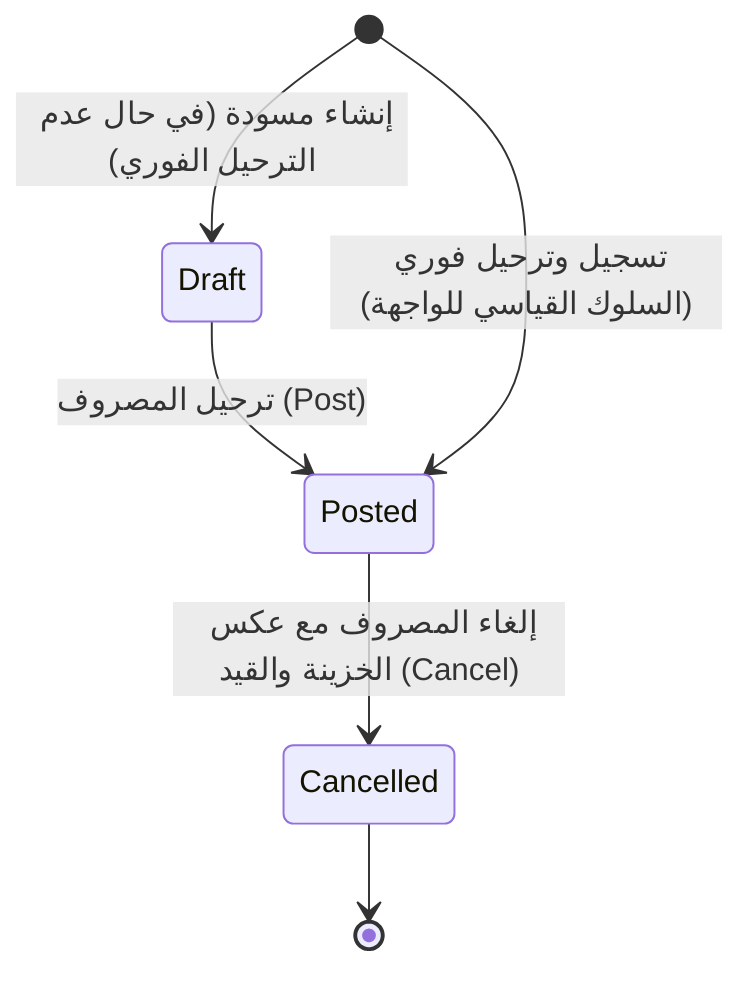

# دليل مستخدم وحدة المصروفات (Expenses User Manual)

---

## 1. نظرة عامة (Expenses Overview)

وحدة **المصروفات (Expenses)** في نظام صَيّاد (SAYAD) هي الوحدة المسؤولة عن إثبات وضبط ومتابعة كافة النفقات والمصروفات التشغيلية والإدارية والنثرية للمنشأة. تتميز الوحدة بالتكامل التام والمباشر مع كل من **وحدة الخزينة والبنوك (Treasury)** و**وحدة الحسابات العامة (Accounting)**؛ حيث تؤدي حركة تسجيل وترحيل المصروف إلى خصم القيمة تلقائياً من حساب الخزينة أو البنك المحدد وتوليد قيد يومية محاسبي مزدوج ومتوازن في الأستاذ العام بصورة لحظية وذرية.

---

## 2. جرد شاشات وحدة المصروفات (Screen Inventory)

تتكون وحدة المصروفات في واجهة المستخدم من الشاشات التالية:

### 1. شاشة قائمة المصروفات (Expenses List)
- **الغرض:** استعراض ومتابعة سجل المصروفات، وتصفيتها، والاطلاع على حالتها التشغيلية والمحاسبية.
- **المسار (Route):** `/expenses/list` (المسار الرئيسي `/expenses` يعيد التوجيه تلقائياً إلى هذا المسار).
- **الصلاحيات المطلوبة:** `expenses.view`
- **متى تُستخدم:** المتابعة اليومية للنفقات، البحث عن إيصال مصروف، أو مراجعة المبالغ المنصرفة.
- **الحقول المعروضة:**
  - رقم المصروف (`ExpenseNumber` / الكود المعروض بصيغة وثيقة صَيّاد).
  - التاريخ (`ExpenseDate`).
  - فئة/نوع المصروف (`ExpenseCategoryCode` - `ExpenseCategoryNameArabic`).
  - الخزينة المنصرف منها (`TreasuryAccountCode` - `TreasuryAccountNameArabic`).
  - المبلغ (`Amount`).
  - الجهة المستلمة / المدفوع له (`PaidToName` أو اسم الطرف المستفيد).
  - حالة المصروف (`Status`: مُرحل `Posted` / مُلغى `Cancelled` / مسودة `Draft`).
  - حالة الترحيل المحاسبي (`IsAccountingPosted` / `AccountingPostingStatus`).
- **الإجراءات المتاحة:**
  - زر "إضافة مصروف" (`Add Expense`) للانتقال إلى نموذج التسجيل.
  - زر "إدارة تصنيفات المصروفات" (`Manage Expense Types`) للانتقال لقائمة التصنيفات (يتطلب صلاحية `expenses.categories.manage`).
  - زر عرض التفاصيل (أيقونة العين) لكل سطر للانتقال لشاشة التفاصيل.
  - التصفية المتعددة والترقيم والتنقل بين الصفحات.
- **قواعد العمل:** يتم فرز المصروفات تنازلياً بحسب تاريخ الإنشاء.
- **الشاشات المرتبطة:** شاشة إضافة مصروف (`/expenses/new`)، شاشة التفاصيل (`/expenses/:id`)، وشاشة التصنيفات (`/expenses/categories`).

<!-- SCREENSHOT: EXP-LIST-001 | Expenses List | Route: /expenses/list | State: Table with data | Proves: List view, status badges, and GL posting indicators | Lang: AR -->

---

### 2. شاشة تسجيل مصروف جديد (Create Expense Form)
- **الغرض:** إثبات وتوثيق عملية صرف مالي وخصمها من الخزينة وإثبات قيدها المحاسبي.
- **المسار (Route):** `/expenses/new`
- **الصلاحيات المطلوبة:** `expenses.create`
- **متى تُستخدم:** عند حدوث واقعة سداد مصروف نقدي أو بنكي (نثريات، فواتير، إيجار، ضيافة، صيانة... إلخ).
- **الحقول:**
  - **فيمَ صُرف المبلغ؟ / تصنيف المصروف (`ExpenseCategoryId`):** قائمة منسدلة إجبارية بالتصنيفات النشطة.
  - **كم المبلغ؟ (`Amount`):** حقل رقمي إجباري (> 0).
  - **من أي خزينة؟ (`TreasuryAccountId`):** قائمة منسدلة إجبارية بالخزائن والحسابات البنكية النشطة.
  - **التاريخ (`ExpenseDate`):** حقل تاريخ إجباري (يأخذ تلقائياً تاريخ اليوم).
  - **الجهة المدفوع لها / المستلم (`PaidToName`):** نص اختياري لتحديد اسم المستلم أو البائع.
  - **الملاحظات (`Notes`):** نص اختياري لتفاصيل أو سبب النفقة.
  - **البطاقة الجانبية للملخص (Summary Card):** تعرض اسم الخزينة المختارة ورصيدها المالي الحالي لحظياً قبل الصرف.
- **الإجراءات المتاحة:**
  - زر "حفظ المصروف" (`Record Expense`).
  - زر "إلغاء" (`Cancel`) للعودة للقائمة.
- **قواعد العمل:**
  - يتم التحقق من كفاية الرصيد في الخزينة المختارة، ويُمنع الحفظ في حال عدم كفاية الرصيد إلا إذا كان الحساب مفعّلاً به خيار السحب على المكشوف (`AllowNegativeBalance`).
  - يجب أن تكون فئة المصروف وحساب الخزينة مرتبطين بحسابات صالحة في دليل الحسابات.
  - عند الضغط على حفظ، يتم إنشاء المصروف وترحيله تلقائياً وتزامناً (`Posted`).
- **رسائل الخطأ والتنبيهات:**
  - *"فئة المصروف غير مرتبطة بحساب محاسبي."*
  - *"حساب الخزنة غير مرتبط بحساب محاسبي."*
  - *"لا يمكن ترحيل المصروف إلى الحساب المحاسبي نفسه."*
  - *"الرصيد غير كافٍ لإتمام العملية."*
- **الشاشات المرتبطة:** قائمة المصروفات (`/expenses/list`)، وتفاصيل المصروف المنشأ (`/expenses/:id`).

<!-- SCREENSHOT: EXP-CREATE-001 | Create Expense Form | Route: /expenses/new | State: Form Filled with Summary Card | Proves: Fields, treasury live balance preview, and action buttons | Lang: AR -->

---

### 3. شاشة تفاصيل المصروف (Expense Details)
- **الغرض:** استعراض البيانات الكاملة للمصروف المسجل، وتتبع قيد اليومية وحركة الخزينة، وإجراء الإلغاء.
- **المسار (Route):** `/expenses/:id`
- **الصلاحيات المطلوبة:** `expenses.view`
- **متى تُستخدم:** للتدقيق المالي، التأكد من الترحيل المحاسبي، أو إلغاء مصروف مسجل بالخطأ.
- **الحقول والمعلومات المعروضة:**
  - رقم وتاريخ المصروف.
  - شارة الحالة التشغيلية وشارة حالة القيد المحاسبي.
  - بطاقة المعلومات الأساسية: فئة المصروف، الخزينة المسدد منها، المبلغ المنصرف، الجهة المدفوع لها، مرجع الخزينة، والملاحظات.
  - بطاقة التلخيص الزمني: تاريخ وساعة الإنشاء، تاريخ ووقت الترحيل وهوية المستخدم المرحل، وتاريخ ووقت الإلغاء وسبب الإلغاء إن وجد.
- **الإجراءات المتاحة:**
  - زر "إلغاء المصروف" (`Cancel Expense`): متاح للمصروفات المرحلة (`Posted`) ويتطلب صلاحية `expenses.cancel`.
  - زر "ترحيل المصروف" (`Post Expense`): يظهر في حال وجود مسودات سابقة تتطلب الترحيل (`Draft`).
- **الشاشات المرتبطة:** قائمة المصروفات (`/expenses/list`).

<!-- SCREENSHOT: EXP-DETAIL-001 | Expense Details | Route: /expenses/:id | State: Details Loaded | Proves: Details view, summary timestamps, and cancellation action | Lang: AR -->

---

### 4. شاشة تصنيفات المصروفات (Expense Categories List)
- **الغرض:** تعريف وتصنيف بنود النفقات في المنشأة (كهرباء، إيجار، بوفيه، وقود، أدوات مكتبية... إلخ) وربطها بدليل الحسابات.
- **المسار (Route):** `/expenses/categories`
- **الصلاحيات المطلوبة:** `expenses.categories.view`
- **متى تُستخدم:** الهيكلة الإدارية والمالية لأنواع المصروفات.
- **الحقول المعروضة بالجدول:**
  - كود التصنيف (`Code`).
  - الاسم بالعربية (`NameArabic`).
  - الاسم بالإنجليزية (`NameEnglish`).
  - الحساب المحاسبي المرتبط (`AccountingAccountCode` - `AccountingAccountArabicName`).
  - ترتيب العرض (`DisplayOrder`).
  - الحالة (`Status`: نشط `Active` / معطل `Inactive`).
- **الإجراءات المتاحة:**
  - زر "إضافة تصنيف" (`Add Category`).
  - زر التعديل (أيقونة القلم) للانتقال لنموذج تعديل التصنيف.
  - تفعيل / تعطيل التصنيف (`Activate` / `Deactivate`) عبر القائمة المنسدلة للسطر.
- **الشاشات المرتبطة:** شاشة إنشاء تصنيف (`/expenses/categories/new`) وشاشة التعديل (`/expenses/categories/:id/edit`).

<!-- SCREENSHOT: EXP-CATEGORIES-001 | Categories List | Route: /expenses/categories | State: Table with Categories | Proves: Category list, GL mapping column, and status toggles | Lang: AR -->

---

### 5. شاشة إضافة وتعديل تصنيف مصروف (Expense Category Form)
- **الغرض:** إدخال بيانات تصنيف جديد أو تعديل بيانات تصنيف قائم وربطه بحساب أستاذ من نوع مصروف.
- **المسار (Route):**
  - إنشاء: `/expenses/categories/new`
  - تعديل: `/expenses/categories/:id/edit`
- **الصلاحيات المطلوبة:** `expenses.categories.manage`
- **الحقول:**
  - **الكود (`Code`):** إجباري وفريد (مثل `EXP-RENT`, `EXP-UTIL`).
  - **الاسم بالعربية (`NameArabic`):** إجباري.
  - **الاسم بالإنجليزية (`NameEnglish`):** اختياري.
  - **الحساب المحاسبي المرتبط (`AccountingAccountId`):** قائمة منسدلة بحسابات الأستاذ النشطة القابلة للترحيل من نوع `Expense`.
  - **ترتيب العرض (`DisplayOrder`):** رقم صحيح لتحديد أولوية الظهور.
  - **الوصف (`Description`):** اختياري.
- **قواعد العمل:** الكود يجب أن يكون فريداً على مستوى النظام، والحساب المحاسبي المختار يجب أن يكون حساب ترحيل نهائي نشط من تصنيف المصروفات (`AccountType == Expense`).

<!-- SCREENSHOT: EXP-CATEGORY-CREATE-001 | Category Form | Route: /expenses/categories/new | State: Form Open | Proves: Category fields and GL expense account picker | Lang: AR -->

---

### 6. شاشة حسابات المصروفات بدليل الحسابات (Expense Accounts List)
- **الغرض:** نافذة مخصصة داخل وحدة المصروفات تتيح استعراض وإدارة حسابات الأستاذ العام من تصنيف "المصروفات" المسجلة في دليل الحسابات (Chart of Accounts).
- **المسار (Route):** `/expenses/accounts`
- **الصلاحيات المطلوبة:** `accounting.accounts.view`
- **متى تُستخدم:** إعداد ومراجعة شجرة الحسابات المالية للمصروفات والتأكد من جاهزيتها للربط مع التصنيفات.
- **الحقول المعروضة:** كود الحساب، اسم الحساب بالعربية والإنجليزية، نوع الحساب (`Expense`)، وحالة الحساب (نشط/معطل).
- **الإجراءات المتاحة:** زر إضافة حساب مصروف، تعديل الحساب، وتفعيل/تعطيل الحساب.

---

### 7. شاشة إضافة وتعديل حساب مصروف بدليل الحسابات (Expense Account Form)
- **الغرض:** إضافة حساب أستاذ عام جديد من نوع مصروفات أو تعديل بياناته.
- **المسار (Route):** `/expenses/accounts/new` و `/expenses/accounts/:id/edit`
- **الصلاحيات المطلوبة:** `accounting.accounts.create` (للإنشاء) و `accounting.accounts.update` (للتعديل).
- **الحقول:** كود الحساب، الاسم بالعربية والإنجليزية، تصنيف الحساب (مثبت تلقائياً على `Expense`)، وحالة النشاط.

<!-- SCREENSHOT: EXP-ACCOUNTS-001 | Expense Accounts List | Route: /expenses/accounts | State: Loaded | Proves: Filtered view of GL expense posting accounts | Lang: AR -->

---

## 3. تصنيفات المصروفات وقواعد الربط المحاسبي (Categories & Mappings)

### ما هو الفرق بين "فئة المصروف" و"حساب المصروف"؟
يحرص نظام صَيّاد على الفصل الدقيق بين المفهوم التشغيلي والمفهوم المحاسبي:
1. **فئة المصروف (Expense Category):**
   - هو البند الإداري/التشغيلي الذي يتعامل معه الموظف أو أمين الصندوق عند تسجيل المصروف (مثل: "بنزين وانتقالات"، "صيانة أجهزة"، "بوفيه وضيافة").
   - يُدار من شاشة `/expenses/categories`.
2. **حساب المصروف في دليل الحسابات (GL Expense Account):**
   - هو حساب الأستاذ العام في الهيكل المحاسبي للشركة (ضمن قائمة الدخل - المصروفات التشغيلية أو الإدارية).
   - يُدار من شاشة `/expenses/accounts` أو من وحدة الحسابات العامة (`Accounting`).
   - يتم ربطه بفئة المصروف في حقل `AccountingAccountId`.

### الأثر التشغيلي لربط الفئة بالحساب المحاسبي
- عند إنشاء تصنيف مصروف، يمكن حفظ التصنيف بدون تحديد حساب محاسبي مؤقتاً لتسهيل الإعداد المبدئي.
- **لكن عند ترحيل أي مصروف:** يشترط النظام إلزامياً أن تكون فئة المصروف مرتبطة بحساب أستاذ عام نشط وصالح للترحيل، وإلا يفشل تسجيل المصروف فورياً مع رسالة: *"فئة المصروف غير مرتبطة بحساب محاسبي."*

---

## 4. دورة حياة المصروف (Expense Lifecycle)

يمر مستند المصروف بالحالات التالية:

### الحالات المعتمدة (Statuses)

| الحالة | التسمية | الوصف والأثر التشغيلي |
| :--- | :--- | :--- |
| `Draft` | **مسودة** | المصروف مسجل لكنه لم يؤثر على رصيد الخزينة ولم يولد قيداً محاسبياً. يمكن تعديله بالكامل عبر الخادم. *(ملاحظة: نموذج الواجهة الحالي `/expenses/new` ينفذ الإنشاء والترحيل فوراً في خطوة واحدة).* |
| `Posted` | **مُرحل** | المصروف معتمد ومنفذ؛ تم خصم المبلغ من الخزينة فورياً وتوليد قيد اليومية المحاسبي. **لا يمكن تعديل المصروف في هذه الحالة نهائياً.** |
| `Cancelled` | **مُلغى** | تم إلغاء المصروف بواسطة مستخدم مخول مع إدخال سبب الإلغاء؛ تم رد المبلغ إلى الخزينة وعكس القيد المحاسبي. **حالة نهائية لا يمكن إعادة ترحيلها.** |

---

## 5. ترحيل المصروف والأثر المالي (Posting Expense)

### شروط وضوابط الترحيل:
1. **نشاط فئة المصروف:** يجب أن تكون فئة المصروف نشطة (`IsActive == true`).
2. **نشاط الخزينة:** يجب أن يكون حساب الخزينة أو البنك نشطاً.
3. **كفاية الرصيد (Sufficient Balance):** يفحص النظام رصيد الخزينة قبل إتمام العملية. إذا كان الرصيد غير كافٍ لتغطية المصروف ولم يكن الحساب مفعلاً به خيار `AllowNegativeBalance`، يتم رفض العملية فورياً.
4. **صحة الربط المحاسبي لطرفي القيد:**
   - فئة المصروف مربوطة بحساب نشط من نوع `Expense`.
   - حساب الخزينة مربوط بحساب نشط من نوع `Asset`.
   - يمنع تماماً أن يكون الحسابان متطابقين.
5. **الذريّة وعدم التجزئة (Transaction Atomicity):**
   تتم عملية الترحيل بالكامل داخل معاملة برمجية موحدة (`ExecuteInTransactionAsync`). فإذا تعذر إنشاء حركة الخزينة أو رفض النظام المحاسبي القيد (بسبب إغلاق الفترة المالية مثلاً)، تتراجع العملية بأكملها بالكامل ولا يتم تسجيل أي أثر مالي مجزأ.

### الأثر الناتج عن الترحيل:
- **في الخزينة:** توليد حركة `TreasuryMovement` من نوع صرف (`Payment`) تخفض رصيد الخزينة برقم مرجعي مرتبط برقم المصروف (`EXP-XXXXX`).
- **في الأطراف (Parties):** يتم تسجيل الطرف المرتبط بالمصروف عند وجوده وإثبات الحركة في دفتر الأستاذ المساعد للطرف.
- **في الحسابات العامة:** توليد قيد يومية متوازن:
  - **من حـ/** حساب المصروف المرتبط بالفئة (مدين / Debit).
  - **إلى حـ/** حساب الخزينة/البنك المرتبط بدليل الحسابات (دائن / Credit).

<!-- SCREENSHOT: EXP-POST-001 | Expense Details | Route: /expenses/:id | State: Post Confirmation Dialog | Proves: Treasury balance validation and posting prompt | Lang: AR -->

---

## 6. إلغاء المصروف (Cancelling Expense)

### ضوابط وإجراءات الإلغاء:
- متاح حصرياً للمصروفات ذات الحالة **مُرحل (`Posted`)**.
- الصلاحية المطلوبة: `expenses.cancel`.
- يتطلب النظام إدخال **سبب الإلغاء الإلزامي (`Cancellation Reason`)**.

### الأثر المالي والرقابي للإلغاء:
1. **عدم الحذف الفيزيائي:** لا يُحذف سجل المصروف من قاعدة البيانات، بل تظل بياناته التاريخية محفوظة وتتغير حالته إلى `Cancelled` مع تسجيل هوية المستخدم وتاريخ وتوقيت الإلغاء وسببه.
2. **عكس حركة الخزينة:** يقوم النظام آلياً بإنشاء حركة خزينة عكسية من نوع `PaymentReversal` بقيمة المبلغ بالكامل، مما يعيد رصيد الخزينة إلى قيمته السابقة. الحركة العكسية تحمل شارة `IsReversal = true` وترتبط بالحركة الأصلية عبر `ReversesMovementId`.
3. **عكس القيد المحاسبي:** يتم استدعاء خدمة القيود المحاسبية لعكس قيد اليومية الأصلي بالكامل تزامناً (`ReverseSystemEntryAsync`).
4. **عكس حركة الطرف:** يتم تسجيل قيد عكسي في دفتر الأطراف لتسوية الأثر.
5. **حظر إعادة الترحيل:** لا يمكن بأي حال إعادة ترحيل أو تعديل مستند مصروف تم إلغاؤه؛ الإلغاء حالة نهائية (Terminal State).

<!-- SCREENSHOT: EXP-CANCEL-001 | Expense Details Dialog | Route: /expenses/:id | State: Cancellation Reason Modal | Proves: Mandatory reason input and cancel confirmation | Lang: AR -->

---

## 7. مقارنة الحذف والتعطيل والإلغاء (Delete vs Deactivate vs Cancel)

| الإجراء | ينطبق على | السلوك والأثر التشغيلي |
| :--- | :--- | :--- |
| **الإلغاء (Cancel)** | مستندات المصروفات المرحلة (`Expenses`) | يعكس الأثر المالي والمحاسبي في الخزينة والأستاذ العام، مع الاحتفاظ بالسجل التاريخي للمستند بحالة `Cancelled`. |
| **التعطيل (Deactivate)** | تصنيفات المصروفات (`Expense Categories`) | يوقف إمكانية اختيار التصنيف عند تسجيل مصروفات جديدة، مع بقائه محفوظاً وظهوره في التقارير التاريخية. يمكن إعادة تفعيله في أي وقت. |
| **الحذف الفيزيائي (Delete)** | المصروفات والتصنيفات | **غير مدعوم (Not Implemented):** لا يوجد مسار لحذف سجل مصروف أو تصنيف مصروف فيزيائياً من النظام، وذلك لحماية سلامة المراجعة المالية وتطابق الأرصدة. |

---

## 8. التكامل المحاسبي وحركات الخزينة (GL & Treasury Integration)

| العملية (Flow) | حركة الخزينة | قيد اليومية (GL Entry) | حالة المصروف | إمكانية العكس |
| :--- | :---: | :---: | :---: | :---: |
| **تسجيل وحفظ المصروف (`Create`)** | `Payment` (تخفيض الرصيد) | **قيد مدين للمصروف ودائن للخزينة** | `Posted` | نعم (عبر الإلغاء) |
| **تعديل مسودة مصروف (`Update Draft`)** | لا توجد | لا يوجد | `Draft` | غير منطبق |
| **ترحيل مسودة مصروف (`Post Draft`)** | `Payment` (تخفيض الرصيد) | **قيد مدين للمصروف ودائن للخزينة** | `Posted` | نعم (عبر الإلغاء) |
| **إلغاء مصروف مرحل (`Cancel`)** | `PaymentReversal` (إعادة الرصيد) | **عكس القيد المحاسبي بالكامل** | `Cancelled` | لا (حالة نهائية) |

### ماذا يحدث في الوحدات الأخرى؟
- **وحدة الخزينة والبنوك (Treasury):** ينعكس المصروف فورياً في كشف حساب الخزينة المعنية، ويظهر في لوحة معلومات الخزينة ضمن بطاقة "مدفوعات الفترة" (`Period Payments`).
- **وحدة الحسابات العامة (Accounting):** يظهر قيد اليومية ضمن دفتر القيود اليومية بحالة مرحل آلياً، ويؤثر مباشرة على ميزان المراجعة وقائمة الدخل لحساب المصروف المحدد.
- **وحدة الأطراف (Parties):** في حال ربط المصروف بطرف مستفيد (مورد أو جهة خدمية)، تظهر الحركة في كشف حساب الطرف كدفعة مسددة.

---

## 9. البحث والتصفية (Search & Filters)

تتيح شاشة قائمة المصروفات حزمة فلاتر دقيقة:

<!-- SCREENSHOT: EXP-FILTERS-001 | Expenses List Filters | Route: /expenses/list | State: Filters Expanded | Proves: Search input, category dropdown, status selector, and date pickers | Lang: AR -->

- **البحث الحر (`Search`):** يبحث في رقم المصروف، اسم المستلم، رقم المرجع، والملاحظات.
- **نوع/تصنيف المصروف (`Expense Category`):** تصفية ذكية (Autocomplete) بحسب فئة المصروف.
- **الحالة (`Status`):** تصفية بحسب (الكل / مرحل `Posted` / ملغى `Cancelled`).
- **الفترة الزمنية:** حقل "من تاريخ" (`dateFrom`) وحقل "إلى تاريخ" (`dateTo`).
- **ترقيم الصفحات:** دعم كامل للترقيم مع خيارات عرض (10، 20، 50، 100 سجل لكل صفحة).
- **الاستيراد والتصدير:** **غير منفذ (Not Implemented)** في وحدة المصروفات؛ لا يتوفر تصدير أو استيراد ملفات إكسل للمصروفات في الإصدار الحالي.

---

## 10. جدول قواعد وضوابط العمل (Business Rules Matrix)

| القاعدة والضابط التشغيلي | الحالة النظامية | التفاصيل والشروط |
| :--- | :--- | :--- |
| **قيمة مبلغ المصروف > 0** | **BLOCKED** | يمنع حفظ أي مصروف بمبلغ صفر أو سالب. |
| **تعديل مصروف مسودة (`Draft`)** | **ALLOWED** | مسموح عبر الخادم طالما المستند لم يُرحل. |
| **تعديل مصروف مرحل (`Posted`)** | **BLOCKED** | محظور تماماً؛ المصروفات المرحلة مقفلة لمنع التلاعب المالي. |
| **تعديل مصروف ملغى (`Cancelled`)** | **BLOCKED** | محظور تماماً. |
| **اشتراط نشاط حساب الخزينة** | **BLOCKED** | يمنع الصرف من أي حساب خزينة معطل (`Deactivated`). |
| **اشتراط نشاط فئة المصروف** | **BLOCKED** | يمنع استخدام فئة مصروف معطلة في حركات الصرف. |
| **كفاية رصيد الخزينة** | **CONDITIONAL** | إلزامي ما لم يكن حساب الخزينة مفعّلاً به خيار `AllowNegativeBalance`. |
| **اشتراط الربط المحاسبي للفئة والخزينة** | **BLOCKED** | يمنع الترحيل تماماً في حال غياب الحساب المحاسبي لأي من الطرفين. |
| **تطابق حساب المصروف مع حساب الخزينة** | **BLOCKED** | يمنع أن يكون حساب المصروف المحاسبي هو نفسه حساب الخزينة المحاسبي. |
| **إغلاق الفترة المحاسبية** | **BLOCKED** | إذا كان تاريخ المصروف يقع في فترة محاسبية مغلقة، يفشل القيد ويتراجع الصرف. |
| **ترحيل المصروف مرتين** | **BLOCKED** | لا يمكن ترحيل مستند مرحل مسبقاً. |
| **إلغاء المصروف مرتين** | **BLOCKED** | لا يمكن إلغاء مستند ملغى مسبقاً. |
| **إعادة ترحيل مصروف ملغى** | **BLOCKED** | مستند المصروف الملغى يظل نهائياً ولا يمكن تنشيطه. |
| **حذف سجل المصروف** | **NOT APPLICABLE** | لا يوجد إجراء حذف للمصروف في النظام. |

---

## 11. مصفوفة الإجراءات التشغيلية (Business Procedures Matrix)

### A. إنشاء فئة مصروف (Create Expense Category)
- **الحالة:** `IMPLEMENTED AND USER-EXPOSED`
- **الصلاحية:** `expenses.categories.manage`
- **الخطوات:**
  1. الانتقال إلى شاشة تصنيفات المصروفات (`/expenses/categories`).
  2. الضغط على زر **إضافة تصنيف (Add Category)**.
  3. إدخال كود التصنيف (فريد)، والاسم بالعربية والإنجليزية.
  4. اختيار حساب الأستاذ العام المناسب من قائمة حسابات المصروفات.
  5. تحديد ترتيب العرض والوصف ثم الضغط على **حفظ التصنيف**.

### B. تعديل فئة مصروف (Edit Expense Category)
- **الحالة:** `IMPLEMENTED AND USER-EXPOSED`
- **الصلاحية:** `expenses.categories.manage`
- **الخطوات:**
  1. من جدول التصنيفات، الضغط على أيقونة التعديل بجوار التصنيف المطلوب.
  2. تعديل الاسم أو الحساب المحاسبي أو الترتيب.
  3. الضغط على **حفظ التعديلات**.

### C. إنشاء وتسجيل مصروف (Create Expense)
- **الحالة:** `IMPLEMENTED AND USER-EXPOSED`
- **الصلاحية:** `expenses.create`
- **الخطوات:**
  1. من القائمة الرئيسية، الانتقال إلى **المصروفات** والضغط على **إضافة مصروف (Add Expense)**.
  2. اختيار فئة المصروف وتحديد المبلغ المنصرف.
  3. اختيار الخزينة أو الحساب البنكي المراد الصرف منه ومراجعة رصيده في البطاقة الجانبية.
  4. تحديد تاريخ المصروف وإدخال اسم الجهة المدفوع لها والملاحظات.
  5. الضغط على **حفظ المصروف (Record Expense)**. يتم خصم المبلغ وترحيل القيد آلياً.

### D. تعديل مصروف مسودة (Edit Draft Expense)
- **الحالة:** `BACKEND ONLY`
- **التوضيح:** تعديل مصروف Draft مدعوم في Backend، لكن الواجهة الحالية لا تعرض هذا التدفق للمستخدم.

### E. ترحيل مصروف (Post Expense)
- **الحالة:** `IMPLEMENTED AND USER-EXPOSED`
- **الصلاحية:** `expenses.post`
- **الخطوات:** يتم تلقائياً عند حفظ المصروف من النموذج، أو يدوياً عبر زر **ترحيل المصروف** في شاشة التفاصيل لأي مستند مسودة سابق.

### F. إلغاء مصروف مرحل (Cancel Expense)
- **الحالة:** `IMPLEMENTED AND USER-EXPOSED`
- **الصلاحية:** `expenses.cancel`
- **الخطوات:**
  1. فتح صفحة تفاصيل المصروف المطلوب إلغاؤه (`/expenses/:id`).
  2. الضغط على زر **إلغاء المصروف (Cancel Expense)**.
  3. كتابة **سبب الإلغاء الإلزامي** في النافذة المنبثقة.
  4. الضغط على تأكيد الإلغاء؛ يقوم النظام برد المبلغ للخزينة وعكس القيد المحاسبي وتحديث الحالة إلى `Cancelled`.

### G. مراجعة تفاصيل المصروف (Review Expense Details)
- **الحالة:** `IMPLEMENTED AND USER-EXPOSED`
- **الصلاحية:** `expenses.view`
- **الخطوات:** الضغط على زر العرض في جدول المصروفات للاطلاع على بيانات الصرف، المرجع المحاسبي، والتوقيتات الزمنية.

### H. البحث وتصفية المصروفات (Search & Filter Expenses)
- **الحالة:** `IMPLEMENTED AND USER-EXPOSED`
- **الصلاحية:** `expenses.view`
- **الخطوات:** استخدام شريط التصفية في أعلى قائمة المصروفات للبحث بالنص أو تحديد الفئة أو الحالة أو الفترة الزمنية.

### I. إدارة حسابات المصروفات بدليل الحسابات (Manage Expense Accounts)
- **الحالة:** `IMPLEMENTED AND USER-EXPOSED`
- **الصلاحية:** `accounting.accounts.view` / `accounting.accounts.create` / `accounting.accounts.update`
- **الخطوات:** الدخول عبر الرابط المباشر `/expenses/accounts` لإضافة وتفعيل حسابات الأستاذ العام المؤهلة للربط مع فئات المصروفات.

### J. استيراد المصروفات من ملف (Import Expenses)
- **الحالة:** `NOT IMPLEMENTED`
- **التوضيح:** لا تدعم وحدة المصروفات حالياً استيراد النفقات من ملفات خارجية.

### K. تصدير المصروفات إلى إكسل (Export Expenses)
- **الحالة:** `NOT IMPLEMENTED`
- **التوضيح:** لا يتوفر زر تصدير مباشر لجدول المصروفات في واجهة المستخدم الحالية.

---

## 12. مصفوفة الصلاحيات الدقيقة (Exact Permissions Catalog)

| كود الصلاحية | التسمية العربية الرسمية | الاستخدام والحماية في واجهة المستخدم والواجهة الخلفية |
| :--- | :--- | :--- |
| `expenses.view` | عرض المصروفات | تتيح استعراض قائمة المصروفات وشاشة التفاصيل (`/expenses/list` و `/expenses/:id`). |
| `expenses.create` | إنشاء المصروفات | تتيح فتح واستخدام نموذج تسجيل المصروف الجديد (`/expenses/new`). |
| `expenses.edit` | تعديل المصروفات | تتيح تعديل مسودة المصروف في الواجهة الخلفية قبل الترحيل (`PUT /api/expenses/{id}`). |
| `expenses.post` | ترحيل المصروفات | تتيح زر اعتماد وترحيل المصروف (`POST /api/expenses/{id}/post`). |
| `expenses.cancel` | إلغاء المصروفات | تتيح زر ونافذة إلغاء المصروف المرحل وعكس أثره المالي (`POST /api/expenses/{id}/cancel`). |
| `expenses.categories.view` | عرض تصنيفات المصروفات | تتيح استعراض جدول فئات المصروفات (`/expenses/categories`). |
| `expenses.categories.manage`| إدارة تصنيفات المصروفات| تتيح إضافة وتعديل وتفعيل وتعطيل فئات المصروفات (`/expenses/categories/new` و `/edit`). |

---

## 13. مصفوفة التحقق والاكتمال النهائي (Final Completeness Matrix)

| الخاصية / الوظيفة | منفذة برمجياً (Implemented) | معروضة للمستخدم (User Exposed) | موثقة بالكامل (Documented) | تحتاج تحقق حي (Live Verification) |
| :--- | :---: | :---: | :---: | :---: |
| **قائمة المصروفات (Expense List)** | نعم | نعم | نعم | نعم (شاشة حية) |
| **تسجيل مصروف (Create Expense)** | نعم | نعم | نعم | نعم (النموذج) |
| **تعديل مصروف (Edit Expense)** | نعم (Draft فقط) | غير معروض بالواجهة | نعم | لا |
| **تفاصيل المصروف (Expense Detail)**| نعم | نعم | نعم | نعم (شاشة حية) |
| **تصنيفات المصروفات (Categories List)**| نعم | نعم | نعم | نعم (شاشة حية) |
| **إضافة تصنيف (Create Category)** | نعم | نعم | نعم | نعم (النموذج) |
| **تعديل تصنيف (Edit Category)** | نعم | نعم | نعم | لا |
| **تفعيل/تعطيل تصنيف (Activate/Deactivate)**| نعم | نعم | نعم | لا |
| **حسابات المصروفات (Expense Accounts)**| نعم | نعم | نعم | نعم (شاشة حية) |
| **ترحيل المصروف (Post)** | نعم | نعم | نعم | نعم (تأكيد القيد) |
| **إلغاء المصروف (Cancel)** | نعم | نعم | نعم | نعم (نافذة السبب) |
| **التكامل مع الخزينة (Treasury Payment)**| نعم | نعم | نعم | لا |
| **التكامل المحاسبي (GL Journal Entry)**| نعم | نعم | نعم | لا |
| **فلاتر البحث (Search & Filters)** | نعم | نعم | نعم | لا |
| **استيراد المصروفات (Import)** | لا | لا | نعم (موضحة كغير منفذة) | لا |
| **تصدير المصروفات (Export)** | لا | لا | نعم (موضحة كغير منفذة) | لا |
| **حذف المصروف (Delete Expense)** | لا | لا | نعم (موضحة كغير منفذة) | لا |
