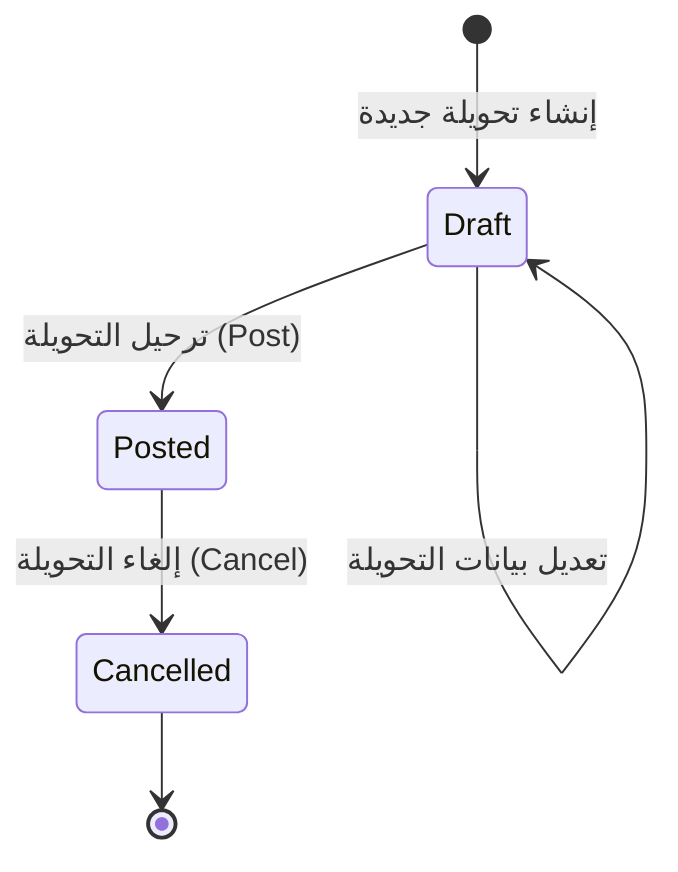

# دليل مستخدم وحدة الخزينة والبنوك (Treasury User Manual)

---

## 1. نظرة عامة (Treasury Overview)

وحدة **الخزينة والبنوك (Treasury)** في نظام صَيّاد (SAYAD) هي المركز المالي المباشر لإدارة وتتبع السيولة النقدية والمصرفية للمنشأة. تشمل الوحدة إدارة الصناديق النقدية، حسابات البنوك، العُهد، والمحافظ الإلكترونية، وتتيح تنفيذ الحركات النقدية اليدوية (Manual Cash In / Cash Out)، التحويلات المالية بين الحسابات (Transfers)، واستخراج كشوف الحسابات التفصيلية، مع ربط محاسبي آني ودقيق بدليل الحسابات (General Ledger).

---

## 2. لوحة معلومات الخزينة (Treasury Dashboard)

توفر شاشة لوحة المعلومات ملخصاً شاملاً وفورياً للأرصدة والسيولة مصنفة بحسب كل عملة مسجلة في النظام:

### مؤشرات الأداء والبطاقات (KPIs)
لكل عملة (مثال: EGP) يتم عرض المؤشرات التالية:
1. **إجمالي الرصيد (Total Balance):** صافي الرصيد القائم لكافة حسابات هذه العملة (المدين - الدائن).
2. **رصيد الخزائن النقدية (Cashbox Balance):** مجموع أرصدة الحسابات من نوع نقدية (`Cash`) وعُهدة (`PettyCash`).
3. **رصيد البنوك (Bank Balance):** مجموع أرصدة الحسابات البنكية (`Bank`).
4. **رصيد المحافظ الإلكترونية (Digital Wallet Balance):** مجموع أرصدة المحافظ الرقمية (`DigitalWallet`).
5. **مقبوضات الفترة (Period Receipts):** إجمالي الإيداعات والتحصيلات المسجلة خلال الفترة الزمنية المحددة في الفلتر (تشمل حركات `Receipt` و `ManualCashIn`).
6. **مدفوعات الفترة (Period Payments):** إجمالي المصروفات والمدفوعات المسجلة خلال الفترة الزمنية المحددة في الفلتر (تشمل حركات `Payment` و `ManualCashOut`).

### فلاتر لوحة المعلومات
- **من تاريخ (Date From) / إلى تاريخ (Date To):** يؤثران على احتساب مقبوضات ومدفوعات الفترة، بينما يمثل إجمالي الأرصدة الرصيد الفعلي التراكمي حتى اللحظة.
- **الحسابات غير النشطة:** تظهر الحسابات المعطلة ضمن إجماليات الأرصدة وقوائم الحسابات مع تمييزها بشارة توضح حالتها.

### قائمة أحدث الحركات (Recent Movements)
تعرض آخر 5 حركات مالية مسجلة على مستوى كافة الخزائن (التاريخ، نوع الحركة، رقم المرجع، الطرف، والمبلغ).

<!-- SCREENSHOT: TRY-DASHBOARD-001 | Dashboard | Route: /treasury/dashboard or /treasury | State: Loaded | Proves: Treasury KPIs, currency groupings, and recent movements table | Lang: AR -->

---

## 3. أنواع حسابات الخزينة (Account Types)

يدعم النظام 5 أنواع رئيسية لحسابات الخزينة معتمدة في قاعدة البيانات وواجهة المستخدم:

| نوع الحساب في الواجهة | القيمة البرمجية (Enum) | الوصف والاستخدام التشغيلي |
| :--- | :--- | :--- |
| **خزينة نقدية** | `Cash` | الصناديق والخزائن النقدية الرئيسية في الفروع أو المقرات. |
| **حساب بنكي** | `Bank` | الحسابات الجارية والاستثمارية لدى البنوك والمصارف. |
| **عهدة نقدية** | `PettyCash` | العُهد النقدية المؤقتة أو المستديمة المسلمة للموظفين لتغطية النثريات. |
| **محفظة إلكترونية** | `DigitalWallet` | حسابات الدفع الرقمي والمحافظ الإلكترونية (مثل فودافون كاش، إنستاباي، وغيرها). |
| **حساب آخر** | `Other` | أي أوعية مالية أو نقدية وسيطة أخرى لا تندرج تحت التصنيفات السابقة. |

> [!NOTE]
> **توحيد حقول النماذج:** تشترك كافة أنواع الحسابات الخمسة في نفس حقول الإدخال الأساسية داخل واجهة المستخدم (الكود، الاسم، النوع، العملة، الرصيد الافتتاحي، الحساب المحاسبي، والملاحظات). لا توجد حالياً حقول تفصيلية خاصة بالبنوك (مثل IBAN أو اسم الفرع) أو أرقام المحافظ، وتُسجل هذه البيانات الإضافية ضمن حقل **الملاحظات (Notes)**.

---

## 4. الحركات النقدية اليدوية (Cash In vs Cash Out)

تُستخدم الحركات النقدية اليدوية للعمليات المالية المباشرة على الخزينة التي لا ترتبط مباشرة بفاتورة بيع أو شراء:

### أ. الإيداع النقدي اليدوي (Manual Cash In)
- **الشاشة ومسار الإجراء:** تفاصيل حساب الخزينة (`/treasury/accounts/:id`) عبر الضغط على زر **إيداع نقدي (Cash In)** لفتح نافذة `TreasuryCashMovementDialog`.
- **الحقول:**
  - تاريخ الحركة (`Receipt Date`): إلزامي (افتراضياً تاريخ اليوم).
  - المبلغ (`Amount`): إلزامي (> 0).
  - الحساب المحاسبي المقابل (`Counter Accounting Account`): إلزامي، يتم اختياره من دليل الحسابات لحسابات الأستاذ النشطة القابلة للترحيل، مع استبعاد الحساب المحاسبي المرتبط بالخزينة نفسها.
  - السبب (`Reason`): إلزامي، نص يوضح طبيعة الإيداع (مثل: تمويل من المالك، تسوية نقدية).
  - الملاحظات (`Notes`): اختياري.
- **الصلاحية المطلوبة:** `treasury.receipts.create`
- **توقيت الترحيل:** فوري وتزامني (Synchronous) بمجرد تأكيد النافذة.
- **نوع حركة الخزينة:** `ManualCashIn` (مدين في الخزينة، يزيد الرصيد). كود المرجع يتولد آلياً بصيغة: `MANUAL-IN-YYYYMMDD-XXXX`.
- **الأثر المحاسبي:** ينشئ قيد يومية آلياً وفورياً من طرفين متوازنين:
  - **من حـ/** حساب الخزينة المرتبط بدليل الحسابات (Asset / مدين).
  - **إلى حـ/** الحساب المحاسبي المقابل المختار (دائن).
- **الإلغاء والعكس:** لا يدعم النظام زر إلغاء أو حذف مباشر للحركات النقدية اليدوية بعد ترحيلها.

<!-- SCREENSHOT: TRY-CASH-IN-001 | Account Details Dialog | Route: /treasury/accounts/:id | State: Cash In Dialog Open | Proves: Cash In form fields and counter-account selection | Lang: AR -->

---

### ب. الصرف النقدي اليدوي (Manual Cash Out)
- **الشاشة ومسار الإجراء:** تفاصيل حساب الخزينة (`/treasury/accounts/:id`) عبر الضغط على زر **صرف نقدي (Cash Out)** لفتح نافذة `TreasuryCashMovementDialog`.
- **الحقول:** تاريخ الصرف (`Payment Date`)، المبلغ (`Amount` > 0)، الحساب المحاسبي المقابل (`Counter Accounting Account`)، السبب (`Reason`)، والملاحظات (`Notes`).
- **الصلاحية المطلوبة:** `treasury.payments.create`
- **توقيت الترحيل:** فوري وتزامني بمجرد الحفظ.
- **شرط كفاية الرصيد:** يتحقق النظام من وجود رصيد كافٍ لتغطية المبلغ المنصرف، ويمنع الحركة إلا إذا كان الحساب مفعّلاً به خيار "السماح بالرصيد السالب" (`AllowNegativeBalance`).
- **نوع حركة الخزينة:** `ManualCashOut` (دائن في الخزينة، يخفض الرصيد). كود المرجع: `MANUAL-OUT-YYYYMMDD-XXXX`.
- **الأثر المحاسبي:** ينشئ قيد يومية آلياً وفورياً:
  - **من حـ/** الحساب المحاسبي المقابل المختار (مدين).
  - **إلى حـ/** حساب الخزينة المرتبط بدليل الحسابات (Asset / دائن).
- **الإلغاء والعكس:** لا يدعم النظام زر إلغاء مباشر للحركة اليدوية المنفذة.

<!-- SCREENSHOT: TRY-CASH-OUT-001 | Account Details Dialog | Route: /treasury/accounts/:id | State: Cash Out Dialog Open | Proves: Cash Out form and balance check validation | Lang: AR -->

---

## 5. مقبوضات العملاء ومدفوعات الموردين (Cross-Module Flows)

تُمثل سندات القبض والدفع الخاصة بالعملاء والموردين تدفقات مالية عابرة للوحدات (Cross-Module Flows):

1. **تسجيل قبض من عميل (Customer Receipt):**
   - **الواجهة ومكان الإنشاء:** يُنشئه المستخدم من وحدة الأطراف (`/parties/:id` -> تبويب التسويات) أو أثناء تحصيل فاتورة مبيعات نقدياً في وحدة المبيعات (`/sales/invoices`).
   - **الأثر في الخزينة:** يقوم النظام آلياً بتوليد حركة خزينة واردة (`Receipt`) مرتبطة برقم الفاتورة أو إشعار التسوية، مما يرفع رصيد الخزينة المحددة.
   - **الصلاحيات:** تتبع وحدة الأطراف (`parties.adjustments.manage`) أو المبيعات (`sales.invoices.*`).

2. **تسجيل دفع لمورد (Supplier Payment):**
   - **الواجهة ومكان الإنشاء:** يُنشئه المستخدم من وحدة الأطراف (`/parties/:id` -> تبويب التسويات) أو أثناء سداد فاتورة مشتريات نقدياً في وحدة المشتريات (`/purchases/invoices`).
   - **الأثر في الخزينة:** يقوم النظام آلياً بتوليد حركة خزينة صادرة (`Payment`) تخفض رصيد الخزينة بعد التحقق من كفاية الرصيد.
   - **الصلاحيات:** تتبع وحدة الأطراف (`parties.adjustments.manage`) أو المشتريات (`purchases.invoices.*`).

> [!IMPORTANT]
> **التفرقة التشغيلية:** لا يتم إدخال تحصيلات العملاء أو مدفوعات الموردين عبر نافذة (Cash In / Cash Out) اليدوية في الخزينة، لتجنب فك ارتباط مديونية الطرف وتوزيع الفواتير (Invoice Allocation). يجب دائماً استخدام وحدات المبيعات أو المشتريات أو الأطراف لتسجيل تلك المقبوضات والمدفوعات.

<!-- SCREENSHOT: TRY-CUSTOMER-RECEIPT-001 | Customer Details Settlements | Route: /parties/:id | State: Create Receipt Settlement | Proves: Customer receipt flow affecting treasury | Lang: AR -->
<!-- SCREENSHOT: TRY-SUPPLIER-PAYMENT-001 | Supplier Details Settlements | Route: /parties/:id | State: Create Payment Settlement | Proves: Supplier payment flow affecting treasury | Lang: AR -->

---

## 6. التكامل المحاسبي وقواعد ربط دليل الحسابات (Accounting Integration)

تخضع كافة عمليات الخزينة لضوابط محاسبية صارمة تضمن اتساق سجلات الخزينة مع الأستاذ العام:

1. **إنشاء حساب الخزينة بدون حساب محاسبي:**
   - **مسموح شرطياً:** يمكن إنشاء حساب الخزينة دون تحديد حساب محاسبي مرتبط (`AccountingAccountId`) **فقط إذا كان الرصيد الافتتاحي صفراً (0)**.
   - **محظور عند وجود رصيد افتتاحي:** إذا تم إدخال رصيد افتتاحي أكبر من الصفر، يرفض النظام إنشاء الحساب ويعيد رسالة خطأ صريحة: *"Treasury account is not linked to an accounting account."*
2. **شروط الحساب المحاسبي المرتبط:**
   - يجب أن يكون الحساب المحاسبي موجوداً ونشطاً (`IsActive == true`).
   - يجب أن يكون حساب ترحيل نهائي وليس حساباً رئيسياً (`IsPosting == true` و `ParentId is not null`).
   - يجب أن يكون من تصنيف الأصول (`AccountType == Asset`).
   - يجب أن يكون فريداً وغير مرتبط بأي حساب خزينة آخر في النظام.
3. **حظر الحركات اليدوية بدون ربط محاسبي:**
   - يمنع النظام تماماً تسجيل أي حركة (Cash In) أو (Cash Out) لحساب خزينة غير مرتبط بحساب أستاذ عام، ويرد النظام فورياً برفض العملية برمز 400.
4. **حظر ترحيل التحويلات بدون ربط محاسبي:**
   - لا يمكن ترحيل تحويلة مالية (Transfer Post) إذا كان الحساب المصدر أو الحساب الوجهة يفتقد للربط المحاسبي الصالح.
5. **تزامنية الترحيل والذريّة (Atomicity):**
   - كافة القيود المحاسبية تنفذ بالتزامن داخل نفس المعاملة البرمجية (Database Transaction). إذا فشل إنشاء القيد المحاسبي لأي سبب (مثل عدم اكتمال إعدادات الربط أو إغلاق الفترة المحاسبية)، تفشل حركة الخزينة بأكملها وتتراجع، ولا يمكن حدوث حركة خزينة ناجحة مع قيد محاسبي معلق أو فاشل.

---

## 7. دورة حياة التحويلات بين الحسابات (Transfer Lifecycle)

تتيح التحويلات مناقلة الأموال بين حسابات الخزائن والبنوك داخل المنشأة وفق دورة مستندية محكمة:



### حالات مستند التحويل (Document Statuses)
1. **مسودة (Draft):**
   - مرحلة إنشاء المستند واختيار الحساب المحول منه (`FromAccount`) والحساب المحول إليه (`ToAccount`) والمبلغ والتاريخ.
   - لا يترتب على المسودة أي أثر مالي أو محاسبي ولا تتأثر أرصدة الحسابات.
   - **التعديل:** مسموح بالكامل طالما المستند في حالة المسودة.
   - **الحذف:** لا يدعم النظام إجراء حذف لمسودة التحويل بعد إنشائها.
2. **مُرحل (Posted):**
   - يتم الترحيل يدوياً بالضغط على زر **ترحيل (Post Transfer)**.
   - **شروط الترحيل:**
     - يجب أن يكون المبلغ أكبر من الصفر.
     - يجب أن يكون الحسابان المصدر والوجهة مختلفين ونشطين (`IsActive`).
     - **توافق العملة:** يجب أن يكون الحسابان بنفس العملة تماماً (يمنع النظام الترحيل بين عملات مختلفة).
     - **كفاية الرصيد:** يجب توفر رصيد كافٍ في الحساب المصدر لتغطية المبلغ (ما لم يكن مفعلاً به السحب على المكشوف).
     - **صحة الربط المحاسبي:** يجب وجود حساب محاسبي صالح لكل من الطرفين وألا يكونا نفس الحساب المحاسبي.
   - **الأثر المالي:**
     - توليد حركة `TransferOut` على الحساب المصدر (تخفيض الرصيد).
     - توليد حركة `TransferIn` على الحساب الوجهة (زيادة الرصيد).
   - **الأثر المحاسبي:** توليد قيد يومية محاسبي موحد ومتوازن:
     - **من حـ/** الحساب المحاسبي للخزينة الوجهة (مدين).
     - **إلى حـ/** الحساب المحاسبي للخزينة المصدر (دائن).
3. **مُلغى (Cancelled):**
   - متاح فقط للتحويلات المرحلة (`Posted`).
   - **المتطلبات:** إدخال سبب الإلغاء الإلزامي (`Cancellation Reason`)، وأن يكون كلا الحسابين نشطين.
   - **الأثر المالي:** لا يتم حذف الحركات الأصلية؛ بل ينشئ النظام حركتين عكسيتين:
     - حركة `TransferReversalOut` تعيد المبلغ إلى الحساب المصدر.
     - حركة `TransferReversalIn` تخصم المبلغ من الحساب الوجهة.
     - يتم ربط الحركات العكسية بالحركات الأصلية عبر معرف (`ReversesMovementId`) مع تفعيل شارة العكس (`IsReversal = true`).
   - **الأثر المحاسبي:** يتم عكس القيد المحاسبي تزامناً وفورياً عبر دالة العكس المحاسبي (`ReverseSystemEntryAsync`).
   - **إعادة الترحيل:** محظورة تماماً؛ لا يمكن إعادة ترحيل أو تعديل مستند ملغى.

<!-- SCREENSHOT: TRY-TRANSFER-LIST-001 | Transfers List | Route: /treasury/transfers | State: Filtered List | Proves: Transfers listing with status chips | Lang: AR -->
<!-- SCREENSHOT: TRY-TRANSFER-CREATE-001 | Create Transfer | Route: /treasury/transfers/new | State: Form Filled | Proves: Account selectors and transfer fields | Lang: AR -->
<!-- SCREENSHOT: TRY-TRANSFER-POST-001 | Transfer Details | Route: /treasury/transfers/:id | State: Transfer Posted | Proves: Posted transfer details and GL link | Lang: AR -->
<!-- SCREENSHOT: TRY-TRANSFER-CANCEL-001 | Transfer Details Dialog | Route: /treasury/transfers/:id | State: Cancel Dialog Open | Proves: Cancellation reason requirement | Lang: AR -->

---

## 8. التعطيل مقابل الحذف النهائي (Deactivate vs Final Delete)

يفرق النظام بوضوح تام بين إجراء إيقاف الحساب المؤقت وإجراء الحذف النهائي الجذري:

```
+---------------------------------------------------------------------------------------+
|                                    مقارنة الحذف والتعطيل                             |
+------------------------------------+--------------------------------------------------+
| التعطيل (Deactivate)               | الحذف النهائي (Final Delete)                     |
+------------------------------------+--------------------------------------------------+
| - متاح للأدمن ذي الصلاحية          | - محصور بمالك النظام فقط (System Owner)          |
| - يحتفظ بكامل التاريخ المالي       | - إجراء خطير يمس الأرشيف المالي                  |
| - يمنع العمليات الجديدة فقط        | - يتطلب كلمة مرور المالك وتأكيد كود الحساب      |
| - كشوف الحسابات تظل قابلة للعرض    | - خيار نقل الروابط أو الحذف الشامل للكافة        |
| - يمكن إعادة تفعيله في أي وقت      | - حذف فيزيائي لا يمكن التراجع عنه               |
+------------------------------------+--------------------------------------------------+
```

### أ. التعطيل (Deactivate)
- متاح عبر زر **تعطيل (Deactivate)** في صفحة الحساب.
- الصلاحية المطلوبة: `treasury.accounts.deactivate`.
- **النتيجة:** يظل الحساب وكافة حركاته وتقاريره وكشوفه السابقة محفوظة بالكامل في قاعدة البيانات، ولكن يتم حظره من الظهور في قوائم الاختيار للحركات الجديدة (تحويلات، إيداع، صرف). يمكن إعادة تنشيطه عبر صلاحية `treasury.accounts.activate`.

### ب. الحذف النهائي (Final Delete)
- إجراء تدميري بالغ الحساسية مخصص لحالات تنظيف البيانات التجريبية أو الأخطاء الجسيمة.
- **شروط التنفيذ:**
  1. يجب أن يكون المستخدم الحالي هو **مالك النظام (System Owner)** حصراً.
  2. إدخال كلمة مرور المالك للتحقق الأمني (`Owner Password`).
  3. كتابة كود الحساب بدقة في حقل التأكيد لمنع الحذف بالخطأ.
  4. كتابة سبب الحذف الإلزامي.
- **استراتيجيات الحذف المتاحة في النظام:**
  1. **نقل الروابط للحساب البديل (Move Links):**
     - يتطلب اختيار حساب خزينة بديل نشط (`Replacement Account`) بنفس العملة.
     - يقوم النظام بنقل كافة الحركات المالية (`TreasuryMovements`)، التحويلات (`TransferVouchers`)، والمصروفات المرتبطة بالحساب إلى الحساب البديل، ثم يحذف سجل الخزينة الأصلي فيزيائياً.
  2. **حذف شامل للبيانات (Delete All):**
     - > [!CAUTION]
       > **تحذير تدمير التاريخ المالي:** استراتيجية `DeleteAll` تقوم بالحذف الفيزيائي المباشر لكافة سجلات المصروفات المرتبطة، حركات الخزينة، قسائم التحويل، وسجل الحساب نفسه نهائياً من قاعدة البيانات، مما يتسبب في إتلاف التسلسل التاريخي لتلك العمليات.

<!-- SCREENSHOT: TRY-DELETE-001 | Account Details Dialog | Route: /treasury/accounts/:id | State: Final Delete Dialog | Proves: Owner password, code confirmation, and strategy selection | Lang: AR -->

---

## 9. كشف حساب الخزينة (Treasury Statement)

يتيح كشف الحساب متابعة السجل الزمني التفصيلي للتدفقات النقدية لحساب معين:

### حقول وإجماليات الكشف
- **الرصيد الافتتاحي المنقول (Brought-forward Balance):** صافي الرصيد ما قبل تاريخ البداية المحدد.
- **إجمالي المقبوضات (Total Receipts / Debit):** مجموع التدفقات الداخلة خلال الفترة.
- **إجمالي المدفوعات (Total Payments / Credit):** مجموع التدفقات الخارجة خلال الفترة.
- **الرصيد الختامي (Closing Balance):** صافي رصيد الحساب في نهاية الفترة مع تحديد طبيعته (مدين/دائن/متزن).

### أعمدة جدول الحركات
1. **تاريخ الحركة (Movement Date):** تاريخ تسجيل العملية.
2. **رقم المرجع (Reference Number):** رقم المستند أو الإشعار المصدر (مثل رقم الفاتورة أو التحويلة).
3. **نوع الحركة (Movement Type):** إيداع، صرف، تحويل صادر، تحويل وارد، عكس تحويل، تسوية عميل/مورد.
4. **الطرف (Party):** كود واسم العميل أو المورد المرتبط بالحركة إن وجد.
5. **الوارد / مدين (Debit Amount):** المبالغ الداخلة للحساب.
6. **المنصرف / دائن (Credit Amount):** المبالغ الخارجة من الحساب.
7. **الرصيد التراكمي (Running Balance):** الرصيد المحتسب لحظياً بعد كل حركة مع طبيعته (`Debit` / `Credit` / `Settled`).
8. **البيان والملاحظات:** الشرح العربي والإنجليزي المرفق بالحركة.
9. **شارة العكس (Reversal Badge):** تظهر في حال كانت الحركة تمثل حركة عكسية لحركة سابقة.

### خيارات الفلترة والتصدير
- تصفية بحسب: الفترة الزمنية (من / إلى)، الطرف، نوع الحركة، ورقم المرجع.
- دعم ترقيم الصفحات (Pagination) بمعدل افتراضي 20 حركة بحد أقصى 100 حركة بالصفحة.
- خيارات الطباعة وتصدير الكشف.

<!-- SCREENSHOT: TRY-STATEMENT-001 | Treasury Statement | Route: /treasury/statements | State: Account Statement Rendered | Proves: Running balance, debit/credit totals, and movement rows | Lang: AR -->

---

## 10. استيراد وتصدير الحسابات (Import / Export)

### أ. تصدير الحسابات (Export)
- يتم التصدير بصيغة ملف إكسل (`.xlsx`) عبر استدعاء المسار `/api/treasury/accounts/export`.
- يُصدر الملف كافة حسابات الخزينة المسجلة في النظام مرتبة تصاعدياً بحسب الكود، ويتضمن كلاً من الحسابات النشطة وغير النشطة.
- **أعمدة ملف التصدير:** الكود، الاسم بالعربية، الاسم بالإنجليزية، نوع الحساب، العملة، الملاحظات، السماح بالرصيد السالب، الحالة (نشط/معطل)، كود الحساب المحاسبي، واسم الحساب المحاسبي.

### ب. استيراد الحسابات (Import)
- يتيح النظام استيراد حسابات الخزينة جماعياً عبر ملف إكسل على مرحلتين:
  1. **تحميل النموذج (Template):** يحتوي الملف على أعمدة الإدخال المقبولة بالإضافة إلى ورقة مرجعية (`Reference Sheet`) توضح أنواع الحسابات المعتمدة وقائمة الأكواد المحاسبية المؤهلة للربط.
  2. **المعاينة والتحقق (Preview):** فحص الملف والتحقق من صحة أسماء الأعمدة، عدم تكرار الأكواد، وصحة الحسابات المحاسبية قبل الاعتماد.
  3. **الاعتماد (Commit):** عملية ذرية شاملة (All-or-Nothing)؛ يتم إنشاء الحسابات داخل معاملة برمجية موحدة برصيد افتتاحي (0)، وإذا واجه أي صف خطأ يتم إلغاء استيراد الملف بالكامل.

<!-- SCREENSHOT: TRY-IMPORT-001 | Import Dialog | Route: /treasury/accounts | State: Preview Dialog Open | Proves: Excel validation and row preview | Lang: AR -->
<!-- SCREENSHOT: TRY-EXPORT-001 | Accounts List | Route: /treasury/accounts | State: Export Triggered | Proves: Export action button and file generation | Lang: AR -->

---

## 11. قواعد العمل والضوابط التشغيلية (Business Rules Matrix)

| القاعدة التشغيلية | الحالة النظامية | التفاصيل والشروط |
| :--- | :--- | :--- |
| **قيمة المبلغ > 0** | **BLOCKED** | يُمنع تماماً تسجيل أي حركة نقدية أو تحويل بمبلغ صفر أو سالب. |
| **نشاط الحساب (Active Account)** | **BLOCKED** | يُحظر إجراء حركات صرف أو قبض أو تحويل على أي حساب معطل (`Deactivated`). |
| **كفاية الرصيد (Sufficient Balance)** | **CONDITIONAL** | مطلوب إلزامياً للصرف والتحويل، ما لم يكن الحساب مفعلاً به خيار `AllowNegativeBalance`. |
| **السماح بالرصيد السالب** | **ALLOWED** | متاح عند تفعيل الخيار في بطاقة الحساب (مخصص للبنوك والسحب على المكشوف). |
| **التحويل لنفس الحساب** | **BLOCKED** | محظور تماماً؛ يجب أن يختلف الحساب المصدر عن الحساب الوجهة. |
| **تطابق عملة التحويل** | **BLOCKED** | التحويل بين عملتين مختلفتين محظور برمجياً في النظام؛ التحويل متاح للعملة المتطابقة فقط. |
| **فروق أسعار الصرف للتحويلات** | **NOT APPLICABLE** | غير مطبقة لعدم دعم التحويلات العابرة للعملات. |
| **تعديل التحويلة بعد الترحيل** | **BLOCKED** | لا يمكن تعديل أي بيان في التحويلة بعد ترحيلها (`Posted`). |
| **إعادة ترحيل تحويلة ملغاة** | **BLOCKED** | التحويلات الملغاة نهائية ولا يمكن تفعيلها أو ترحيلها مجدداً. |
| **حذف مسودة تحويل** | **NOT APPLICABLE** | لا يوجد مسار لحذف مسودة التحويل في واجهة أو خادم النظام. |
| **تعديل الرصيد الافتتاحي بعد الحركات** | **BLOCKED** | بمجرد تسجيل أي حركة تشغيلية على الحساب، يُقفل حقل الرصيد الافتتاحي ويمنع تعديله نهائياً. |
| **إلغاء حركات الصرف/القبض اليدوية** | **NOT APPLICABLE** | لا يدعم النظام زراً أو وظيفة لعكس الحركات النقدية اليدوية بصورة مباشرة. |

---

## 12. جدول التأثيرات المالية العابرة للوحدات (Cross-Module Effect Table)

| التدفق المالي (Flow) | رصيد الخزينة | رصيد الطرف | توزيع الفواتير | قيد اليومية | الوحدة المصدر |
| :--- | :---: | :---: | :---: | :---: | :---: |
| **إيداع نقدي يدوي (Manual Cash In)** | **YES (+)** | **NO** | **NO** | **YES** | الخزينة (Treasury) |
| **صرف نقدي يدوي (Manual Cash Out)** | **YES (-)** | **NO** | **NO** | **YES** | الخزينة (Treasury) |
| **سند تحصيل عميل (Customer Receipt)** | **YES (+)** | **YES (-)** | **YES** | **YES** | الأطراف (Parties) |
| **سند دفع لمورد (Supplier Payment)** | **YES (-)** | **YES (-)** | **YES** | **YES** | الأطراف (Parties) |
| **تحصيل نقدي لفاتورة بيع** | **YES (+)** | **YES (-)** | **YES** | **YES** | المبيعات (Sales) |
| **سداد نقدي لفاتورة شراء** | **YES (-)** | **YES (-)** | **YES** | **YES** | المشتريات (Purchases) |
| **صرف مصروف تشغيلي (Expense)** | **YES (-)** | **NO** | **NO** | **YES** | المصروفات (Expenses) |
| **صرف مسيرات الرواتب (Payroll)** | **YES (-)** | **NO** | **NO** | **YES** | الرواتب (Payroll) |
| **ترحيل تحويلة نقدية (Transfer Post)** | **YES (+ / -)** | **NO** | **NO** | **YES** | الخزينة (Treasury) |
| **إلغاء تحويلة نقدية (Transfer Cancel)** | **YES (+ / -)** | **NO** | **NO** | **YES** | الخزينة (Treasury) |

---

## 13. مصفوفة الإجراءات التشغيلية المعتمدة (Business Procedures Matrix)

فيما يلي قائمة الإجراءات التشغيلية المعتمدة وفق الترميز الرسمي:

### A. إنشاء حساب خزينة (Cash Account)
- **الحالة:** `IMPLEMENTED AND USER-EXPOSED`
- **الصلاحية:** `treasury.accounts.create`
- **الخطوات:**
  1. الانتقال إلى قائمة حسابات الخزينة (`/treasury/accounts`) والضغط على زر **إضافة حساب خزينة**.
  2. اختيار نوع الحساب **خزينة نقدية (Cash)**.
  3. إدخال اسم الحساب بالعربية (إلزامي) والملاحظات.
  4. إدخال الرصيد الافتتاحي واختيار الحساب المحاسبي المرتبط من دليل الحسابات (إلزامي إذا كان الرصيد الافتتاحي > 0).
  5. الضغط على زر **حفظ (Save)**.

### B. إنشاء حساب بنكي (Bank Account)
- **الحالة:** `IMPLEMENTED AND USER-EXPOSED`
- **الصلاحية:** `treasury.accounts.create`
- **الخطوات:**
  1. من صفحة إضافة حساب جديد، اختيار نوع الحساب **حساب بنكي (Bank)**.
  2. استكمال البيانات الأساسية واسم البنك وتفاصيل الحساب في حقل الملاحظات.
  3. ربط الحساب بحساب الأستاذ العام المناسب في الأصول المتداولة.
  4. تحديد ما إذا كان مسموحاً بالسحب على المكشوف عبر خيار **السماح بالرصيد السالب**.
  5. الضغط على **حفظ**.

### C. تعديل حساب خزينة (Edit Account)
- **الحالة:** `IMPLEMENTED AND USER-EXPOSED`
- **الصلاحية:** `treasury.accounts.update`
- **الخطوات:**
  1. فتح صفحة تفاصيل الحساب والضغط على أيقونة **تعديل (Edit)**.
  2. تعديل الاسم، الحساب المحاسبي، أو الملاحظات.
  3. في حال وجود حركات تشغيلية سابقة، يكون حقل الرصيد الافتتاحي مقفلاً وغير قابل للتعديل.
  4. الضغط على **حفظ التعديلات**.

### D. تعطيل/تفعيل حساب (Deactivate / Activate)
- **الحالة:** `IMPLEMENTED AND USER-EXPOSED`
- **الصلاحية:** `treasury.accounts.deactivate` / `treasury.accounts.activate`
- **الخطوات:**
  1. من بطاقة الحساب، الضغط على زر **تعطيل الحساب (Deactivate)** لإيقاف استقبال أي حركات جديدة عليه.
  2. لتنشيط الحساب مجدداً، يتم الضغط على زر **تفعيل الحساب (Activate)**.

### E. تسجيل إيداع نقدي (Manual Cash In)
- **الحالة:** `IMPLEMENTED AND USER-EXPOSED`
- **الصلاحية:** `treasury.receipts.create`
- **الخطوات:**
  1. الدخول إلى صفحة تفاصيل حساب الخزينة المطلوب الإيداع فيه.
  2. الضغط على زر **إيداع نقدي (Cash In)** لفتح نافذة الإيداع.
  3. إدخال تاريخ العملية والمبلغ المقبوض.
  4. اختيار **الحساب المحاسبي المقابل (Counter Account)** الذي يمثل مصدر التمويل.
  5. كتابة سبب الإيداع ثم الضغط على **تأكيد الإيداع النقدي**.

### F. تسجيل صرف نقدي (Manual Cash Out)
- **الحالة:** `IMPLEMENTED AND USER-EXPOSED`
- **الصلاحية:** `treasury.payments.create`
- **الخطوات:**
  1. من صفحة تفاصيل الحساب، الضغط على زر **صرف نقدي (Cash Out)**.
  2. إدخال تاريخ وتفاصيل المبلغ المنصرف والسبب.
  3. اختيار الحساب المحاسبي المقابل المدين.
  4. الضغط على **تأكيد الصرف النقدي** (يشترط كفاية رصيد الحساب).

### G. تسجيل قبض من عميل (Customer Receipt)
- **الحالة:** `SYSTEM-GENERATED / EXPOSED FROM ANOTHER MODULE`
- **المصدر الأساسي:** يُنشئه المستخدم من وحدة الأطراف (`Parties`) أو المبيعات (`Sales`) ويُنشئ حركة خزينة في `Treasury`.
- **الخطوات:**
  1. التوجه لملف العميل في وحدة الأطراف (`/parties/:id`) أو شاشة تحصيل فاتورة بيع.
  2. تسجيل سند التسوية واختيار حساب الخزينة المستلم للمبلغ.
  3. ترحيل السند في وحدة الأطراف يولد آلياً وتزامناً حركة قبض (`Receipt`) في كشف حساب الخزينة المختارة.

### H. تسجيل دفع لمورد (Supplier Payment)
- **الحالة:** `SYSTEM-GENERATED / EXPOSED FROM ANOTHER MODULE`
- **المصدر الأساسي:** يُنشئه المستخدم من وحدة الأطراف (`Parties`) أو المشتريات (`Purchases`) ويُنشئ حركة خزينة في `Treasury`.
- **الخطوات:**
  1. التوجه لملف المورد أو شاشة سداد فاتورة الشراء.
  2. إدخال سند السداد وتحديد حساب الخزينة المسدد منه.
  3. يؤدي الحفظ والترحيل لتوليد حركة صرف (`Payment`) وتخفيض رصيد الخزينة المعنية.

### I. إنشاء تحويل بين حسابين (Create Transfer)
- **الحالة:** `IMPLEMENTED AND USER-EXPOSED`
- **الصلاحية:** `treasury.transfers.create`
- **الخطوات:**
  1. الانتقال إلى شاشة التحويلات (`/treasury/transfers`) والضغط على **تحويل جديد**.
  2. اختيار الحساب المصدر (`From Account`) والحساب الوجهة (`To Account`) بنفس العملة.
  3. إدخال تاريخ التحويل والمبلغ المراد مناقلته والملاحظات.
  4. الضغط على **حفظ كمسودة (Save Draft)**.

### J. ترحيل تحويل (Post Transfer)
- **الحالة:** `IMPLEMENTED AND USER-EXPOSED`
- **الصلاحية:** `treasury.transfers.post`
- **الخطوات:**
  1. فتح تفاصيل مستند التحويل المسودة (`/treasury/transfers/:id`).
  2. مراجعة بيانات الطرفين وتوفر الرصيد الكافي في المصدر.
  3. الضغط على زر **ترحيل (Post Transfer)**.
  4. يقوم النظام بنقل المبلغ، تحديث رصيدي الخزينتين، وتوليد القيد المحاسبي المزدوج فورياً.

### K. إلغاء تحويل (Cancel Transfer)
- **الحالة:** `IMPLEMENTED AND USER-EXPOSED`
- **الصلاحية:** `treasury.transfers.cancel`
- **الخطوات:**
  1. من صفحة تفاصيل التحويل المرحل، الضغط على زر **إلغاء التحويل (Cancel Transfer)**.
  2. إدخال **سبب الإلغاء** الإلزامي في النافذة المنبثقة.
  3. الضغط على تأكيد؛ يقوم النظام بإنشاء الحركات العكسية ورد الأموال وعكس القيد المحاسبي.

### L. مراجعة كشف حساب خزينة (Treasury Statement)
- **الحالة:** `IMPLEMENTED AND USER-EXPOSED`
- **الصلاحية:** `treasury.statements.view`
- **الخطوات:**
  1. الانتقال إلى شاشة كشوف الحسابات (`/treasury/statements`).
  2. اختيار حساب الخزينة وتحديد الفترة الزمنية المطلوبة.
  3. استعراض الرصيد الافتتاحي، الحركات اليومية، والرصيد الختامي التراكمي.

### M. استيراد حسابات خزينة (Import Accounts)
- **الحالة:** `IMPLEMENTED AND USER-EXPOSED`
- **الصلاحية:** `treasury.accounts.create`
- **الخطوات:**
  1. من قائمة الحسابات، الضغط على زر **استيراد (Import)**.
  2. تحميل ملف النموذج وتعبئة بيانات الحسابات والربط المحاسبي.
  3. رفع الملف ومعاينة نتائج الفحص والتأكد من خلوه من الأخطاء.
  4. الضغط على **اعتماد الاستيراد (Commit)** لحفظ الحسابات برصيد افتتاحي (0).

### N. تصدير حسابات خزينة (Export Accounts)
- **الحالة:** `IMPLEMENTED AND USER-EXPOSED`
- **الصلاحية:** `treasury.accounts.view`
- **الخطوات:**
  1. من قائمة الحسابات، الضغط على زر **تصدير (Export)**.
  2. يقوم النظام بتوليد وتحميل ملف إكسل بكافة حسابات الخزينة وأكوادها المحاسبية وحالاتها.

### O. الحذف النهائي لحساب خزينة (Final Delete)
- **الحالة:** `IMPLEMENTED AND USER-EXPOSED`
- **المحددات:** محصور بـ **مالك النظام (System Owner)** حصراً.
- **الخطوات:**
  1. فتح صفحة الحساب والضغط على خيار **الحذف النهائي (Final Delete)**.
  2. معاينة ملخص الحركات المرتبطة بالحساب.
  3. اختيار الاستراتيجية: `MoveLinks` (مع تحديد الحساب البديل) أو `DeleteAll` (حذف شامل وتدميري).
  4. كتابة كود الحساب للتأكيد، وإدخال سبب الحذف، وكلمة مرور مالك النظام.
  5. الضغط على تأكيد الحذف النهائي.

---

## 14. الصلاحيات التفصيلية لوحدة الخزينة (Exact Permission Catalog)

تتضمن وحدة الخزينة 23 كود صلاحية دقيق ومستقل في قاعدة بيانات النظام:

| كود الصلاحية النظامي | التسمية العربية الرسمية | الوصف الوظيفي |
| :--- | :--- | :--- |
| `treasury.view` | عرض الخزينة | يسمح بالوصول للوحة معلومات الخزينة وعرض السجلات العامة. |
| `treasury.accounts.view` | عرض حسابات الخزينة | يسمح باستعراض قائمة وتفاصيل حسابات الخزينة وتصديرها. |
| `treasury.accounts.create` | إنشاء حساب خزينة | يسمح بإنشاء حسابات خزينة جديدة واستيرادها من إكسل. |
| `treasury.accounts.update` | تعديل حسابات الخزينة | يسمح بتعديل بيانات الحسابات وبدء إجراء الحذف النهائي. |
| `treasury.accounts.activate` | تفعيل حساب خزينة | يسمح بإعادة تفعيل الحسابات المعطلة. |
| `treasury.accounts.deactivate` | تعطيل حساب خزينة | يسمح بإيقاف الحسابات ومنع التعامل عليها مؤقتاً. |
| `treasury.receipts.view` | عرض سندات القبض | يسمح بعرض حركات وسندات القبض النقدية. |
| `treasury.receipts.create` | إنشاء سند قبض | يسمح بتسجيل حركة إيداع نقدي يدوي (Cash In) وسندات القبض. |
| `treasury.receipts.update` | تعديل سند قبض | تعديل سندات القبض في حالة المسودة (الكتالوج الخلفي). |
| `treasury.receipts.post` | ترحيل سند قبض | ترحيل سندات القبض وإثبات الحركات المالية. |
| `treasury.receipts.cancel` | إلغاء سند قبض | إلغاء سندات القبض المرحلة. |
| `treasury.payments.view` | عرض سندات الصرف | يسمح بعرض حركات وسندات الصرف النقدية. |
| `treasury.payments.create` | إنشاء سند صرف | يسمح بتسجيل حركة صرف نقدي يدوي (Cash Out) وسندات الصرف. |
| `treasury.payments.update` | تعديل سند صرف | تعديل سندات الصرف في حالة المسودة (الكتالوج الخلفي). |
| `treasury.payments.post` | ترحيل سند صرف | ترحيل سندات الصرف وتثبيت أثرها المالي. |
| `treasury.payments.cancel` | إلغاء سند صرف | إلغاء سندات الصرف المرحلة. |
| `treasury.transfers.view` | عرض تحويلات الخزينة | استعراض سجل وقوائم التحويلات المالية بين الحسابات. |
| `treasury.transfers.create` | إنشاء تحويلة خزينة | إنشاء مسودات التحويلات المالية بين الخزائن والبنوك. |
| `treasury.transfers.update` | تعديل تحويلة خزينة | تعديل بيانات التحويلة المالية طالما في حالة المسودة. |
| `treasury.transfers.post` | ترحيل تحويلة خزينة | اعتماد وترحيل التحويلة النقدية وتوليد قيدها المالي. |
| `treasury.transfers.cancel` | إلغاء تحويلة خزينة | إلغاء تحويلة مرحلة وتوليد حركاتها وقيدها العكسي. |
| `treasury.statements.view` | عرض كشف الخزينة | استخراج واستعراض كشوف حسابات الخزائن والبنوك. |
| `treasury.lookups.view` | عرض إعدادات الخزينة | استعراض ثوابت وخيارات ونطاقات عمل وحدة الخزينة. |

---

## 15. قائمة لقطات الشاشة المعتمدة (Screenshot Checklist)

| المعرف (ID) | الشاشة / الوصف | المسار / الوحدة المصدر | الحالة / الإجراء المطلوب | الغرض والدلالة | اللغة المطلوبة |
| :--- | :--- | :--- | :--- | :--- | :---: |
| `TRY-DASHBOARD-001` | لوحة معلومات الخزينة | `/treasury` | حالة العرض المكتمل | إثبات المؤشرات، بطاقات العملات، وأحدث الحركات | AR |
| `TRY-ACCOUNTS-001` | قائمة حسابات الخزينة | `/treasury/accounts` | جدول الحسابات | إثبات عرض أنواع الحسابات، الأرصدة، والحالة | AR |
| `TRY-ACCOUNT-CREATE-001` | إضافة حساب خزينة | `/treasury/accounts/new` | النموذج معبأ | إثبات حقول النوع، الاسم، الرصيد الافتتاحي، والربط | AR |
| `TRY-ACCOUNT-EDIT-001` | تعديل حساب خزينة | `/treasury/accounts/:id/edit` | شاشة التعديل | إثبات قفل الرصيد الافتتاحي عند وجود حركات سابقة | AR |
| `TRY-ACCOUNT-DETAIL-001` | تفاصيل حساب الخزينة | `/treasury/accounts/:id` | البطاقة العامة | إثبات ظهور أزرار الإيداع، الصرف، والتعطيل | AR |
| `TRY-CASH-IN-001` | نافذة الإيداع النقدي | `/treasury/accounts/:id` | النافذة المنبثقة | إثبات حقول الإيداع واختيار الحساب المقابل | AR |
| `TRY-CASH-OUT-001` | نافذة الصرف النقدي | `/treasury/accounts/:id` | النافذة المنبثقة | إثبات حقول الصرف والتحقق من الرصيد | AR |
| `TRY-CUSTOMER-RECEIPT-001` | سند قبض عميل | `/parties/:id` (Parties) | تسوية قبض عميل | إثبات التدفق المالي العابر من الأطراف إلى الخزينة | AR |
| `TRY-SUPPLIER-PAYMENT-001` | سند دفع لمورد | `/parties/:id` (Parties) | تسوية دفع مورد | إثبات التدفق المالي العابر للسداد إلى الخزينة | AR |
| `TRY-TRANSFER-LIST-001` | قائمة التحويلات | `/treasury/transfers` | جدول التحويلات | إثبات عرض حالات التحويل (Draft, Posted, Cancelled) | AR |
| `TRY-TRANSFER-CREATE-001` | إنشاء تحويل بين حسابين | `/treasury/transfers/new` | نموذج التحويل | إثبات اختيار الحساب المصدر والوجهة والمبلغ | AR |
| `TRY-TRANSFER-POST-001` | تفاصيل تحويل مرحل | `/treasury/transfers/:id` | مستند مرحل | إثبات ظهور رقم القيد المحاسبي وحالة الترحيل | AR |
| `TRY-TRANSFER-CANCEL-001` | نافذة إلغاء التحويل | `/treasury/transfers/:id` | نافذة سبب الإلغاء | إثبات إلزامية إدخال سبب إلغاء التحويل المرحل | AR |
| `TRY-STATEMENT-001` | كشف حساب خزينة | `/treasury/statements` | تقرير الكشف مع الحركات | إثبات الرصيد التراكمي وإجماليات المدين والدائن | AR |
| `TRY-IMPORT-001` | استيراد حسابات الخزينة | `/treasury/accounts` | نافذة فحص الملف | إثبات التحقق من ملف الإكسل ومعاينة الصفوف | AR |
| `TRY-EXPORT-001` | تصدير حسابات الخزينة | `/treasury/accounts` | بدء التحميل | إثبات استخراج ملف إكسل شامل لكافة الحسابات | AR |
| `TRY-DELETE-001` | نافذة الحذف النهائي | `/treasury/accounts/:id` | نافذة التحقق الأمني | إثبات طلب كلمة مرور المالك واختيار استراتيجية الحذف | AR |

---

## 16. مصفوفة التحقق والاكتمال النهائي (Final Completeness Matrix)

| الخاصية / الوظيفة | منفذة برمجياً (Implemented) | معروضة للمستخدم (User Exposed) | موثقة بالكامل (Documented) | تحتاج تحقق حي (Live Verification) |
| :--- | :---: | :---: | :---: | :---: |
| **لوحة المعلومات (Dashboard)** | نعم | نعم | نعم | نعم (الواجهة الحية) |
| **قائمة الحسابات (Accounts List)** | نعم | نعم | نعم | لا |
| **حساب نقدية (Cash Account)** | نعم | نعم | نعم | لا |
| **حساب بنكي (Bank Account)** | نعم | نعم | نعم | لا |
| **عهدة نقدية (Petty Cash)** | نعم | نعم | نعم | لا |
| **محفظة إلكترونية (Digital Wallet)**| نعم | نعم | نعم | لا |
| **حساب آخر (Other Account)** | نعم | نعم | نعم | لا |
| **إنشاء حساب (Create Account)** | نعم | نعم | نعم | نعم (التقاط صورة) |
| **تعديل حساب (Edit Account)** | نعم | نعم | نعم | نعم (التقاط صورة) |
| **تفعيل/تعطيل (Activate/Deactivate)**| نعم | نعم | نعم | لا |
| **الرصيد الافتتاحي (Opening Balance)**| نعم | نعم | نعم | لا |
| **إيداع يدوي (Manual Cash In)** | نعم | نعم | نعم | نعم (نافذة الإدخال) |
| **صرف يدوي (Manual Cash Out)** | نعم | نعم | نعم | نعم (نافذة الإدخال) |
| **قبض عميل (Customer Receipt)** | نعم | نعم (عبر الأطراف/المبيعات) | نعم | نعم (تدفق عابر) |
| **دفع مورد (Supplier Payment)** | نعم | نعم (عبر الأطراف/المشتريات) | نعم | نعم (تدفق عابر) |
| **إنشاء تحويل (Transfer Create)** | نعم | نعم | نعم | نعم (النموذج) |
| **تعديل تحويل (Transfer Edit)** | نعم | نعم | نعم | لا |
| **ترحيل تحويل (Transfer Post)** | نعم | نعم | نعم | نعم (التأكيد والقيد) |
| **إلغاء تحويل (Transfer Cancel)** | نعم | نعم | نعم | نعم (نافذة السبب) |
| **كشف الحساب (Statement)** | نعم | نعم | نعم | نعم (التقرير) |
| **استيراد إكسل (Import)** | نعم | نعم | نعم | نعم (معاينة الملف) |
| **تصدير إكسل (Export)** | نعم | نعم | نعم | نعم (تحميل الملف) |
| **الحذف النهائي (Final Delete)** | نعم | نعم (لمالك النظام) | نعم | نعم (شاشة الأمان) |
| **التكامل المحاسبي (GL Posting)** | نعم | نعم (آلي متزامن) | نعم | لا |
